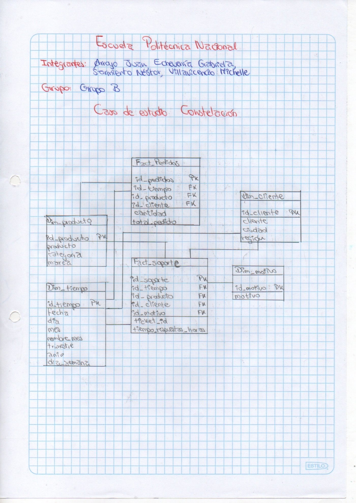
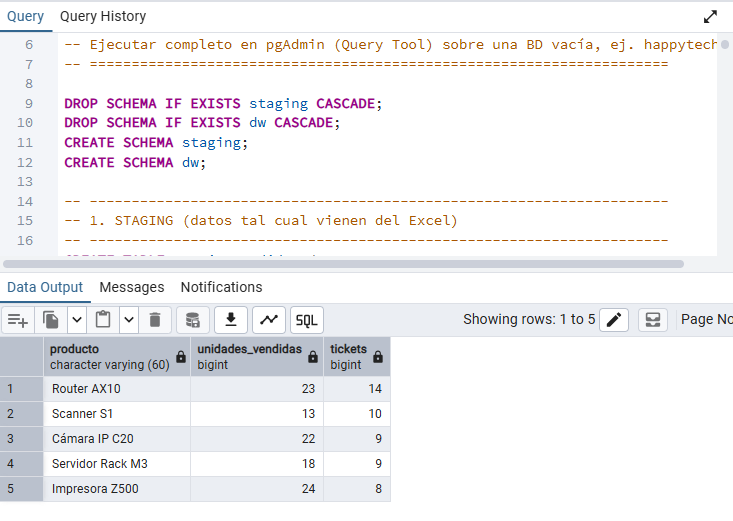
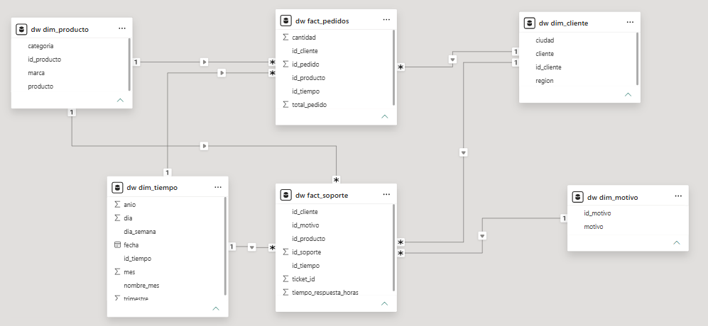
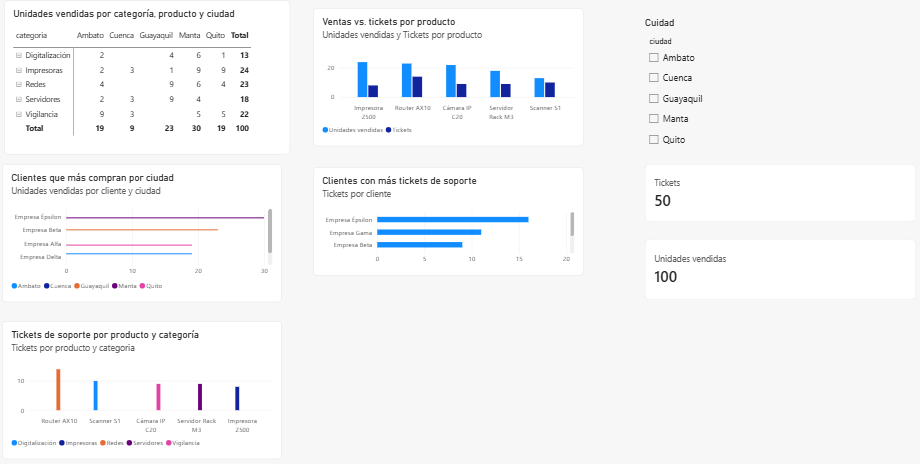

<p align="center">

  

</p>

<h1 align="center">Escuela Politécnica Nacional</h1>

<h2 align="center">Business Intelligence</h2>

<h3 align="center">Caso de estudio: Esquema Constelación (HAPPYTECH)</h3>


**Curso:** GR2SW

**Grupo:** Grupo B

**Integrantes:**

- Arroyo Juan

- Echeverría Gabriela

- Sarmiento Néstor

- Villavicencio Michelle

**Fecha:** 17/11/2026

---

## Índice de contenidos

- [1. Objetivos](#1-objetivos)
  - [1.1. Objetivo general](#11-objetivo-general)
  - [1.2. Objetivos específicos](#12-objetivos-específicos)
- [2. Descripción del problema](#2-descripción-del-problema)
- [3. Fuente de datos utilizada](#3-fuente-de-datos-utilizada)
- [4. Diseño del modelo constelación](#4-diseño-del-modelo-constelación)
  - [4.1. Procesos de negocio y granularidad](#41-procesos-de-negocio-y-granularidad)
  - [4.2. Dimensiones compartidas](#42-dimensiones-compartidas)
  - [4.3. Modelo a mano](#43-modelo-a-mano)
- [5. Problemas identificados en los datos](#5-problemas-identificados-en-los-datos)
- [6. Implementación en PostgreSQL](#6-implementación-en-postgresql)
  - [6.1. Vista general del flujo](#61-vista-general-del-flujo)
  - [6.2. Estructura de las tablas](#62-estructura-de-las-tablas)
  - [6.3. Ejecución del script y carga de datos](#63-ejecución-del-script-y-carga-de-datos)
- [7. Modelo en Power BI](#7-modelo-en-power-bi)
  - [7.1. Conexión a PostgreSQL](#71-conexión-a-postgresql)
  - [7.2. Modelo de datos obtenido](#72-modelo-de-datos-obtenido)
  - [7.3. Medidas creadas](#73-medidas-creadas)
- [8. Dashboard en Power BI](#8-dashboard-en-power-bi)
  - [8.1. Diseño del dashboard](#81-diseño-del-dashboard)
  - [8.2. Enlace al dashboard](#82-enlace-al-dashboard)
- [9. Resultados del análisis](#9-resultados-del-análisis)
  - [9.1. Productos y categorías más vendidos por ciudad](#91-productos-y-categorías-más-vendidos-por-ciudad)
  - [9.2. Clientes que más compran por ciudad](#92-clientes-que-más-compran-por-ciudad)
  - [9.3. Productos y categorías con más tickets de soporte](#93-productos-y-categorías-con-más-tickets-de-soporte)
  - [9.4. Clientes con más tickets de soporte](#94-clientes-con-más-tickets-de-soporte)
  - [9.5. Análisis cruzado de ventas y soporte](#95-análisis-cruzado-de-ventas-y-soporte)
- [10. Conclusiones](#10-conclusiones)
- [11. Referencias bibliográficas](#11-referencias-bibliográficas)
- [12. Declaración de uso de Inteligencia Artificial](#12-declaración-de-uso-de-inteligencia-artificial)

---

## Índice de figuras

- [Figura 1. Modelo constelación diseñado a mano](#figura-1)
- [Figura 2. Ejecución del script en pgAdmin 4](#figura-2)
- [Figura 3. Modelo constelación obtenido en Power BI](#figura-3)
- [Figura 4. Dashboard de pedidos y soporte técnico en Power BI](#figura-4)

---

## Índice de tablas

- [Tabla 1. Hojas del archivo Caso_Constelacion_Pedidos_Soporte.xlsx](#tabla-1)
- [Tabla 2. Columnas de las hojas de pedidos y soporte](#tabla-2)
- [Tabla 3. Procesos de negocio, granularidad y medidas](#tabla-3)
- [Tabla 4. Matriz de dimensiones compartidas](#tabla-4)
- [Tabla 5. Problemas identificados en los datos](#tabla-5)
- [Tabla 6. Estructura de las tablas del esquema dw](#tabla-6)
- [Tabla 7. Registros cargados en el esquema dw](#tabla-7)
- [Tabla 8. Configuración de la conexión de Power BI](#tabla-8)
- [Tabla 9. Relaciones del modelo en Power BI](#tabla-9)
- [Tabla 10. Objetos visuales del dashboard](#tabla-10)
- [Tabla 11. Producto más vendido en cada ciudad](#tabla-11)
- [Tabla 12. Unidades vendidas por cliente y ciudad](#tabla-12)
- [Tabla 13. Tickets de soporte por producto y categoría](#tabla-13)
- [Tabla 14. Tickets de soporte por cliente](#tabla-14)
- [Tabla 15. Unidades vendidas frente a tickets por producto](#tabla-15)

---

## 1. Objetivos

### 1.1. Objetivo general

<p align="justify">
Diseñar e implementar un modelo de datos con esquema constelación que integre los pedidos y los tickets de soporte técnico de HAPPYTECH, y analizarlo mediante un dashboard en Power BI.
</p>

### 1.2. Objetivos específicos

- Identificar los procesos de negocio, su granularidad y las dimensiones que comparten.
- Diseñar a mano el modelo constelación con dos tablas de hechos y dimensiones comunes.
- Implementar el modelo en PostgreSQL y cargar los datos desde el archivo Excel.
- Obtener el modelo en Power BI y comprobar sus relaciones.
- Construir un dashboard que responda las cuatro preguntas de negocio y permita el análisis cruzado.

---

## 2. Descripción del problema

<p align="justify">
HAPPYTECH es una empresa tecnológica que vende productos de red, impresión y vigilancia a clientes empresariales. Además de los pedidos, registra las solicitudes de soporte técnico sobre los productos vendidos. Los dos procesos usan los mismos productos, clientes y fechas, por lo que se pueden modelar como dos tablas de hechos que comparten dimensiones. La empresa quiere conocer:
</p>

1. Los productos y categorías más vendidos en las diferentes ciudades.
2. Los clientes que compran más productos en las diferentes ciudades.
3. Los productos y categorías con más tickets de soporte técnico.
4. Los clientes con más tickets de soporte técnico.

---

## 3. Fuente de datos utilizada

<p align="justify">
La única fuente es el archivo <a href="source_data/Caso_Constelacion_Pedidos_Soporte.xlsx">Caso_Constelacion_Pedidos_Soporte.xlsx</a>. Tiene dos hojas desnormalizadas, una por proceso, con registros de enero de 2025 (Tabla 1).
</p>

<a id="tabla-1"></a>

**Tabla 1. Hojas del archivo Caso_Constelacion_Pedidos_Soporte.xlsx.**

| Hoja | Filas | Columnas | Periodo | Proceso |
| --- | --- | --- | --- | --- |
| hechos_pedidos | 50 | 9 | 01/01/2025 – 30/01/2025 | Pedidos de clientes |
| hechos_soporte | 50 | 10 | 01/01/2025 – 29/01/2025 | Tickets de soporte técnico |

*Descripción: hojas del libro, número de registros y proceso que representa cada una.*

<p align="justify">
Las dos hojas repiten los datos de producto y cliente en cada fila. Sus columnas se detallan en la Tabla 2.
</p>

<a id="tabla-2"></a>

**Tabla 2. Columnas de las hojas de pedidos y soporte.**

| Columna | hechos_pedidos | hechos_soporte | Ejemplo |
| --- | --- | --- | --- |
| fecha | Sí | Sí | 2025-01-01 |
| producto | Sí | Sí | Router AX10 |
| categoria | Sí | Sí | Redes |
| marca | Sí | Sí | NetGo |
| cliente | Sí | Sí | Empresa Beta |
| ciudad | Sí | Sí | Guayaquil |
| region | Sí | Sí | Costa |
| cantidad | Sí | No | 2 |
| total_pedido | Sí | No | 5930 |
| ticket_id | No | Sí | 4535 |
| motivo | No | Sí | Configuración |
| tiempo_respuesta_horas | No | Sí | 26 |

*Descripción: columnas comunes a ambos procesos y columnas propias de cada uno.*

<p align="justify">
Ambas hojas contienen los mismos 5 productos (uno por categoría y marca), los mismos 5 clientes (uno por ciudad) y 2 regiones (Costa y Sierra).
</p>

---

## 4. Diseño del modelo constelación

### 4.1. Procesos de negocio y granularidad

<p align="justify">
Se identificaron dos procesos de negocio. Cada uno se convirtió en una tabla de hechos con su propia granularidad y sus propias medidas (Tabla 3).
</p>

<a id="tabla-3"></a>

**Tabla 3. Procesos de negocio, granularidad y medidas.**

| Proceso | Tabla de hechos | Granularidad (una fila es…) | Medidas |
| --- | --- | --- | --- |
| Pedidos | fact_pedidos | Un pedido de un producto por un cliente en una fecha | cantidad, total_pedido |
| Soporte técnico | fact_soporte | Un ticket de soporte sobre un producto de un cliente en una fecha | tiempo_respuesta_horas y el conteo de tickets |

*Descripción: granularidad y medidas de cada tabla de hechos.*

### 4.2. Dimensiones compartidas

<p align="justify">
En un esquema constelación varias tablas de hechos usan las mismas dimensiones. Esto permite comparar los procesos con los mismos filtros, por ejemplo ventas y tickets de una misma ciudad. La Tabla 4 muestra qué dimensiones usa cada tabla de hechos.
</p>

<a id="tabla-4"></a>

**Tabla 4. Matriz de dimensiones compartidas.**

| Dimensión | Atributos | fact_pedidos | fact_soporte | Tipo |
| --- | --- | --- | --- | --- |
| dim_tiempo | fecha, día, mes, nombre del mes, trimestre, año, día de la semana | ✔ | ✔ | Compartida |
| dim_producto | producto, categoría, marca | ✔ | ✔ | Compartida |
| dim_cliente | cliente, ciudad, región | ✔ | ✔ | Compartida |
| dim_motivo | motivo | — | ✔ | Exclusiva de soporte |

*Descripción: tres dimensiones son comunes a los dos procesos y una pertenece solo al soporte.*

<p align="justify">
La categoría y la marca se mantienen dentro de dim_producto, y la ciudad y la región dentro de dim_cliente. Separarlas en tablas propias normalizaría las dimensiones y llevaría a un copo de nieve, lo que no aporta al análisis porque cada producto y cada cliente tiene un único valor de esos atributos.
</p>

### 4.3. Modelo a mano

<p align="justify">
El modelo se diseñó a mano antes de implementarlo (Figura 1). Las dos tablas de hechos están al centro y se conectan con las tres dimensiones compartidas; dim_motivo se conecta solo con fact_soporte. Cada tabla indica su clave primaria (PK) y las claves foráneas (FK).
</p>

<a id="figura-1"></a>

**Figura 1. Modelo constelación diseñado a mano.**

<p align="center">

  

</p>

*Descripción: fact_pedidos y fact_soporte comparten dim_tiempo, dim_producto y dim_cliente; dim_motivo pertenece solo a soporte.*

---

## 5. Problemas identificados en los datos

<p align="justify">
Las hojas no tenían valores nulos ni filas repetidas. Los problemas encontrados son de estructura y de identificación (Tabla 5).
</p>

<a id="tabla-5"></a>

**Tabla 5. Problemas identificados en los datos.**

| Problema | Ejemplo | Tratamiento |
| --- | --- | --- |
| Producto, cliente y fecha repetidos en cada fila | Router AX10 aparece en muchas filas | Separación en dimensiones con un registro por producto y por cliente |
| Los mismos productos y clientes aparecen en las dos hojas | Empresa Épsilon compra y abre tickets | Dimensiones cargadas con la UNION de ambas hojas, para que sean comunes |
| Fechas distintas en cada proceso | Pedidos hasta el 30/01; tickets hasta el 29/01 | dim_tiempo cargada con las fechas de ambas hojas (30 fechas) |
| ticket_id no es único | El ticket 7221 aparece dos veces | Clave sustituta id_soporte; ticket_id se guarda como dimensión degenerada |
| Hojas sin claves numéricas | Producto y cliente se identifican por nombre | Claves sustitutas SERIAL en las dimensiones |
| Textos con tildes | Empresa Épsilon, Cámara IP C20 | Base de datos en UTF-8 |

*Descripción: problemas de la fuente y cómo se resolvieron en el modelo.*

---

## 6. Implementación en PostgreSQL

### 6.1. Vista general del flujo

<p align="justify">
Todo el proceso está en un solo script, <a href="scripts/happytech_constelacion.sql">happytech_constelacion.sql</a>, ejecutado en pgAdmin 4 sobre la base de datos vacía happytech_dw. El script sigue estos pasos:
</p>

1. **Esquemas:** crea el esquema staging, para los datos tal como vienen del Excel, y el esquema dw, para el modelo constelación.
2. **Staging:** crea staging.pedidos y staging.soporte y carga en ellas las 50 filas de cada hoja mediante sentencias INSERT.
3. **Dimensiones:** crea y carga dim_tiempo, dim_producto, dim_cliente y dim_motivo con SELECT DISTINCT. Las tres dimensiones compartidas se llenan con la UNION de ambas tablas de staging.
4. **Hechos:** crea fact_pedidos y fact_soporte y las carga uniendo staging con las dimensiones para reemplazar los nombres por las claves sustitutas.
5. **Verificación y consultas:** cuenta los registros cargados y ejecuta las consultas de las cuatro preguntas y del análisis cruzado.

### 6.2. Estructura de las tablas

<p align="justify">
La Tabla 6 resume las claves y restricciones del esquema dw. La clave de dim_tiempo usa el formato AAAAMMDD; las demás dimensiones usan claves sustitutas.
</p>

<a id="tabla-6"></a>

**Tabla 6. Estructura de las tablas del esquema dw.**

| Tabla | Clave primaria | Claves foráneas | Otras columnas |
| --- | --- | --- | --- |
| dim_tiempo | id_tiempo (INT, AAAAMMDD) | — | fecha (UNIQUE), dia, mes, nombre_mes, trimestre, anio, dia_semana |
| dim_producto | id_producto (SERIAL) | — | producto (UNIQUE), categoria, marca |
| dim_cliente | id_cliente (SERIAL) | — | cliente (UNIQUE), ciudad, region |
| dim_motivo | id_motivo (SERIAL) | — | motivo (UNIQUE) |
| fact_pedidos | id_pedido (SERIAL) | id_tiempo, id_producto, id_cliente | cantidad, total_pedido |
| fact_soporte | id_soporte (SERIAL) | id_tiempo, id_producto, id_cliente, id_motivo | ticket_id, tiempo_respuesta_horas |

*Descripción: claves primarias, claves foráneas y atributos de cada tabla del modelo.*

### 6.3. Ejecución del script y carga de datos

<p align="justify">
El script se ejecutó completo sin errores. En la Figura 2 se ve el inicio del script en el Query Tool y, en Data Output, el resultado de la última consulta, que compara las unidades vendidas con los tickets de cada producto. Esa consulta solo es posible porque las dos tablas de hechos comparten dim_producto.
</p>

<a id="figura-2"></a>

**Figura 2. Ejecución del script en pgAdmin 4.**

<p align="center">

  

</p>

*Descripción: creación de los esquemas staging y dw, y resultado del análisis cruzado de ventas y tickets por producto.*

<p align="justify">
La consulta de verificación confirmó 50 registros en cada tabla de hechos, igual que en el Excel (Tabla 7).
</p>

<a id="tabla-7"></a>

**Tabla 7. Registros cargados en el esquema dw.**

| Tabla | Registros |
| --- | --- |
| dim_tiempo | 30 |
| dim_producto | 5 |
| dim_cliente | 5 |
| dim_motivo | 4 |
| fact_pedidos | 50 |
| fact_soporte | 50 |

*Descripción: número de filas de cada tabla después de la carga.*

---

## 7. Modelo en Power BI

### 7.1. Conexión a PostgreSQL

<p align="justify">
El modelo se importó en Power BI Desktop con el conector de PostgreSQL. Se cargaron solo las seis tablas del esquema dw; las tablas de staging no se incluyeron porque son un paso intermedio de la carga. La configuración se muestra en la Tabla 8.
</p>

<a id="tabla-8"></a>

**Tabla 8. Configuración de la conexión de Power BI.**

| Parámetro | Valor |
| --- | --- |
| Conector | Base de datos PostgreSQL |
| Servidor | localhost:5433 |
| Base de datos | happytech_dw |
| Modo de conectividad | Importar |
| Autenticación | Base de datos (usuario postgres) |
| Tablas cargadas | dw.dim_tiempo, dw.dim_producto, dw.dim_cliente, dw.dim_motivo, dw.fact_pedidos, dw.fact_soporte |

*Descripción: parámetros usados para importar el modelo desde PostgreSQL.*

<p align="justify">
El servidor se indicó con el puerto 5433 porque es el puerto en el que se ejecuta PostgreSQL en el equipo usado; con el puerto predeterminado (5432) la autenticación fallaba.
</p>

### 7.2. Modelo de datos obtenido

<p align="justify">
Power BI creó las relaciones automáticamente a partir de las claves foráneas definidas en PostgreSQL. Se obtuvieron siete relaciones de uno a varios (Tabla 9).
</p>

<a id="tabla-9"></a>

**Tabla 9. Relaciones del modelo en Power BI.**

| Dimensión (1) | Tabla de hechos (*) | Columna |
| --- | --- | --- |
| dim_tiempo | fact_pedidos | id_tiempo |
| dim_tiempo | fact_soporte | id_tiempo |
| dim_producto | fact_pedidos | id_producto |
| dim_producto | fact_soporte | id_producto |
| dim_cliente | fact_pedidos | id_cliente |
| dim_cliente | fact_soporte | id_cliente |
| dim_motivo | fact_soporte | id_motivo |

*Descripción: relaciones uno a varios entre dimensiones y tablas de hechos.*

<p align="justify">
En la Figura 3 se ve el modelo: dim_tiempo, dim_producto y dim_cliente se relacionan con las dos tablas de hechos, mientras que dim_motivo solo se relaciona con fact_soporte. El resultado coincide con el modelo a mano de la Figura 1.
</p>

<a id="figura-3"></a>

**Figura 3. Modelo constelación obtenido en Power BI.**

<p align="center">

  

</p>

*Descripción: dos tablas de hechos con tres dimensiones compartidas y una dimensión exclusiva.*

### 7.3. Medidas creadas

<p align="justify">
Para el dashboard se crearon dos medidas en DAX. Además, en dim_tiempo se configuró la columna anio con "Resumir por: Ninguno", para que Power BI no sume los años.
</p>

```DAX
Unidades vendidas = SUM(fact_pedidos[cantidad])

Tickets = COUNTROWS(fact_soporte)
```

<p align="justify">
Tickets cuenta las filas de fact_soporte y no los valores de ticket_id, porque ese identificador se repite en un caso (Tabla 5).
</p>

---

## 8. Dashboard en Power BI

### 8.1. Diseño del dashboard

<p align="justify">
El dashboard tiene un objeto visual por cada pregunta de negocio, un gráfico de análisis cruzado, dos tarjetas con los totales y una segmentación por ciudad (Tabla 10).
</p>

<a id="tabla-10"></a>

**Tabla 10. Objetos visuales del dashboard.**

| Pregunta | Objeto visual | Campos |
| --- | --- | --- |
| 1. Productos y categorías más vendidos por ciudad | Matriz | Filas: categoria y producto · Columnas: ciudad · Valores: Unidades vendidas |
| 2. Clientes que más compran por ciudad | Gráfico de barras agrupadas | Eje Y: cliente · Eje X: Unidades vendidas · Leyenda: ciudad |
| 3. Productos y categorías con más tickets | Gráfico de columnas agrupadas | Eje X: producto · Eje Y: Tickets · Leyenda: categoria |
| 4. Clientes con más tickets | Gráfico de barras agrupadas | Eje Y: cliente · Eje X: Tickets |
| Análisis cruzado | Gráfico de columnas agrupadas | Eje X: producto · Eje Y: Unidades vendidas y Tickets |
| Totales | Dos tarjetas | Unidades vendidas (100) y Tickets (50) |
| Filtro | Segmentación | ciudad |

*Descripción: relación entre cada pregunta de negocio y el objeto visual que la responde.*

<p align="justify">
Como la segmentación usa dim_cliente, que es una dimensión compartida, al elegir una ciudad se filtran a la vez los pedidos y los tickets. El dashboard completo se muestra en la Figura 4.
</p>

<a id="figura-4"></a>

**Figura 4. Dashboard de pedidos y soporte técnico en Power BI.**

<p align="center">

  

</p>

*Descripción: visuales de ventas, tickets y análisis cruzado, con totales y segmentación por ciudad.*

### 8.2. Enlace al dashboard

<p align="justify">
El informe se publicó en el servicio de Power BI desde Power BI Desktop. Se puede consultar en el siguiente enlace:
</p>

**Enlace:** [Dashboard en Power BI](https://app.powerbi.com/view?r=eyJrIjoiMzZjYjQzOTMtZTgyOC00Mzk1LWI1YzEtMTUzNTVkMzA1ZmQ3IiwidCI6IjY4MmE0ZTZhLWE3N2YtNDk1OC1hM2FjLTllMjY2ZDE4YWEzNyIsImMiOjR9)

---

## 9. Resultados del análisis

### 9.1. Productos y categorías más vendidos por ciudad

<p align="justify">
Por categoría, Impresoras es la más vendida (24 unidades), seguida de Redes (23), Vigilancia (22), Servidores (18) y Digitalización (13). Manta es la ciudad con más unidades (30) y Cuenca la que menos (9). El producto más vendido en cada ciudad se muestra en la Tabla 11.
</p>

<a id="tabla-11"></a>

**Tabla 11. Producto más vendido en cada ciudad.**

| Ciudad | Producto más vendido | Categoría | Unidades |
| --- | --- | --- | --- |
| Ambato | Cámara IP C20 | Vigilancia | 9 |
| Cuenca | Cámara IP C20, Servidor Rack M3 e Impresora Z500 (empate) | Vigilancia, Servidores, Impresoras | 3 |
| Guayaquil | Router AX10 y Servidor Rack M3 (empate) | Redes, Servidores | 9 |
| Manta | Impresora Z500 | Impresoras | 9 |
| Quito | Impresora Z500 | Impresoras | 9 |

*Descripción: producto con más unidades vendidas en cada ciudad.*

### 9.2. Clientes que más compran por ciudad

<p align="justify">
Cada cliente está en una sola ciudad. Empresa Épsilon, de Manta, es el cliente que más unidades compra (30), pero Empresa Beta, de Guayaquil, genera el mayor monto de ventas ($42 778) (Tabla 12).
</p>

<a id="tabla-12"></a>

**Tabla 12. Unidades vendidas por cliente y ciudad.**

| Cliente | Ciudad | Unidades | Total vendido ($) |
| --- | --- | --- | --- |
| Empresa Épsilon | Manta | 30 | 40 962 |
| Empresa Beta | Guayaquil | 23 | 42 778 |
| Empresa Delta | Ambato | 19 | 28 935 |
| Empresa Alfa | Quito | 19 | 30 724 |
| Empresa Gama | Cuenca | 9 | 14 959 |

*Descripción: clientes ordenados por unidades compradas.*

### 9.3. Productos y categorías con más tickets de soporte

<p align="justify">
Router AX10, de la categoría Redes, es el producto con más tickets (14). Impresora Z500 es el que menos tiene (8), aunque es el más vendido (Tabla 13). El motivo más frecuente es Falla de hardware, con 16 tickets.
</p>

<a id="tabla-13"></a>

**Tabla 13. Tickets de soporte por producto y categoría.**

| Producto | Categoría | Tickets | Tiempo de respuesta promedio (h) |
| --- | --- | --- | --- |
| Router AX10 | Redes | 14 | 27,2 |
| Scanner S1 | Digitalización | 10 | 27,1 |
| Servidor Rack M3 | Servidores | 9 | 22,0 |
| Cámara IP C20 | Vigilancia | 9 | 21,7 |
| Impresora Z500 | Impresoras | 8 | 26,8 |

*Descripción: productos ordenados por número de tickets, con su tiempo promedio de respuesta.*

### 9.4. Clientes con más tickets de soporte

<p align="justify">
Empresa Épsilon es el cliente con más tickets (16) y Empresa Alfa el que menos (5) (Tabla 14).
</p>

<a id="tabla-14"></a>

**Tabla 14. Tickets de soporte por cliente.**

| Cliente | Ciudad | Tickets |
| --- | --- | --- |
| Empresa Épsilon | Manta | 16 |
| Empresa Gama | Cuenca | 11 |
| Empresa Delta | Ambato | 9 |
| Empresa Beta | Guayaquil | 9 |
| Empresa Alfa | Quito | 5 |

*Descripción: clientes ordenados por número de tickets.*

### 9.5. Análisis cruzado de ventas y soporte

<p align="justify">
Gracias a las dimensiones compartidas se pueden comparar los dos procesos (Tabla 15). Scanner S1 tiene 10 tickets para solo 13 unidades vendidas, la proporción más alta, mientras que Impresora Z500 es el producto más vendido y el que menos soporte requiere. Por cliente, Empresa Gama compra poco (9 unidades) pero abre 11 tickets, más que cualquier otro cliente excepto Empresa Épsilon.
</p>

<a id="tabla-15"></a>

**Tabla 15. Unidades vendidas frente a tickets por producto.**

| Producto | Unidades vendidas | Tickets | Tickets por unidad |
| --- | --- | --- | --- |
| Router AX10 | 23 | 14 | 0,61 |
| Scanner S1 | 13 | 10 | 0,77 |
| Cámara IP C20 | 22 | 9 | 0,41 |
| Servidor Rack M3 | 18 | 9 | 0,50 |
| Impresora Z500 | 24 | 8 | 0,33 |

*Descripción: comparación entre pedidos y tickets por producto.*

---

## 10. Conclusiones

1. El esquema constelación permitió representar dos procesos de negocio, pedidos y soporte técnico, en un solo modelo con dos tablas de hechos.
2. Compartir dim_tiempo, dim_producto y dim_cliente evitó duplicar dimensiones y permitió el análisis cruzado, por ejemplo comparar ventas y tickets por producto o por ciudad.
3. Cargar las dimensiones compartidas con la UNION de ambas fuentes garantizó que incluyeran todos los productos, clientes y fechas de los dos procesos.
4. La clave sustituta id_soporte resolvió la repetición de ticket_id sin perder ese dato, que se conserva como dimensión degenerada.
5. Power BI reconoció las relaciones del modelo a partir de las claves foráneas de PostgreSQL, y el dashboard responde las cuatro preguntas: Impresoras es la categoría más vendida, Empresa Épsilon es el cliente con más compras y más tickets, y Router AX10 es el producto con más tickets.

---

## 11. Referencias bibliográficas

[1] R. Kimball y M. Ross, *The Data Warehouse Toolkit: The Definitive Guide to Dimensional Modeling*, 3.ª ed. Indianapolis, IN, EE. UU.: John Wiley & Sons, 2013.

[2] R. Kimball y J. Caserta, *The Data Warehouse ETL Toolkit: Practical Techniques for Extracting, Cleaning, Conforming, and Delivering Data*. Indianapolis, IN, EE. UU.: John Wiley & Sons, 2004.

[3] The PostgreSQL Global Development Group, "CREATE TABLE," *PostgreSQL Documentation*. [En línea]. Disponible en: https://www.postgresql.org/docs/current/sql-createtable.html

[4] The PostgreSQL Global Development Group, "Combining Queries (UNION, INTERSECT, EXCEPT)," *PostgreSQL Documentation*. [En línea]. Disponible en: https://www.postgresql.org/docs/current/queries-union.html

[5] Microsoft, "PostgreSQL connector," *Microsoft Learn*. [En línea]. Disponible en: https://learn.microsoft.com/power-query/connectors/postgresql

[6] Microsoft, "Model relationships in Power BI Desktop," *Microsoft Learn*. [En línea]. Disponible en: https://learn.microsoft.com/power-bi/transform-model/desktop-relationships-understand

---

## 12. Declaración de uso de Inteligencia Artificial

Se declara un uso estimado del 40% de inteligencia artificial generativa como apoyo en la guía de configuración de Power BI y en la redacción y organización del informe.
