<p align="center">

  

</p>

<h1 align="center">Escuela Politécnica Nacional</h1>

<h2 align="center">Business Intelligence</h2>

**Curso:** GR2SW

**Integrantes:**

- Arroyo Juan

- Echeverría Gabriela

- Sarmiento Néstor

- Villavicencio Michelle

**Fecha:** 27/11/2026

---

## Índice

1. [Descripción del negocio y problema](#1-descripción-del-negocio-y-problema)
2. [Objetivos](#2-objetivos)
3. [Fuentes de datos y problemas encontrados](#3-fuentes-de-datos-y-problemas-encontrados)
4. [Preguntas de negocio](#4-preguntas-de-negocio)
5. [Arquitectura y modelo dimensional](#5-arquitectura-y-modelo-dimensional)
6. [Transformaciones y flujo ETL](#6-transformaciones-y-flujo-etl)
7. [Validación y calidad de datos](#7-validación-y-calidad-de-datos)
8. [Consultas SQL y resultados](#8-consultas-sql-y-resultados)
9. [Implementación y dashboards en Power BI](#9-implementación-y-dashboards-en-power-bi)
10. [Análisis OLAP](#10-análisis-olap)
11. [Insights y recomendaciones](#11-insights-y-recomendaciones)
12. [Limitaciones y trabajo futuro](#12-limitaciones-y-trabajo-futuro)
13. [Conclusiones](#13-conclusiones)
14. [Bibliografía](#14-bibliografía)

## 1. Descripción del negocio y problema

Intertel ofrece servicios de localización y rastreo vehicular mediante GPS y comercializa planes de acceso a su plataforma. Durante la reunión inicial, el cliente indicó que atiende principalmente a cooperativas, que gestiona aproximadamente 700 vehículos y que su actividad se concentra en Cayambe y, en segundo lugar, Quito. Estas afirmaciones corresponden al contexto proporcionado por la empresa, no a indicadores geográficos verificados mediante el Data Warehouse.

La información comercial y operativa se encuentra dispersa en archivos exportados o preparados manualmente. La facturación contiene el valor total de cada documento, pero no sus líneas de detalle. Tampoco existe un identificador común confiable entre facturas, clientes, dispositivos, planes y ciudades. Por lo tanto, obtener tendencias comerciales o identificar grupos con información GPS incompleta requiere consolidación, depuración y análisis.

**Problema:** ausencia de una estructura integrada y reproducible que permita consultar indicadores comerciales y operativos, identificar deficiencias en los datos y apoyar decisiones de gestión.

**Alcance:** análisis descriptivo de las facturas de la hoja principal de 2025–2026 y de la instantánea GPS del 19/11/2026. El proyecto se implementa localmente y no constituye un sistema de monitoreo GPS en tiempo real.

## 2. Objetivos

### 2.1. Objetivo general

Desarrollar una solución de Business Intelligence para Intertel que integre, depure y analice datos comerciales y operativos mediante Pentaho, PostgreSQL y Power BI, con el fin de responder preguntas de negocio y apoyar la toma de decisiones.

### 2.2. Objetivos específicos

- Identificar las fuentes disponibles, sus limitaciones y las preguntas de negocio que pueden responderse.
- Diseñar e implementar un modelo dimensional con granularidad explícita, dimensiones conformadas y restricciones de integridad.
- Automatizar la extracción, transformación y carga mediante transformaciones y un Job de Pentaho, con auditoría de ejecuciones e incidencias.
- Validar la consistencia, los conteos y la conciliación de importes entre el origen limpio y el destino.
- Elaborar consultas SQL y visualizaciones interactivas que permitan análisis comercial, operativo y multidimensional.
- Formular recomendaciones sustentadas en los resultados y distinguir las conclusiones verificadas de las hipótesis que requieren información adicional.

## 3. Fuentes de datos y problemas encontrados

### 3.1. Fuentes de datos utilizadas

| Fuente | Contenido | Filas cargadas en staging | Uso |
|---|---|---:|---|
| `CLIENTES INTERTEL.xlsx` | Código, nombre, RUC | 93 | Catálogo de referencia para identificar coincidencias por nombre |
| `FACTURACION INTERTEL.xlsx` | Número de factura, nombre, total, fecha | 1.651 | Análisis de facturación; se procesa la hoja principal |
| `offline_device_report_2026_11_19.xls` | Dispositivo, grupo, SIM, hora, posición, velocidad, altitud, ángulo, duración, distancia, odómetro y horas del motor | 666 | Instantánea operativa y calidad de datos GPS |
| `PLANES DE PLATAFORMA DE RASTREO VEHICULAR GPS.docx` | Planes Básico, Plus y Premium, tarifas y prestaciones | No aplica | Contexto comercial; sin relación individual con facturas o suscripciones |

La hoja de cálculo de facturación contiene otras hojas; el alcance del ETL se restringió a la hoja principal seleccionada. Los conteos de staging no son necesariamente los conteos físicos de todas las filas de Excel, debido a encabezados, filas vacías y hojas excluidas. No se incorporaron las otras hojas sin validar su propósito y posibles solapamientos.

| Plan | Mensual (USD) | Anual (USD) | Instalación (USD) |
|---|---:|---:|---:|
| Básico | 9,90 | 118,80 | 39,00 |
| Plus | 12,90 | 154,80 | 39,00 |
| Premium | 14,50 | 174,00 | 39,00 |

Las tarifas son las del documento suministrado, no precios inferidos de la facturación. No es válido deducir el plan de una factura por similitud de importe: puede incluir instalaciones, otros cargos o acuerdos particulares.

<details><summary>Ver evidencias de las fuentes de datos</summary>

> **Captura pendiente:** Fuente de clientes (anonimizada).
>
> Archivo: `Intertel_BI/docs/capturas/01_fuentes/fuente_clientes.png`

<!-- Cuando se suba la captura, sustituir el bloque anterior por la línea siguiente, sin los delimitadores de comentario:

-->

*Fuente de clientes (anonimizada).*

> **Captura pendiente:** Fuente de facturación (anonimizada).
>
> Archivo: `Intertel_BI/docs/capturas/01_fuentes/fuente_facturacion.png`

<!-- Cuando se suba la captura, sustituir el bloque anterior por la línea siguiente, sin los delimitadores de comentario:

-->

*Fuente de facturación (anonimizada).*

> **Captura pendiente:** Fuente de dispositivos GPS (anonimizada).
>
> Archivo: `Intertel_BI/docs/capturas/01_fuentes/fuente_dispositivos_gps.png`

<!-- Cuando se suba la captura, sustituir el bloque anterior por la línea siguiente, sin los delimitadores de comentario:

-->

*Fuente de dispositivos GPS (anonimizada).*

> **Captura pendiente:** Catálogo de planes de Intertel.
>
> Archivo: `Intertel_BI/docs/capturas/01_fuentes/catalogo_planes.png`

<!-- Cuando se suba la captura, sustituir el bloque anterior por la línea siguiente, sin los delimitadores de comentario:

-->

*Catálogo de planes de Intertel.*

</details>

### 3.2. Problemas encontrados y tratamiento

| Problema | Tratamiento | Consecuencia analítica |
|---|---|---|
| Nombres con diferencias de escritura | Normalización de mayúsculas, acentos y espacios | Coincidencia textual, no identidad legal verificada |
| Facturas sin correspondencia en catálogo | Conservar factura válida y clasificar `SIN_COINCIDENCIA` | Evitar pérdida de importes válidos |
| Coincidencia múltiple | Clasificar `COINCIDENCIA_MULTIPLE`; no asignar código arbitrario | No confundir homónimos con identidad cierta |
| Número o importe inválido | Validación y rechazo, conservando regla y fila de origen | Cinco filas rechazadas en la carga observada |
| Formatos de fecha y número | Funciones de conversión explícitas; no interpretar formatos ambiguos | Fechas e importes consistentes |
| GPS sin hora o mensaje de ausencia de resultados | Clasificar `SIN_DATOS` | Ausencia de información, no diagnóstico de falla |
| Fecha GPS futura o no interpretable | Clasificar `FECHA_INVALIDA` y no calcular antigüedad | No inventar fecha válida |
| Grupo faltante | Miembro `SIN GRUPO` | Conservar registro para análisis de calidad |
| SIM ausente | Indicador `tiene_sim = false` y clave provisional por reporte/fila | No afirmar identidad persistente del equipo |
| Coordenadas ausentes o inválidas | Validar rangos de latitud/longitud y guardar indicador booleano | No exponer ubicación ni inferir ciudad |
| Datos sin detalle de planes, pagos o contratos | Excluir dimensiones y métricas que no pueden relacionarse | Evitar resultados especulativos |

## 4. Preguntas de negocio

Las preguntas se organizan en tres áreas. La numeración corresponde al script `05_intertel_consultas_negocio.sql` y se mantiene en las evidencias para asegurar trazabilidad.

| ID | Pregunta | Área | Evidencia de respuesta |
|---|---|---|---|
| PN01 | ¿Cuánto se ha facturado por año, trimestre y mes? | Comercial | Evolución temporal y matriz |
| PN02 | ¿Cómo evolucionó la facturación entre enero y octubre de 2025 y 2026? | Comercial | Inicio: crecimiento interanual |
| PN03 | ¿Cuáles son los diez clientes facturados con mayor importe? | Comercial | Ranking Top 10 |
| PN04 | ¿Qué porcentaje de facturación corresponde a los diez principales clientes? | Comercial | Tarjeta concentración Top 10 |
| PN05 | ¿Cuál es el importe promedio de una factura? | Comercial | Inicio y Comercial: ticket promedio |
| PN06 | ¿Cuántos nombres de clientes diferentes registran facturación cada mes? | Comercial | Clientes facturados + filtros |
| PN07 | ¿Qué meses tienen mayor y menor facturación? | Comercial | Gráfico mensual y matriz |
| PN08 | ¿Con qué frecuencia se emiten facturas por nombre de cliente? | Comercial | Consulta SQL y tooltip de ranking |
| PN09 | ¿Cuántos registros y claves de dispositivo aparecen en el reporte? | Operativo | Tarjetas GPS y grupos |
| PN10 | ¿Qué grupos concentran más registros de dispositivos? | Operativo | Barras por grupo |
| PN11 | ¿Qué proporción de registros tiene información GPS disponible? | Operativo | Anillo de disponibilidad |
| PN12 | ¿Qué grupos presentan más registros sin datos y qué proporción representan? | Operativo | Matriz y barras apiladas |
| PN13 | ¿Cuál es la antigüedad de la información GPS disponible? | Operativo | Gráfico de antigüedad |
| PN14 | ¿Qué grupos requieren revisión por registros con más de 30 días de antigüedad? | Operativo | Matriz y segmentadores |
| PN15 | ¿Cuántos registros cuentan con coordenadas válidas? | Operativo | Consulta SQL / GPS Con Posicion |
| PN16 | ¿Qué proporción de facturas no coincide por nombre con el catálogo? | Calidad | Anillo de calidad comercial |
| PN17 | ¿Cuántos registros GPS carecen de grupo o SIM? | Calidad | Tarjetas GPS y consulta SQL |

## 5. Arquitectura y modelo dimensional

### 5.1. Arquitectura del Data Warehouse

Se adoptó una arquitectura local de tres capas en PostgreSQL: `staging` conserva la estructura de los archivos, `dw` contiene los hechos y dimensiones, y `audit` registra ejecuciones e incidencias. Pentaho orquesta la extracción y la carga; las funciones y vistas SQL realizan parte de las transformaciones. Power BI consume el modelo dimensional y aporta una capa semántica con relaciones, medidas y filtros.

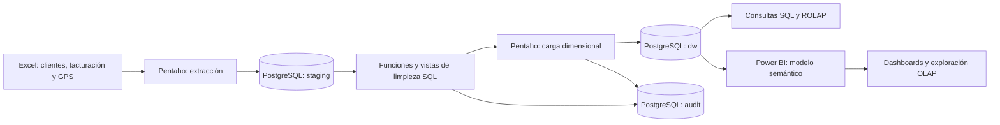

El catálogo de planes se emplea como contexto de negocio, no como una entrada del flujo de carga dimensional.

### 5.2. Justificación del esquema de constelación

La solución integra dos procesos de negocio con granos diferentes: facturación y estado de los registros GPS. Un modelo estrella único mezclaría facturas y registros operativos o forzaría relaciones sin respaldo en los archivos. Por ello se definieron dos tablas de hechos que comparten la dimensión fecha, conformando una constelación de hechos. Las dimensiones específicas se mantienen separadas para evitar multiplicación de filas y agregaciones incorrectas.

La dimensión `dim_fecha` cumple tres roles: fecha de factura, fecha de reporte y fecha del último registro GPS. Los dos últimos corresponden a relaciones distintas hacia la misma dimensión. No se crea una relación directa entre ambas tablas de hechos ni se asume que un grupo GPS corresponde a un cliente de facturación.

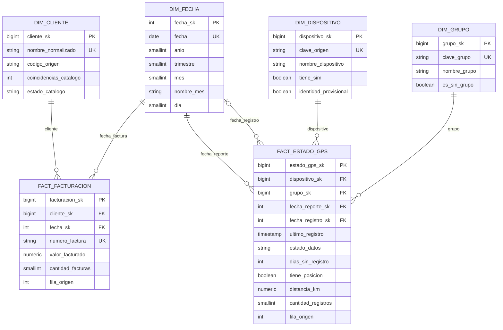

*Diagrama lógico elaborado a partir de las definiciones SQL. La evidencia siguiente corresponde al modelo físico implementado.*


*Modelo de constelación implementado en PostgreSQL.*

### 5.3. Granularidad y medidas

| Tabla de hechos | Granularidad | Medidas / atributos analíticos | Consideraciones |
|---|---|---|---|
| `dw.fact_facturacion` | Una fila por número de factura válido de la fuente principal | `valor_facturado`, `cantidad_facturas = 1` | Importe y cantidad aditivos; promedio y porcentajes se recalculan por contexto |
| `dw.fact_estado_gps` | Una fila por registro del reporte y fecha de extracción | `cantidad_registros = 1`, `dias_sin_registro`, `tiene_posicion`, `estado_datos`, `distancia_km` | Recuento aditivo dentro de una instantánea; no sumar antigüedad o distancia como si fueran flujos; no sumar instantáneas para contar vehículos únicos |

La facturación tiene granularidad de cabecera y no de detalle de productos, pues los archivos no contienen líneas de factura. La tabla GPS funciona como una instantánea periódica potencial; en la entrega solo existe una fecha de reporte analizada. La combinación `(fecha_reporte_sk, fila_origen)` impide duplicar la misma fila del reporte. `fecha_registro_sk` admite nulos cuando no existe fecha válida.

### 5.4. Dimensiones y jerarquías

| Dimensión | Clave primaria | Grano | Atributos principales | Filas |
|---|---|---|---|---:|
| `dim_fecha` | `fecha_sk` | Día calendario | Año, trimestre, mes, día, nombres de mes y día | 1.826 |
| `dim_cliente` | `cliente_sk` | Nombre normalizado | Código de origen cuando es inequívoco, coincidencias y estado de catálogo | 232 |
| `dim_dispositivo` | `dispositivo_sk` | Identidad provisional de dispositivo | Clave de origen, nombre, existencia de SIM | 666 |
| `dim_grupo` | `grupo_sk` | Grupo normalizado o miembro sin grupo | Nombre, clave y bandera sin grupo | 40 |

La jerarquía temporal es Año → Trimestre → Mes → Fecha. Se genera un calendario continuo entre 2022 y 2026 para cubrir las fechas de los reportes y facturas. Esto no implica que existan facturas en todos esos años. La clave fecha usa el formato AAAAMMDD; las demás dimensiones emplean claves sustitutas numéricas.

### 5.5. Implementación física en PostgreSQL

La base `intertel_bi` contiene once tablas: tres de staging, seis dimensionales y dos de auditoría. El DDL `01_intertel_modelo.sql` establece PK, FK, restricciones `UNIQUE`, `NOT NULL`, `CHECK` e índices de acceso para los hechos. El script `02_intertel_verificar.sql` consulta el catálogo de PostgreSQL para comprobar la estructura.

| Tabla de hechos | FK | Referencia | Nulabilidad |
|---|---|---|---|
| `fact_facturacion` | `cliente_sk` | `dim_cliente.cliente_sk` | No |
| `fact_facturacion` | `fecha_sk` | `dim_fecha.fecha_sk` | No |
| `fact_estado_gps` | `dispositivo_sk` | `dim_dispositivo.dispositivo_sk` | No |
| `fact_estado_gps` | `grupo_sk` | `dim_grupo.grupo_sk` | No |
| `fact_estado_gps` | `fecha_reporte_sk` | `dim_fecha.fecha_sk` | No |
| `fact_estado_gps` | `fecha_registro_sk` | `dim_fecha.fecha_sk` | Sí |

Las seis tablas del esquema `dw` tienen una PK cada una y seis FK en total. Auditoría incorpora adicionalmente una relación entre `incidencia_etl` y `ejecucion_etl`.

<details><summary>Ver evidencias de implementación física</summary>

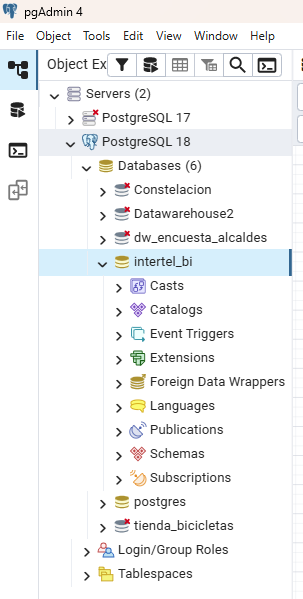

*Base de datos intertel_bi.*


*Esquemas staging, dw y audit.*


*Tablas de staging.*


*Dimensiones.*


*Tablas de hechos.*

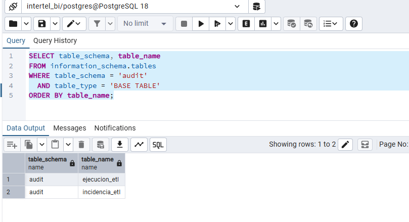

*Tablas de auditoría.*

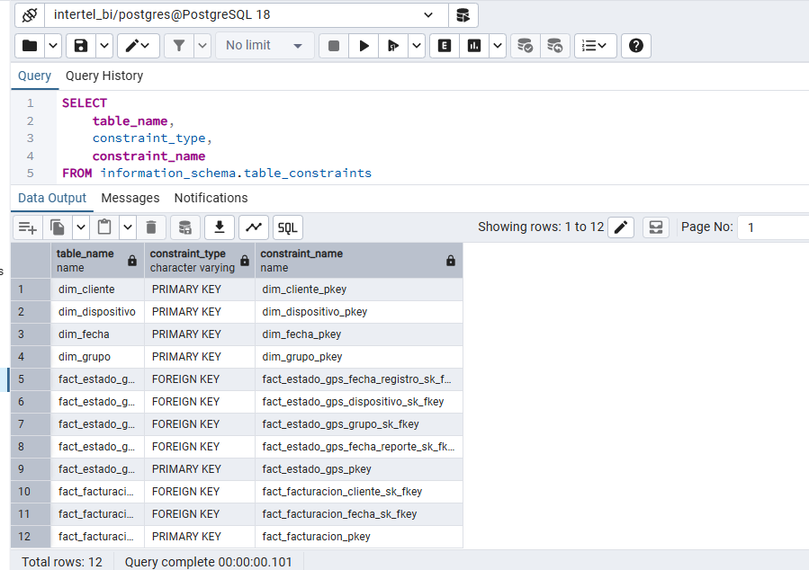

*Restricciones de claves primarias y foráneas.*

</details>

## 6. Transformaciones y flujo ETL

### 6.1. Configuración y extracción

Pentaho Data Integration (Spoon) se conecta a PostgreSQL por JDBC. Las rutas de archivos se parametrizan con `DIR_ORIGEN` para facilitar el traslado del proyecto entre equipos. Cada transformación de extracción utiliza Microsoft Excel Input, selecciona los campos necesarios y carga una tabla de staging, preservando `fila_origen` para la trazabilidad. Los campos de origen se mantienen como texto en staging antes de su conversión y validación.

La preparación local requiere PostgreSQL, Pentaho y los archivos autorizados. El modelo debe instalarse en una base vacía; para una base existente no se debe volver a inicializar ni eliminar información sin respaldo. La fecha del reporte se configura en `staging.v_config_reporte` y corresponde a la extracción, no a la ejecución del Job.


*Conexión JDBC de Pentaho a PostgreSQL (sin credenciales).*


*Parametrización de rutas de archivos.*

### 6.2. Transformaciones aplicadas

El script `03_intertel_transformaciones.sql` implementa funciones y vistas reutilizables, que Pentaho consulta con nodos Table Input para cargar las dimensiones y hechos. La separación permite inspeccionar las reglas en SQL y controlar la secuencia desde Spoon.

| Función / vista | Finalidad |
|---|---|
| `staging.normalizar_texto` | Mayúsculas, eliminación de acentos definidos y reducción de espacios |
| `staging.leer_timestamp` | Conversión controlada de fechas ISO o día-mes-año; nulo si son inválidas |
| `staging.leer_decimal` | Conversión decimal con coma o punto; rechazo de formatos ambiguos |
| `staging.v_factura_revision` | Detectar errores básicos, números duplicados o facturas conflictivas |
| `staging.v_factura_limpia` | Exponer únicamente registros sin regla de rechazo |
| `staging.v_carga_dim_cliente` | Unión de nombres del catálogo y facturación, con clasificación de coincidencias |
| `staging.v_gps_limpio` | Clasificación de disponibilidad, antigüedad, grupos, SIM, posición y distancia |
| `staging.v_carga_dim_fecha` | Calendario y atributos de fecha |
| `staging.v_carga_dim_dispositivo` y `v_carga_dim_grupo` | Identidades provisionales y grupos únicos |
| `staging.v_carga_fact_facturacion` y `v_carga_fact_estado_gps` | Resolución de claves de dimensiones y preparación de hechos |
| `staging.v_incidencias` | Registro lógico de advertencias y rechazos |

Ejemplo de clasificación del último registro GPS (fragmento del script):

```sql
CASE
    WHEN hora_original IS NULL
      OR hora_original ILIKE '%Nada se ha encontrado%'
        THEN 'SIN_DATOS'
    WHEN fecha_leida IS NULL OR fecha_leida::date > fecha_reporte
        THEN 'FECHA_INVALIDA'
    ELSE 'CON_DATOS'
END AS estado_datos
```

La antigüedad se calcula en días calendario mediante `fecha_reporte - fecha_leida::date`, solo para registros `CON_DATOS`. La posición se valida mediante rangos geográficos y se conserva únicamente una bandera de validez. Para dispositivos con SIM se construye una clave provisional a partir del nombre normalizado y la SIM; sin SIM se utiliza fecha y fila de origen. El hash utilizado en la implementación no se considera una garantía de anonimización.

En la facturación se descartan registros con número, nombre, importe o fecha inválidos y se distinguen duplicados y conflictos. Las facturas válidas sin correspondencia en el catálogo se conservan; su rechazo produciría una pérdida de facturación legítima.

### 6.3. Transformaciones de Pentaho

| Transformación | Flujo | Destino | Filas procesadas |
|---|---|---|---:|
| `01_staging_clientes.ktr` | Leer Clientes → Seleccionar Campos → Cargar Staging Clientes | `staging.clientes` | 93 |
| `02_staging_facturacion.ktr` | Leer Facturación → Seleccionar Campos → Cargar Staging Facturación | `staging.facturacion` | 1651 |
| `03_staging_gps.ktr` | Leer Dispositivos GPS → Seleccionar Campos → Cargar Staging GPS | `staging.dispositivos` | 666 |
| `04_dim_fecha.ktr` | Generar Fechas → Cargar Dim Fecha | `dw.dim_fecha` | 1826 |
| `05_dim_cliente.ktr` | Integrar Clientes → Cargar Dim Cliente | `dw.dim_cliente` | 232 |
| `06_dim_dispositivo.ktr` | Limpiar Dispositivos → Cargar Dim Dispositivo | `dw.dim_dispositivo` | 666 |
| `07_dim_grupo.ktr` | Obtener Grupos → Cargar Dim Grupo | `dw.dim_grupo` | 40 |
| `08_fact_facturacion.ktr` | Transformar Facturación → Cargar Fact Facturación | `dw.fact_facturacion` | 1646 |
| `09_fact_estado_gps.ktr` | Transformar Estado GPS → Cargar Fact Estado GPS | `dw.fact_estado_gps` | 666 |

#### 01_staging_clientes

La transformación prepara y carga `staging.clientes`. En la ejecución documentada procesó 93 filas. Su flujo es: Leer Clientes → Seleccionar Campos → Cargar Staging Clientes.

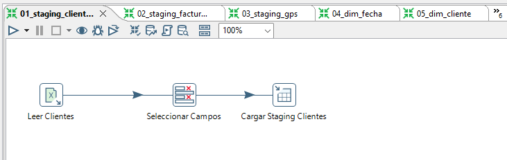

*Transformación 01_staging_clientes en Pentaho.*

#### 02_staging_facturacion

La transformación prepara y carga `staging.facturacion`. En la ejecución documentada procesó 1651 filas. Su flujo es: Leer Facturación → Seleccionar Campos → Cargar Staging Facturación.


*Transformación 02_staging_facturacion en Pentaho.*

#### 03_staging_gps

La transformación prepara y carga `staging.dispositivos`. En la ejecución documentada procesó 666 filas. Su flujo es: Leer Dispositivos GPS → Seleccionar Campos → Cargar Staging GPS.


*Transformación 03_staging_gps en Pentaho.*

#### 04_dim_fecha

La transformación prepara y carga `dw.dim_fecha`. En la ejecución documentada procesó 1826 filas. Su flujo es: Generar Fechas → Cargar Dim Fecha.


*Transformación 04_dim_fecha en Pentaho.*

#### 05_dim_cliente

La transformación prepara y carga `dw.dim_cliente`. En la ejecución documentada procesó 232 filas. Su flujo es: Integrar Clientes → Cargar Dim Cliente.


*Transformación 05_dim_cliente en Pentaho.*

#### 06_dim_dispositivo

La transformación prepara y carga `dw.dim_dispositivo`. En la ejecución documentada procesó 666 filas. Su flujo es: Limpiar Dispositivos → Cargar Dim Dispositivo.


*Transformación 06_dim_dispositivo en Pentaho.*

#### 07_dim_grupo

La transformación prepara y carga `dw.dim_grupo`. En la ejecución documentada procesó 40 filas. Su flujo es: Obtener Grupos → Cargar Dim Grupo.

> **Captura pendiente:** Transformación 07_dim_grupo en Pentaho.
>
> Archivo: `Intertel_BI/docs/capturas/03_etl_pentaho/etl_dim_grupo.png`

<!-- Cuando se suba la captura, sustituir el bloque anterior por la línea siguiente, sin los delimitadores de comentario:

-->

*Transformación 07_dim_grupo en Pentaho.*

#### 08_fact_facturacion

La transformación prepara y carga `dw.fact_facturacion`. En la ejecución documentada procesó 1646 filas. Su flujo es: Transformar Facturación → Cargar Fact Facturación.

> **Captura pendiente:** Transformación 08_fact_facturacion en Pentaho.
>
> Archivo: `Intertel_BI/docs/capturas/03_etl_pentaho/etl_fact_facturacion.png`

<!-- Cuando se suba la captura, sustituir el bloque anterior por la línea siguiente, sin los delimitadores de comentario:

-->

*Transformación 08_fact_facturacion en Pentaho.*

#### 09_fact_estado_gps

La transformación prepara y carga `dw.fact_estado_gps`. En la ejecución documentada procesó 666 filas. Su flujo es: Transformar Estado GPS → Cargar Fact Estado GPS.


*Transformación 09_fact_estado_gps en Pentaho.*

### 6.4. Job principal `Intertel_ETL`

El Job encadena las nueve transformaciones en orden de dependencia. Inicia un registro de auditoría, carga staging, carga dimensiones antes que hechos, valida el Data Warehouse y registra el resultado. Las rutas de error deben impedir que una carga fallida sea declarada exitosa.


*Representación de la ruta principal y control de fallo; el Job real contiene la configuración de conexiones de ejecución.*

El log registrado el 25/11/2026 evidencia la secuencia completa con `result=[true]` en las entradas ejecutadas y finalización de Job. En el historial de auditoría se observaron dos ejecuciones exitosas, de aproximadamente 3,17 y 2,38 segundos según las marcas registradas en la base. Estas duraciones son observaciones del entorno local y no un benchmark de rendimiento. Reejecutar el flujo con los mismos archivos permite comprobar la repetibilidad; no demuestra que exista un planificador automático o actualización en tiempo real.


*Job principal con transformaciones y rutas de control.*

> **Captura pendiente:** Ejecución exitosa del Job.
>
> Archivo: `Intertel_BI/docs/capturas/03_etl_pentaho/job_ejecucion_exitosa.png`

<!-- Cuando se suba la captura, sustituir el bloque anterior por la línea siguiente, sin los delimitadores de comentario:

-->

*Ejecución exitosa del Job.*

> **Captura pendiente:** Log de ejecución final.
>
> Archivo: `Intertel_BI/docs/capturas/03_etl_pentaho/job_log_ejecucion.png`

<!-- Cuando se suba la captura, sustituir el bloque anterior por la línea siguiente, sin los delimitadores de comentario:

-->

*Log de ejecución final.*

## 7. Validación y calidad de datos

### 7.1. Conteos y reconciliación

El script `04_intertel_validar_carga.sql` compara las vistas limpias con el destino, concilia importes, resume incidencias y verifica consistencia de antigüedad. Según las ejecuciones y validaciones realizadas durante el proyecto:

| Capa / tabla | Filas esperadas | Filas cargadas |
|---|---:|---:|
| staging.clientes | 93 | 93 |
| staging.facturacion | 1.651 | 1.651 |
| staging.dispositivos | 666 | 666 |
| dw.dim_fecha | 1.826 | 1.826 |
| dw.dim_cliente | 232 | 232 |
| dw.dim_dispositivo | 666 | 666 |
| dw.dim_grupo | 40 | 40 |
| dw.fact_facturacion | 1.646 | 1.646 |
| dw.fact_estado_gps | 666 | 666 |

De las 1.651 filas de staging de facturación, cinco fueron rechazadas. La carga preservó 1.646 registros válidos (99,70 %). La conciliación compara el total limpio con el DW, no con filas rechazadas ni otras hojas excluidas.

```sql
SELECT
    (SELECT SUM(valor_facturado) FROM staging.v_factura_limpia) AS total_origen_limpio,
    (SELECT SUM(valor_facturado) FROM dw.fact_facturacion) AS total_dw,
    (SELECT SUM(valor_facturado) FROM staging.v_factura_limpia) -
    (SELECT SUM(valor_facturado) FROM dw.fact_facturacion) AS diferencia;
```

Resultado de referencia: ambos totales USD 236.752,00; diferencia esperada y reportada en las validaciones: USD 0,00. La evidencia debe mostrar los valores exactos de la ejecución local.

> **Captura pendiente:** Conciliación del importe facturado entre origen limpio y DW.
>
> Archivo: `Intertel_BI/docs/capturas/04_validaciones/validacion_conciliacion_financiera.png`

<!-- Cuando se suba la captura, sustituir el bloque anterior por la línea siguiente, sin los delimitadores de comentario:

-->

*Conciliación del importe facturado entre origen limpio y DW.*

### 7.2. Integridad y consistencia

```sql
SELECT COUNT(*) AS gps_inconsistentes
FROM dw.fact_estado_gps f
JOIN dw.dim_fecha d ON d.fecha_sk = f.fecha_reporte_sk
LEFT JOIN dw.dim_fecha u ON u.fecha_sk = f.fecha_registro_sk
WHERE f.estado_datos = 'CON_DATOS'
  AND (u.fecha IS NULL OR f.dias_sin_registro IS DISTINCT FROM d.fecha-u.fecha);
```

La consulta devolvió cero inconsistencias. Esto comprueba la regla de antigüedad para los registros con datos; la integridad referencial se asegura además por las FK definidas en el DDL, no únicamente por esta consulta.

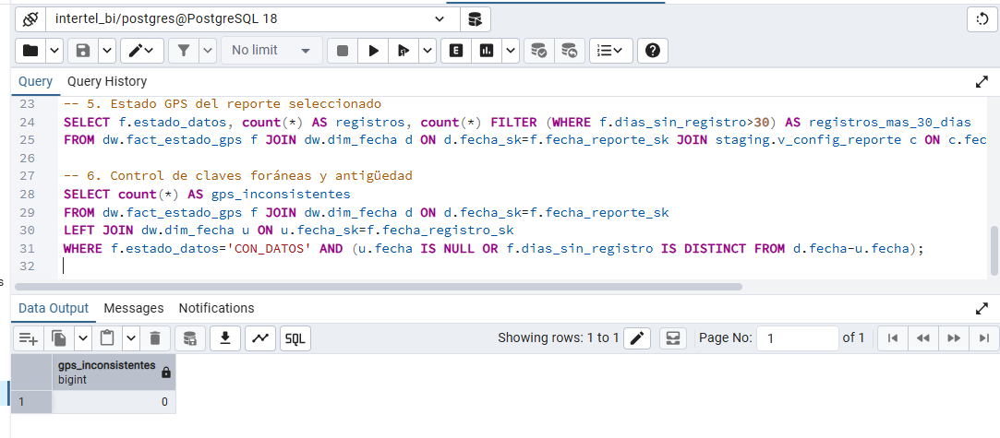

*Validación de consistencia de fechas y antigüedad GPS.*

### 7.3. Resultados de calidad y auditoría

| Fuente | Regla | Severidad | Cantidad |
|---|---|---|---:|
| FACTURACION | SIN_COINCIDENCIA | ADVERTENCIA | 640 |
| FACTURACION | IMPORTE_INVALIDO | RECHAZO | 2 |
| FACTURACION | NUMERO_FACTURA_INVALIDO | RECHAZO | 3 |
| GPS | SIN_DATOS | ADVERTENCIA | 480 |
| GPS | SIN_GRUPO | ADVERTENCIA | 131 |
| GPS | SIN_SIM | ADVERTENCIA | 45 |

Las advertencias no impiden conservar registros válidos. Una fila puede activar varias reglas, de modo que el total de incidencias no representa necesariamente el total de filas afectadas. Se consulta solo la última ejecución exitosa para evitar duplicaciones entre cargas.

La dimensión cliente contiene 90 nombres con coincidencia única, 141 sin coincidencia y uno con coincidencia múltiple. Los 232 miembros incluyen nombres provenientes de las dos fuentes; no equivalen a 232 clientes facturados o identidades legales verificadas. En el reporte GPS se registraron 621 dispositivos con dato de SIM y 45 sin ese dato; se identificaron 39 grupos y un miembro técnico `SIN GRUPO`.


*Incidencias detectadas en la última carga exitosa.*

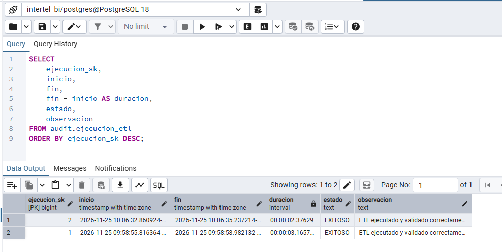

*Historial de ejecuciones del ETL.*

<details><summary>Ver conteos y evidencias adicionales de calidad</summary>

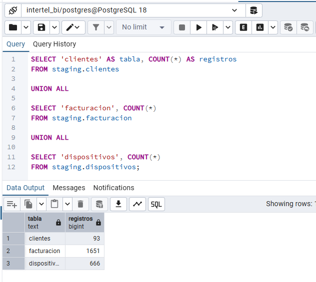

*Conteos de staging.*


*Conteos de dimensiones.*

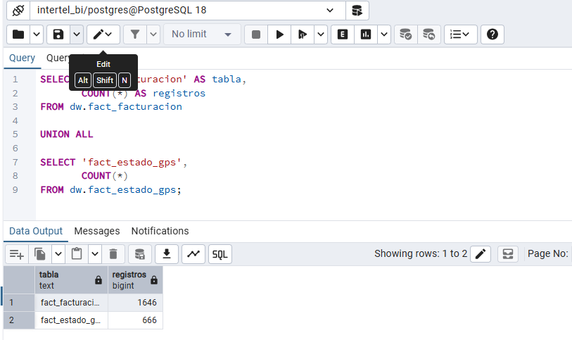

*Conteos de tablas de hechos.*

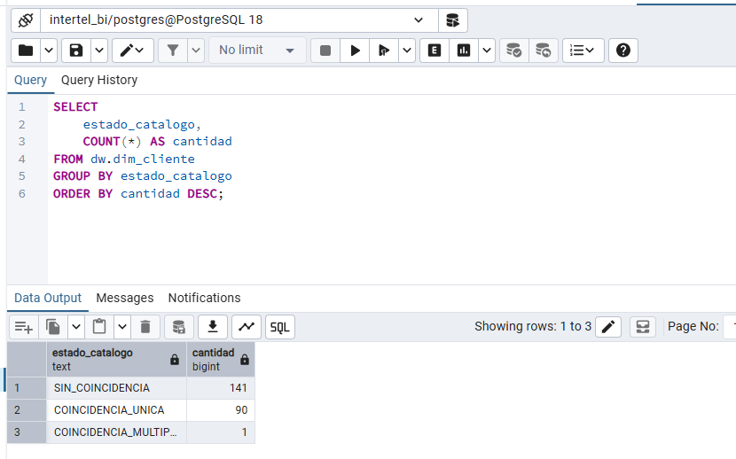

*Coincidencias por nombre en el catálogo.*

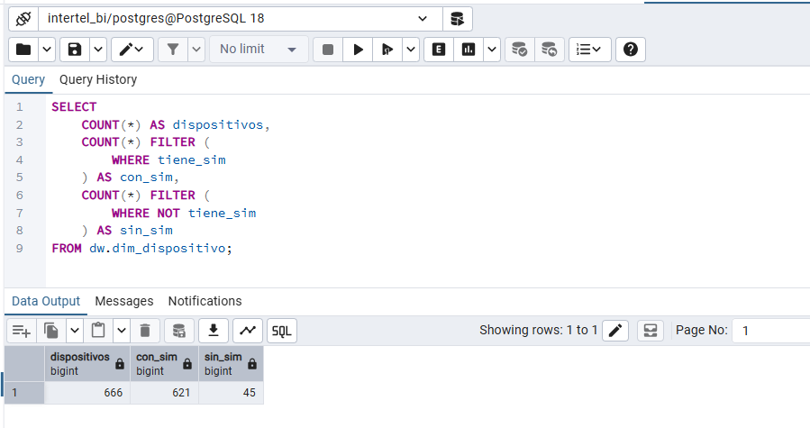

*Disponibilidad de información SIM.*

</details>

## 8. Consultas SQL y resultados

Las 18 consultas se ejecutan sobre `dw` y `audit`, sin modificar los datos. Se utilizan agregaciones, JOIN, filtros, funciones de ventana y expresiones comunes de tabla (CTE). Para garantizar reproducibilidad, se incluye el código de cada bloque original en secciones desplegables.

Los importes comerciales se contrastaron también con la hoja principal de facturación: 1.646 números válidos y únicos, total acumulado USD 236.752,00 y 205 nombres normalizados distintos con facturación. Los valores operativos se basan en las ejecuciones y capturas documentadas del proyecto; las evidencias pendientes deben contrastarse con el entorno local.

### 8.1. Resumen de resultados comerciales

| Indicador | Resultado |
|---|---:|
| Facturación acumulada | USD 236.752,00 |
| Facturas válidas | 1.646 |
| Nombres facturados distintos | 205 |
| Ticket promedio | USD 143,83 |
| Facturación 2025 | USD 113.309,25 |
| Facturación 2026 (parcial) | USD 123.442,75 |
| Enero–octubre 2025 | USD 94.861,49 |
| Enero–octubre 2026 | USD 112.418,94 |
| Variación interanual comparable | +18,51 % |
| Facturación Top 10 | USD 166.804,02 |
| Concentración Top 10 | 70,46 % |

| Mes | 2025 (USD) | 2026 (USD) |
|---|---:|---:|
| Enero | 11.535,91 | 11.598,40 |
| Febrero | 11.566,91 | 7.916,17 |
| Marzo | 7.599,43 | 10.376,22 |
| Abril | 7.484,63 | 11.466,12 |
| Mayo | 12.058,93 | 11.884,84 |
| Junio | 8.279,72 | 10.671,61 |
| Julio | 9.692,97 | 12.480,55 |
| Agosto | 8.954,00 | 4.746,17 |
| Septiembre | 9.349,71 | 12.519,96 |
| Octubre | 8.339,28 | 18.758,90 |
| Noviembre | 9.677,55 | 11.023,81 (parcial) |
| Diciembre | 8.770,21 | Sin registros en el corte |
| **Total registrado** | **113.309,25** | **123.442,75** |

### 8.2. Resumen de resultados operativos

| Indicador | Resultado |
|---|---:|
| Registros del reporte | 666 |
| Grupos identificados | 39 |
| Registros con información | 186 (27,93 %) |
| Registros sin información | 480 (72,07 %) |
| Último registro superior a 30 días | 105 (56,45 % de los que tienen datos) |
| Registros sin grupo | 131 (19,67 %) |
| Registros sin dato SIM | 45 (6,76 %) |

### 8.3. Detalle de consultas y trazabilidad

#### PN01. ¿Cuánto se ha facturado por año, trimestre y mes?

**Interpretación:** PN01 muestra la distribución mensual. Los totales registrados son USD 113.309,25 en 2025 y USD 123.442,75 en 2026 (parcial).

**Visualización asociada:** Evolución temporal y matriz.

<details><summary>Consulta SQL y evidencia PN01</summary>

```sql
-- PN01. ¿Cuánto se ha facturado por año, trimestre y mes?
SELECT d.anio, d.trimestre, d.mes, d.nombre_mes,
       SUM(f.valor_facturado) AS total_facturado,
       COUNT(*) AS cantidad_facturas
FROM dw.fact_facturacion f
JOIN dw.dim_fecha d ON d.fecha_sk = f.fecha_sk
GROUP BY d.anio, d.trimestre, d.mes, d.nombre_mes
ORDER BY d.anio, d.mes;
```

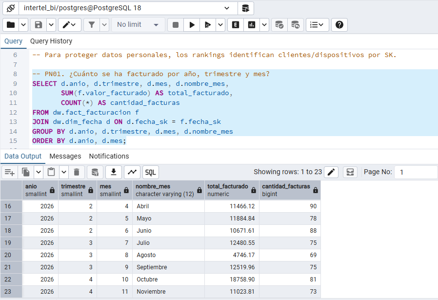

*PN01 — resultado de la consulta en PostgreSQL.*

</details>

#### PN02. ¿Cómo evolucionó la facturación entre enero y octubre de 2025 y 2026?

**Interpretación:** USD 94.861,49 frente a USD 112.418,94: diferencia de USD 17.557,45 y crecimiento de 18,51 %. Comparar meses equivalentes evita incorporar noviembre parcial.

**Visualización asociada:** Inicio: crecimiento interanual.

<details><summary>Consulta SQL y evidencia PN02</summary>

```sql
-- PN02. ¿Cómo evolucionó la facturación entre enero y octubre de 2025 y 2026?
-- Se excluye noviembre de ambos años porque noviembre de 2026 está incompleto.
-- Comparación de registros disponibles: confirmar cobertura completa con Intertel.
WITH periodos AS (
    SELECT
        SUM(f.valor_facturado) FILTER (WHERE d.anio = 2025) AS total_2025,
        SUM(f.valor_facturado) FILTER (WHERE d.anio = 2026) AS total_2026
    FROM dw.fact_facturacion f
    JOIN dw.dim_fecha d ON d.fecha_sk = f.fecha_sk
    WHERE d.anio IN (2025, 2026) AND d.mes BETWEEN 1 AND 10
)
SELECT total_2025, total_2026,
       total_2026 - total_2025 AS diferencia,
       ROUND(100.0 * (total_2026 - total_2025) / NULLIF(total_2025, 0), 2) AS variacion_pct
FROM periodos;
```

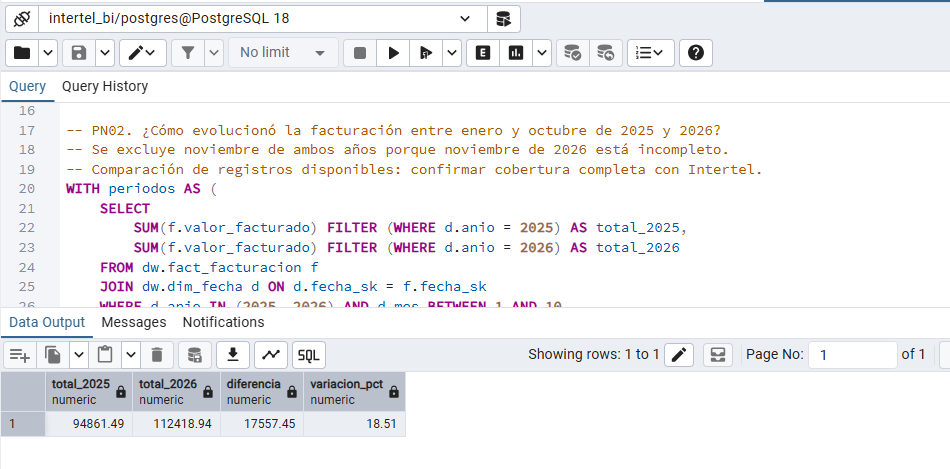

*PN02 — resultado de la consulta en PostgreSQL.*

</details>

#### PN03. ¿Cuáles son los diez clientes facturados con mayor importe?

**Interpretación:** Permite identificar las etiquetas de clientes prioritarias para seguimiento comercial. El ranking se presenta por claves técnicas, no por nombres reales.

**Visualización asociada:** Ranking Top 10.

<details><summary>Consulta SQL y evidencia PN03</summary>

```sql
-- PN03. ¿Cuáles son los diez clientes facturados con mayor importe?
SELECT c.cliente_sk, c.estado_catalogo,
       COUNT(*) AS cantidad_facturas,
       SUM(f.valor_facturado) AS total_facturado
FROM dw.fact_facturacion f
JOIN dw.dim_cliente c ON c.cliente_sk = f.cliente_sk
GROUP BY c.cliente_sk, c.estado_catalogo
ORDER BY total_facturado DESC, c.cliente_sk
LIMIT 10;
```

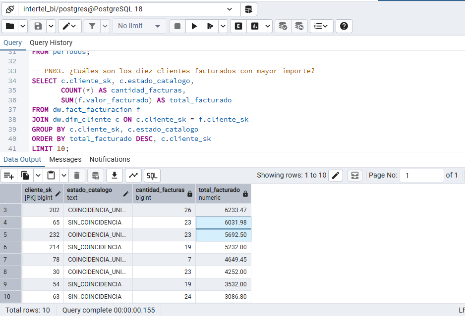

*PN03 — resultado de la consulta en PostgreSQL.*

</details>

#### PN04. ¿Qué porcentaje de facturación corresponde a los diez principales clientes?

**Interpretación:** Los diez principales nombres normalizados acumulan USD 166.804,02 (70,46 % del importe total), según recálculo de la hoja principal. Confirmar el mismo valor en PN04 y Power BI sin filtros.

**Visualización asociada:** Tarjeta concentración Top 10.

<details><summary>Consulta SQL y evidencia PN04</summary>

```sql
-- PN04. ¿Qué porcentaje de facturación corresponde a los diez principales clientes?
WITH por_cliente AS (
    SELECT cliente_sk, SUM(valor_facturado) AS total_cliente
    FROM dw.fact_facturacion GROUP BY cliente_sk
), ranking AS (
    SELECT *, ROW_NUMBER() OVER (ORDER BY total_cliente DESC, cliente_sk) AS posicion
    FROM por_cliente
)
SELECT SUM(total_cliente) AS total_facturado,
       SUM(total_cliente) FILTER (WHERE posicion <= 10) AS facturacion_top_10,
       ROUND(100.0 * SUM(total_cliente) FILTER (WHERE posicion <= 10)
             / NULLIF(SUM(total_cliente), 0), 2) AS concentracion_top_10_pct
FROM ranking;
```


*PN04 — resultado de la consulta en PostgreSQL.*

</details>

#### PN05. ¿Cuál es el importe promedio de una factura?

**Interpretación:** 1.646 facturas; USD 236.752,00 acumulados; USD 143,83 por factura. No es el ingreso promedio por cliente ni el precio promedio de un plan.

**Visualización asociada:** Inicio y Comercial: ticket promedio.

<details><summary>Consulta SQL y evidencia PN05</summary>

```sql
-- PN05. ¿Cuál es el importe promedio de una factura?
SELECT COUNT(*) AS cantidad_facturas,
       SUM(valor_facturado) AS total_facturado,
       ROUND(AVG(valor_facturado), 2) AS ticket_promedio
FROM dw.fact_facturacion;
```

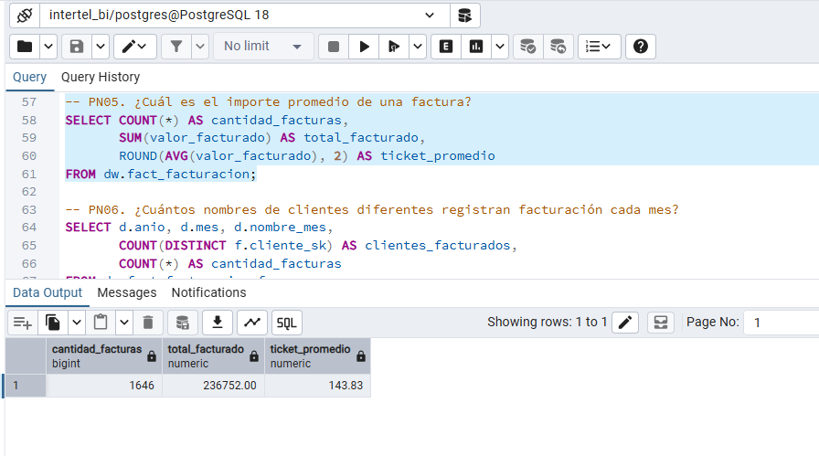

*PN05 — resultado de la consulta en PostgreSQL.*

</details>

#### PN06. ¿Cuántos nombres de clientes diferentes registran facturación cada mes?

**Interpretación:** El recuento distinto de cliente_sk debe calcularse en cada mes; los recuentos mensuales no se suman para obtener clientes únicos anuales.

**Visualización asociada:** Clientes facturados + filtros.

<details><summary>Consulta SQL y evidencia PN06</summary>

```sql
-- PN06. ¿Cuántos nombres de clientes diferentes registran facturación cada mes?
SELECT d.anio, d.mes, d.nombre_mes,
       COUNT(DISTINCT f.cliente_sk) AS clientes_facturados,
       COUNT(*) AS cantidad_facturas
FROM dw.fact_facturacion f
JOIN dw.dim_fecha d ON d.fecha_sk = f.fecha_sk
GROUP BY d.anio, d.mes, d.nombre_mes
ORDER BY d.anio, d.mes;
```


*PN06 — resultado de la consulta en PostgreSQL.*

</details>

#### PN07. ¿Qué meses tienen mayor y menor facturación?

**Interpretación:** Octubre de 2026: USD 18.758,90 (máximo); agosto de 2026: USD 4.746,17 (mínimo), entre meses con registros y excluyendo noviembre de 2026.

**Visualización asociada:** Gráfico mensual y matriz.

<details><summary>Consulta SQL y evidencia PN07</summary>

```sql
-- PN07. ¿Qué meses tienen mayor y menor facturación?
-- Se excluye noviembre de 2026 (parcial) y los meses sin registros.
WITH mensual AS (
    SELECT d.anio, d.mes, d.nombre_mes, SUM(f.valor_facturado) AS total_facturado
    FROM dw.fact_facturacion f
    JOIN dw.dim_fecha d ON d.fecha_sk = f.fecha_sk
    WHERE d.fecha >= DATE '2025-01-01' AND d.fecha < DATE '2026-11-01'
    GROUP BY d.anio, d.mes, d.nombre_mes
), ranking AS (
    SELECT *, DENSE_RANK() OVER (ORDER BY total_facturado DESC) AS mayor,
              DENSE_RANK() OVER (ORDER BY total_facturado ASC) AS menor
    FROM mensual
)
SELECT CASE WHEN mayor = 1 THEN 'MAYOR' ELSE 'MENOR' END AS clasificacion,
       anio, mes, nombre_mes, total_facturado
FROM ranking WHERE mayor = 1 OR menor = 1
ORDER BY mayor, anio, mes;
```

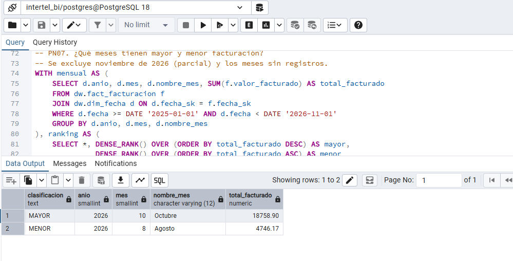

*PN07 — resultado de la consulta en PostgreSQL.*

</details>

#### PN08. ¿Con qué frecuencia se emiten facturas por nombre de cliente?

**Interpretación:** Permite identificar recurrencia documental mediante facturas, meses con actividad y promedio por mes activo; no demuestra suscripciones activas.

**Visualización asociada:** Consulta SQL y tooltip de ranking.

<details><summary>Consulta SQL y evidencia PN08</summary>

```sql
-- PN08. ¿Con qué frecuencia se emiten facturas por nombre de cliente?
SELECT f.cliente_sk, COUNT(*) AS facturas,
       COUNT(DISTINCT (d.anio, d.mes)) AS meses_con_facturas,
       MIN(d.fecha) AS primera_factura, MAX(d.fecha) AS ultima_factura,
       ROUND(COUNT(*)::numeric / NULLIF(COUNT(DISTINCT (d.anio, d.mes)), 0), 2)
           AS facturas_por_mes_con_actividad
FROM dw.fact_facturacion f
JOIN dw.dim_fecha d ON d.fecha_sk = f.fecha_sk
GROUP BY f.cliente_sk
ORDER BY facturas DESC, f.cliente_sk;
```


*PN08 — resultado de la consulta en PostgreSQL.*

</details>

#### PN09. ¿Cuántos registros y claves de dispositivo aparecen en el reporte?

**Interpretación:** 666 registros, 666 claves provisionales en la dimensión de dispositivos y 39 grupos identificados (excluye SIN GRUPO). No equivale a una verificación de 666 vehículos activos.

**Visualización asociada:** Tarjetas GPS y grupos.

<details><summary>Consulta SQL y evidencia PN09</summary>

```sql
-- PN09. ¿Cuántos registros y claves de dispositivo aparecen en el reporte?
SELECT COUNT(*) AS registros_gps,
       COUNT(DISTINCT dispositivo_sk) AS dispositivos_identificados_provisionalmente,
       COUNT(DISTINCT f.grupo_sk) FILTER (WHERE NOT g.es_sin_grupo) AS grupos_identificados
FROM dw.fact_estado_gps f
JOIN dw.dim_grupo g USING (grupo_sk)
WHERE f.fecha_reporte_sk = 20261119;
```


*PN09 — resultado de la consulta en PostgreSQL.*

</details>

#### PN10. ¿Qué grupos concentran más registros de dispositivos?

**Interpretación:** El ranking permite identificar los grupos con mayor volumen, separando SIN GRUPO de los grupos identificados. No todos los grupos son necesariamente cooperativas.

**Visualización asociada:** Barras por grupo.

<details><summary>Consulta SQL y evidencia PN10</summary>

```sql
-- PN10. ¿Qué grupos concentran más registros de dispositivos?
SELECT g.grupo_sk, g.nombre_grupo, g.es_sin_grupo,
       COUNT(*) AS registros_gps,
       COUNT(DISTINCT f.dispositivo_sk) AS claves_dispositivo,
       ROUND(100.0 * COUNT(*) / NULLIF(SUM(COUNT(*)) OVER (), 0), 2) AS participacion_pct
FROM dw.fact_estado_gps f JOIN dw.dim_grupo g USING (grupo_sk)
WHERE f.fecha_reporte_sk = 20261119
GROUP BY g.grupo_sk, g.nombre_grupo, g.es_sin_grupo
ORDER BY registros_gps DESC, g.grupo_sk;
```


*PN10 — resultado de la consulta en PostgreSQL.*

</details>

#### PN11. ¿Qué proporción de registros tiene información GPS disponible?

**Interpretación:** 186 con información (27,93 %) y 480 sin información (72,07 %).

**Visualización asociada:** Anillo de disponibilidad.

<details><summary>Consulta SQL y evidencia PN11</summary>

```sql
-- PN11. ¿Qué proporción de registros tiene información GPS disponible?
SELECT estado_datos, COUNT(*) AS registros,
       ROUND(100.0 * COUNT(*) / NULLIF(SUM(COUNT(*)) OVER (), 0), 2) AS porcentaje
FROM dw.fact_estado_gps WHERE fecha_reporte_sk = 20261119
GROUP BY estado_datos ORDER BY registros DESC;
```


*PN11 — resultado de la consulta en PostgreSQL.*

</details>

#### PN12. ¿Qué grupos presentan más registros sin datos y qué proporción representan?

**Interpretación:** Compara cantidad absoluta y porcentaje dentro de cada grupo; un grupo pequeño con 100 % no siempre tiene el mayor impacto absoluto.

**Visualización asociada:** Matriz y barras apiladas.

<details><summary>Consulta SQL y evidencia PN12</summary>

```sql
-- PN12. ¿Qué grupos presentan más registros sin datos y qué proporción representan?
SELECT g.grupo_sk, g.nombre_grupo, COUNT(*) AS total_registros,
       COUNT(*) FILTER (WHERE f.estado_datos = 'SIN_DATOS') AS sin_datos,
       ROUND(100.0 * COUNT(*) FILTER (WHERE f.estado_datos = 'SIN_DATOS')
             / NULLIF(COUNT(*), 0), 2) AS sin_datos_pct
FROM dw.fact_estado_gps f JOIN dw.dim_grupo g USING (grupo_sk)
WHERE f.fecha_reporte_sk = 20261119
GROUP BY g.grupo_sk, g.nombre_grupo
ORDER BY sin_datos DESC, sin_datos_pct DESC, g.grupo_sk;
```

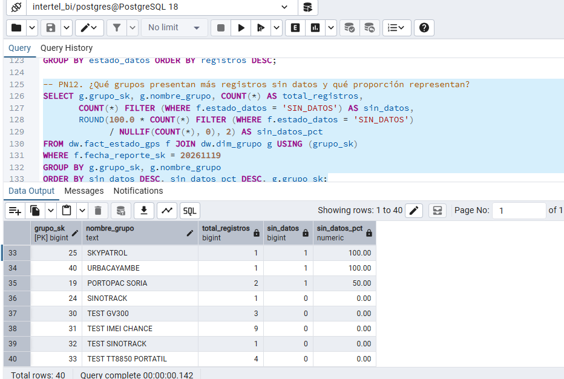

*PN12 — resultado de la consulta en PostgreSQL.*

</details>

#### PN13. ¿Cuál es la antigüedad de la información GPS disponible?

**Interpretación:** 105 registros presentan más de 30 días de antigüedad; equivalen al 56,45 % de los 186 registros con datos.

**Visualización asociada:** Gráfico de antigüedad.

<details><summary>Consulta SQL y evidencia PN13</summary>

```sql
-- PN13. ¿Cuál es la antigüedad de la información GPS disponible?
WITH rangos AS (
    SELECT CASE WHEN estado_datos = 'SIN_DATOS' THEN 5
                WHEN estado_datos = 'FECHA_INVALIDA' THEN 6
                WHEN dias_sin_registro = 0 THEN 1
                WHEN dias_sin_registro BETWEEN 1 AND 7 THEN 2
                WHEN dias_sin_registro BETWEEN 8 AND 30 THEN 3
                ELSE 4 END AS orden
    FROM dw.fact_estado_gps WHERE fecha_reporte_sk = 20261119
)
SELECT orden, CASE orden WHEN 1 THEN 'Mismo día' WHEN 2 THEN '1-7 días'
       WHEN 3 THEN '8-30 días' WHEN 4 THEN 'Más de 30 días'
       WHEN 5 THEN 'Sin datos' ELSE 'Fecha inválida' END AS rango,
       COUNT(*) AS registros,
       ROUND(100.0 * COUNT(*) / NULLIF(SUM(COUNT(*)) OVER (), 0), 2) AS porcentaje
FROM rangos GROUP BY orden ORDER BY orden;
```

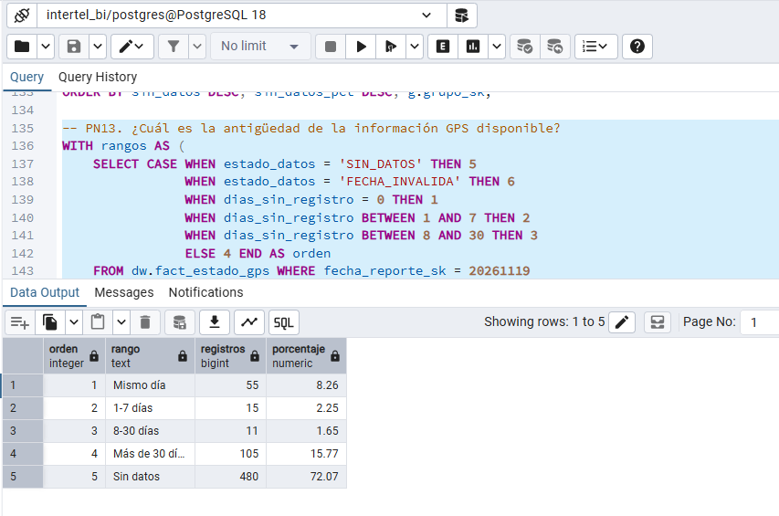

*PN13 — resultado de la consulta en PostgreSQL.*

</details>

#### PN14. ¿Qué grupos requieren revisión por registros con más de 30 días de antigüedad?

**Interpretación:** Identifica grupos por cantidad y proporción de registros antiguos entre aquellos con información válida. No es un diagnóstico de desconexión.

**Visualización asociada:** Matriz y segmentadores.

<details><summary>Consulta SQL y evidencia PN14</summary>

```sql
-- PN14. ¿Qué grupos requieren revisión por registros con más de 30 días de antigüedad?
SELECT g.grupo_sk, g.nombre_grupo, COUNT(*) AS registros,
       COUNT(*) FILTER (WHERE f.estado_datos = 'CON_DATOS') AS con_datos,
       COUNT(*) FILTER (WHERE f.dias_sin_registro > 30) AS mas_30_dias,
       ROUND(100.0 * COUNT(*) FILTER (WHERE f.dias_sin_registro > 30)
          / NULLIF(COUNT(*) FILTER (WHERE f.estado_datos = 'CON_DATOS'), 0), 2) AS pct_sobre_con_datos
FROM dw.fact_estado_gps f JOIN dw.dim_grupo g USING (grupo_sk)
WHERE f.fecha_reporte_sk = 20261119
GROUP BY g.grupo_sk, g.nombre_grupo
ORDER BY mas_30_dias DESC, g.grupo_sk;
```


*PN14 — resultado de la consulta en PostgreSQL.*

</details>

#### PN15. ¿Cuántos registros cuentan con coordenadas válidas?

**Interpretación:** Se evalúa la cobertura del indicador tiene_posicion, no la ubicación geográfica de clientes ni un mapa de vehículos. El valor exacto se evidencia en PN15.

**Visualización asociada:** Consulta SQL / GPS Con Posicion.

<details><summary>Consulta SQL y evidencia PN15</summary>

```sql
-- PN15 (reformulada). ¿Cuántos registros cuentan con coordenadas válidas?
-- El DW solo guarda tiene_posicion, no latitud/longitud ni ciudad.
SELECT COUNT(*) AS registros,
       COUNT(*) FILTER (WHERE tiene_posicion) AS con_posicion,
       COUNT(*) FILTER (WHERE NOT tiene_posicion) AS sin_posicion,
       ROUND(100.0 * COUNT(*) FILTER (WHERE tiene_posicion) / NULLIF(COUNT(*), 0), 2) AS cobertura_pct
FROM dw.fact_estado_gps WHERE fecha_reporte_sk = 20261119;
```


*PN15 — resultado de la consulta en PostgreSQL.*

</details>

#### PN16. ¿Qué proporción de facturas no coincide por nombre con el catálogo?

**Interpretación:** 640 facturas sin coincidencia (38,88 % de las 1.646 válidas). Distinguir facturas de nombres únicos.

**Visualización asociada:** Anillo de calidad comercial.

<details><summary>Consulta SQL y evidencia PN16</summary>

```sql
-- PN16. ¿Qué proporción de facturas no coincide por nombre con el catálogo?
SELECT c.estado_catalogo, COUNT(*) AS facturas,
       SUM(f.valor_facturado) AS valor_facturado,
       ROUND(100.0 * COUNT(*) / NULLIF(SUM(COUNT(*)) OVER (), 0), 2) AS porcentaje_facturas
FROM dw.fact_facturacion f JOIN dw.dim_cliente c USING (cliente_sk)
GROUP BY c.estado_catalogo ORDER BY facturas DESC;
```

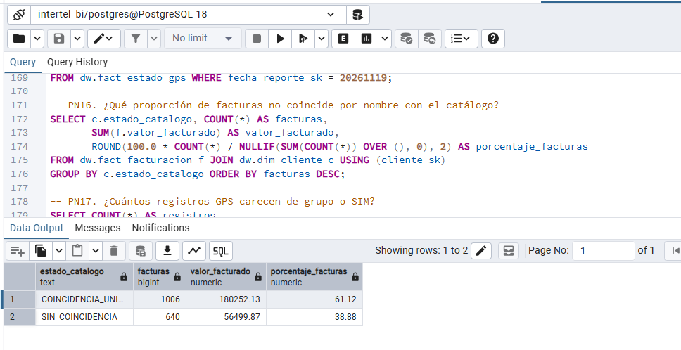

*PN16 — resultado de la consulta en PostgreSQL.*

</details>

#### PN17. ¿Cuántos registros GPS carecen de grupo o SIM?

**Interpretación:** 131 sin grupo y 45 sin SIM; las categorías pueden solaparse, por lo que no se deben sumar para contar casos únicos.

**Visualización asociada:** Tarjetas GPS y consulta SQL.

<details><summary>Consulta SQL y evidencia PN17</summary>

```sql
-- PN17. ¿Cuántos registros GPS carecen de grupo o SIM?
SELECT COUNT(*) AS registros,
       COUNT(*) FILTER (WHERE g.es_sin_grupo) AS sin_grupo,
       COUNT(*) FILTER (WHERE NOT d.tiene_sim) AS sin_sim,
       COUNT(*) FILTER (WHERE g.es_sin_grupo AND NOT d.tiene_sim) AS sin_ambos
FROM dw.fact_estado_gps f
JOIN dw.dim_grupo g USING (grupo_sk)
JOIN dw.dim_dispositivo d USING (dispositivo_sk)
WHERE f.fecha_reporte_sk = 20261119;
```

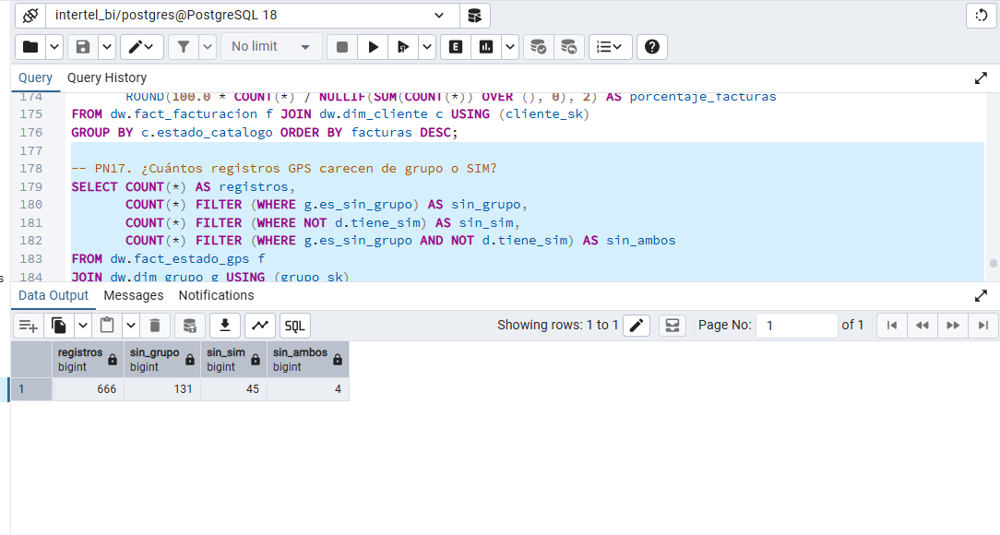

*PN17 — resultado de la consulta en PostgreSQL.*

</details>

#### PN18. ¿Qué incidencias de calidad fueron detectadas en la última carga exitosa?

**Interpretación:** Se contabilizan advertencias y rechazos de la última ejecución exitosa para no duplicar incidencias de cargas repetidas.

**Visualización asociada:** Auditoría SQL.

<details><summary>Consulta SQL y evidencia PN18</summary>

```sql
-- PN18. ¿Qué incidencias de calidad fueron detectadas en la última carga exitosa?
-- Usar solo la última ejecución evita contabilizar nuevamente el mismo archivo.
SELECT fuente, regla, severidad, COUNT(*) AS incidencias
FROM audit.incidencia_etl
WHERE ejecucion_sk = (SELECT MAX(ejecucion_sk) FROM audit.ejecucion_etl WHERE estado = 'EXITOSO')
GROUP BY fuente, regla, severidad ORDER BY fuente, severidad, regla;
```


*PN18 — resultado de la consulta en PostgreSQL.*

</details>

## 9. Implementación y dashboards en Power BI

### 9.1. Conexión y modelo semántico

Power BI Desktop se conectó a PostgreSQL y utiliza las cuatro dimensiones y las dos tablas de hechos del esquema `dw`. El modelo semántico conserva relaciones de uno a muchos de dimensiones hacia hechos. La doble relación de fechas GPS requiere distinguir la relación de fecha de reporte de la de último registro; en Power BI una relación alternativa puede permanecer inactiva y activarse mediante DAX cuando sea necesario. Se debe verificar la configuración efectiva en la vista de modelo, evitando caminos ambiguos o relaciones directas entre hechos.

Los filtros comerciales operan sobre la facturación; los operativos sobre la instantánea GPS. Se ordena el nombre de mes por su número y se utiliza la jerarquía Año → Trimestre → Mes → Fecha para las operaciones de navegación temporal. Las etiquetas de clientes y nombres de categorías se adaptaron para la presentación sin modificar las reglas de negocio originales.

> **Captura pendiente:** Conexión a PostgreSQL en Power BI.
>
> Archivo: `Intertel_BI/docs/capturas/06_power_bi/powerbi_conexion_postgresql.png`

<!-- Cuando se suba la captura, sustituir el bloque anterior por la línea siguiente, sin los delimitadores de comentario:
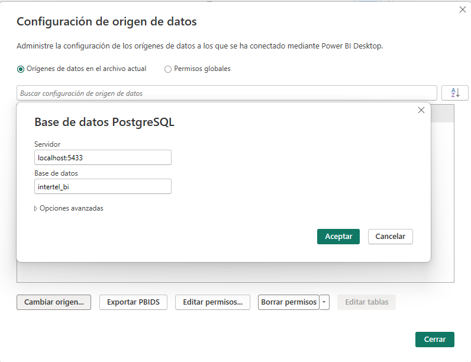
-->

*Conexión a PostgreSQL en Power BI.*

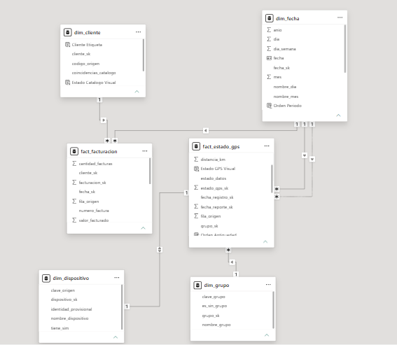

*Modelo semántico y cardinalidades.*

> **Captura pendiente:** Jerarquía temporal.
>
> Archivo: `Intertel_BI/docs/capturas/06_power_bi/powerbi_jerarquia_temporal.png`

<!-- Cuando se suba la captura, sustituir el bloque anterior por la línea siguiente, sin los delimitadores de comentario:

-->

*Jerarquía temporal.*

### 9.2. Medidas e indicadores

| Indicador | Definición |
|---|---|
| Facturación total | Suma de `valor_facturado` |
| Facturas emitidas | Suma de `cantidad_facturas` o recuento de hechos válidos |
| Clientes facturados | Recuento distinto de `cliente_sk` en los hechos filtrados |
| Ticket promedio | Facturación total / cantidad de facturas |
| Crecimiento interanual | Diferencia entre enero–octubre de ambos años / total enero–octubre de 2025 |
| Concentración Top 10 | Importe de diez clientes con mayor facturación / importe del contexto de referencia |
| Total registros GPS | Suma de `cantidad_registros` para la fecha del reporte |
| GPS con/sin datos | Recuento por `estado_datos` |
| Porcentaje GPS sin datos | GPS sin datos / total de registros en contexto |
| GPS más de 30 días | Recuento con `dias_sin_registro > 30` |
| Grupos identificados | Recuento distinto de grupos excluyendo el miembro `SIN GRUPO` |

Ejemplos equivalentes de medidas DAX básicas (la captura y el archivo PBIX documentan la implementación efectiva):

```dax
Facturacion Total = SUM(fact_facturacion[valor_facturado])
Cantidad Facturas = SUM(fact_facturacion[cantidad_facturas])
Ticket Promedio = DIVIDE([Facturacion Total], [Cantidad Facturas])
Clientes Facturados = DISTINCTCOUNT(fact_facturacion[cliente_sk])
Total Registros GPS = SUM(fact_estado_gps[cantidad_registros])
GPS Sin Datos = CALCULATE([Total Registros GPS], fact_estado_gps[estado_datos] = "SIN_DATOS")
Porcentaje GPS Sin Datos = DIVIDE([GPS Sin Datos], [Total Registros GPS])
```

Los porcentajes, promedios y recuentos distintos son medidas no aditivas; deben recalcularse según el contexto de filtros. Seleccionar únicamente la categoría sin datos puede alterar el denominador y producir 100 %, por lo que para comparar tasas entre grupos se deben mantener abiertos los filtros de estado y antigüedad, o definir explícitamente una medida con denominador fijo.

> **Captura pendiente:** Medidas DAX comerciales.
>
> Archivo: `Intertel_BI/docs/capturas/06_power_bi/powerbi_medidas_dax_comerciales.png`

<!-- Cuando se suba la captura, sustituir el bloque anterior por la línea siguiente, sin los delimitadores de comentario:
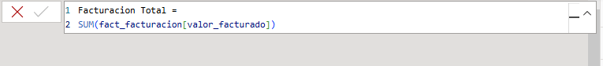
-->

*Medidas DAX comerciales.*

> **Captura pendiente:** Medidas DAX operativas GPS.
>
> Archivo: `Intertel_BI/docs/capturas/06_power_bi/powerbi_medidas_dax_gps.png`

<!-- Cuando se suba la captura, sustituir el bloque anterior por la línea siguiente, sin los delimitadores de comentario:

-->

*Medidas DAX operativas GPS.*

### 9.3. Diseño UI/UX

Las cuatro páginas utilizan un encabezado con navegación, fondo claro, tarjetas blancas, tipografía Segoe UI y colores consistentes. El color azul corporativo propuesto (`#12355B`) representa información comercial; gris azulado (`#94A3B8`) distingue períodos anteriores; verde y naranja (`#84B83E`, `#D97706`) representan disponibilidad y ausencia de información. El rojo se reserva para priorizar registros de antigüedad elevada. Los colores constituyen decisiones visuales del proyecto, no niveles de servicio oficiales.

Se aplicaron principios de jerarquía, contraste, alineación, agrupación, consistencia y reducción de carga cognitiva. Los gráficos incluyen etiquetas textuales y los filtros facilitan la exploración; el menú indica la página activa. El diseño distingue facturación, calidad operativa y análisis OLAP, evitando repetir visualizaciones sin una finalidad específica.

### 9.4. Página 01 — Resumen ejecutivo

Presenta los indicadores generales de facturación, cantidad de facturas, ticket promedio, crecimiento comparable, registros GPS y porcentaje sin información. El gráfico de líneas compara meses entre años; las columnas presentan importes anuales registrados, y el anillo muestra disponibilidad GPS. Responde principalmente PN01, PN02, PN05, PN07, PN09 y PN11.

**Interpretación:** el valor facturado creció entre períodos equivalentes, mientras que el reporte GPS evidencia una importante falta de información. Los dos procesos son independientes: no se afirma que la situación GPS explique los ingresos.

> **Captura pendiente:** Dashboard final — Resumen ejecutivo.
>
> Archivo: `Intertel_BI/docs/capturas/06_power_bi/dashboard_resumen_ejecutivo.png`

<!-- Cuando se suba la captura, sustituir el bloque anterior por la línea siguiente, sin los delimitadores de comentario:

-->

*Dashboard final — Resumen ejecutivo.*

### 9.5. Página 02 — Análisis comercial

Incluye segmentadores por año, trimestre, mes y cliente; tarjetas de facturación, facturas, clientes, ticket y concentración; gráfico temporal jerárquico, ranking Top 10, matriz mensual y calidad de coincidencia con catálogo, según la configuración final. Permite responder PN01–PN08 y PN16 mediante consultas, filtros y visualizaciones.

**Interpretación:** el ranking identifica la concentración de facturación, mientras que la matriz permite comparar períodos. La clasificación de catálogo muestra las limitaciones del cruce de nombres y permite plantear mejoras en el registro de clientes. La comparación anual completa no debe confundirse con el indicador comparable enero–octubre.

> **Captura pendiente:** Dashboard final — Análisis comercial.
>
> Archivo: `Intertel_BI/docs/capturas/06_power_bi/dashboard_analisis_comercial.png`

<!-- Cuando se suba la captura, sustituir el bloque anterior por la línea siguiente, sin los delimitadores de comentario:

-->

*Dashboard final — Análisis comercial.*

### 9.6. Página 03 — Análisis operativo GPS

Presenta indicadores de registros, grupos, disponibilidad, antigüedad elevada y ausencia de grupo. Los segmentadores permiten explorar grupos, estados y rangos de antigüedad. Los gráficos de anillos y barras, junto con la matriz operativa y su formato condicional, permiten priorizar casos para revisión. Responde principalmente PN09–PN14 y PN17; PN15 se complementa con SQL.

**Interpretación:** comparar la cantidad y proporción de registros sin información permite dimensionar el volumen y la intensidad del problema. La fecha de referencia es el 19/11/2026; no se representa una conexión en vivo con los GPS.

> **Captura pendiente:** Dashboard final — Análisis operativo GPS.
>
> Archivo: `Intertel_BI/docs/capturas/06_power_bi/dashboard_operativo_gps.png`

<!-- Cuando se suba la captura, sustituir el bloque anterior por la línea siguiente, sin los delimitadores de comentario:

-->

*Dashboard final — Análisis operativo GPS.*

### 9.7. Página 04 — Análisis multidimensional OLAP

Se utiliza un objeto visual tridimensional DataCube 3D para explorar la facturación por año, trimestre y cliente. Cada celda representa la agregación de `valor_facturado` para una combinación de esos atributos. Los segmentadores permiten Slice y Dice; el intercambio de campos de los ejes permite Pivot. La escala secuencial facilita distinguir importes de menor a mayor. La rotación y el zoom son ayudas visuales, no operaciones OLAP independientes.

Se priorizó un cubo principal de mayor tamaño y una guía de uso. Si la tarjeta lateral muestra facturación según segmentadores, su valor puede incluir clientes fuera del filtro Top 10 aplicado exclusivamente al cubo; no debe interpretarse automáticamente como la suma de sus celdas. El título o una nota deben indicar ese alcance. El Top 10 del cubo debe basarse en Facturación total, no en una agregación de la etiqueta del cliente.

> **Captura pendiente:** Dashboard final — Análisis multidimensional OLAP.
>
> Archivo: `Intertel_BI/docs/capturas/06_power_bi/dashboard_analisis_olap.png`

<!-- Cuando se suba la captura, sustituir el bloque anterior por la línea siguiente, sin los delimitadores de comentario:
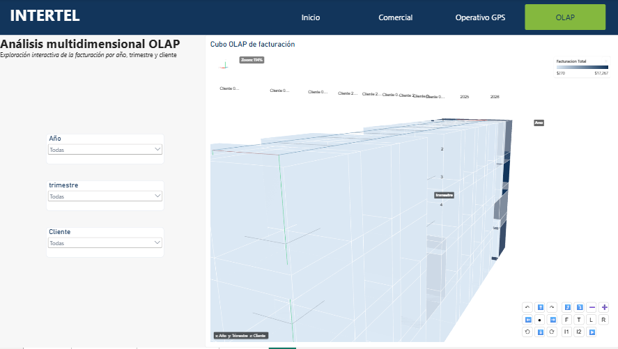
-->

*Dashboard final — Análisis multidimensional OLAP.*

## 10. Análisis OLAP

### 10.1. Operaciones implementadas mediante SQL (ROLAP)

El análisis multidimensional se realiza sobre las tablas relacionales de PostgreSQL mediante el script `06_intertel_consultas_olap.sql`. No se implementó un servidor MOLAP independiente. `ROLLUP`, `CUBE` y `GROUPING SETS` generan agregaciones a distintos niveles; `GROUPING` permite distinguir las filas agregadas de los valores nulos reales.

| Operación | Bloque | Aplicación al negocio |
|---|---|---|
| Roll-up | OLAP01 | Resumir mes, trimestre, año y total general |
| Drill-down | OLAP02 | Desglosar 2026 desde año hacia trimestre y mes |
| Slice | OLAP03 | Analizar exclusivamente 2026 |
| Dice | OLAP04 | Combinar años, meses y estados de catálogo |
| Pivot | OLAP05 | Comparar años en columnas y meses en filas (enero–octubre) |
| Cube | OLAP06 | Obtener combinaciones y subtotales de grupo y estado GPS |
| Grouping sets | OLAP07 | Seleccionar agrupaciones por año, estado y total |

<details><summary>OLAP01 — Roll-up: consulta y resultado</summary>

```sql
-- OLAP01 | ROLL-UP: facturación desde mes a trimestre, año y total general.
SELECT d.anio, d.trimestre, d.mes,
       CASE GROUPING(d.anio, d.trimestre, d.mes)
         WHEN 0 THEN 'MES' WHEN 1 THEN 'TRIMESTRE'
         WHEN 3 THEN 'AÑO' WHEN 7 THEN 'TOTAL GENERAL' END AS nivel,
       SUM(f.valor_facturado) AS total_facturado,
       COUNT(*) AS facturas
FROM dw.fact_facturacion f JOIN dw.dim_fecha d USING (fecha_sk)
GROUP BY ROLLUP (d.anio, d.trimestre, d.mes)
ORDER BY d.anio NULLS LAST, d.trimestre NULLS LAST, d.mes NULLS LAST;
```

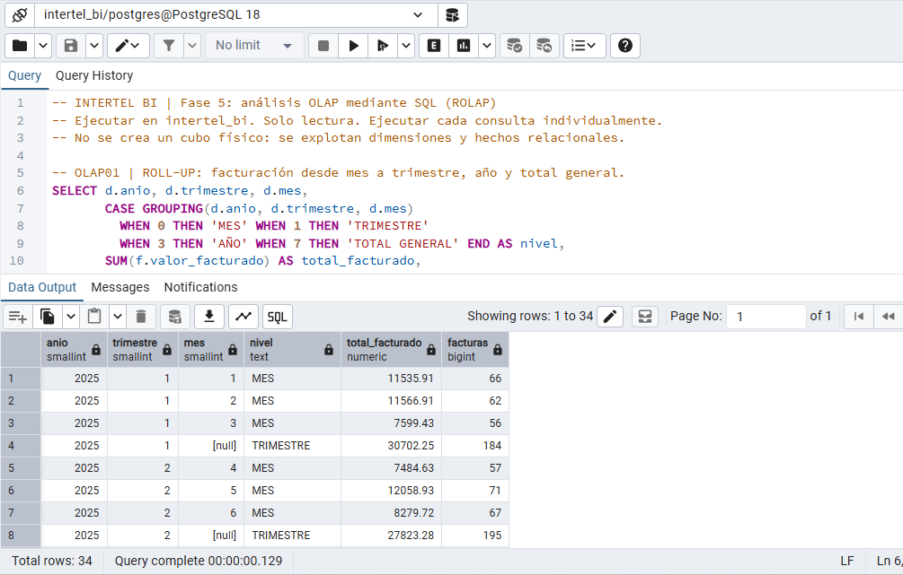

*Roll-up ejecutado en PostgreSQL.*

</details>

<details><summary>OLAP02 — Drill-down: consulta y resultado</summary>

```sql
-- OLAP02 | DRILL-DOWN: partir del total anual 2026 y abrirlo por trimestre/mes.
-- Ejecutar las tres consultas en orden; para bajar a día, consultar d.fecha.
SELECT d.anio, SUM(f.valor_facturado) AS total_facturado
FROM dw.fact_facturacion f JOIN dw.dim_fecha d USING (fecha_sk)
WHERE d.anio = 2026 GROUP BY d.anio;

SELECT d.anio, d.trimestre, SUM(f.valor_facturado) AS total_facturado
FROM dw.fact_facturacion f JOIN dw.dim_fecha d USING (fecha_sk)
WHERE d.anio = 2026 GROUP BY d.anio, d.trimestre ORDER BY d.trimestre;

SELECT d.anio, d.trimestre, d.mes, d.nombre_mes, SUM(f.valor_facturado) AS total_facturado
FROM dw.fact_facturacion f JOIN dw.dim_fecha d USING (fecha_sk)
WHERE d.anio = 2026 GROUP BY d.anio, d.trimestre, d.mes, d.nombre_mes ORDER BY d.mes;
```

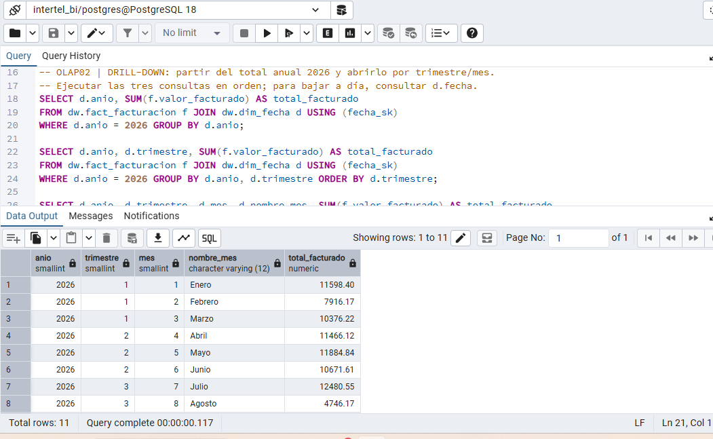

*Evidencia de Drill-down disponible en el repositorio.*

> **Captura pendiente:** Drill-down SQL — Nivel anual.
>
> Archivo: `Intertel_BI/docs/capturas/05_consultas_negocio/sql_olap_drilldown_anio.png`

<!-- Cuando se suba la captura, sustituir el bloque anterior por la línea siguiente, sin los delimitadores de comentario:

-->

*Drill-down SQL — Nivel anual.*

> **Captura pendiente:** Drill-down SQL — Nivel trimestral.
>
> Archivo: `Intertel_BI/docs/capturas/05_consultas_negocio/sql_olap_drilldown_trimestre.png`

<!-- Cuando se suba la captura, sustituir el bloque anterior por la línea siguiente, sin los delimitadores de comentario:

-->

*Drill-down SQL — Nivel trimestral.*

> **Captura pendiente:** Drill-down SQL — Nivel mensual.
>
> Archivo: `Intertel_BI/docs/capturas/05_consultas_negocio/sql_olap_drilldown_mes.png`

<!-- Cuando se suba la captura, sustituir el bloque anterior por la línea siguiente, sin los delimitadores de comentario:

-->

*Drill-down SQL — Nivel mensual.*

</details>

<details><summary>OLAP03 — Slice: consulta y resultado</summary>

```sql
-- OLAP03 | SLICE: fijar una dimensión (año 2026).
SELECT d.mes, d.nombre_mes, SUM(f.valor_facturado) AS total_facturado,
       COUNT(*) AS facturas
FROM dw.fact_facturacion f JOIN dw.dim_fecha d USING (fecha_sk)
WHERE d.anio = 2026
GROUP BY d.mes, d.nombre_mes ORDER BY d.mes;
```


*Slice ejecutado en PostgreSQL.*

</details>

<details><summary>OLAP04 — Dice: consulta y resultado</summary>

```sql
-- OLAP04 | DICE: seleccionar varios valores en dos dimensiones.
-- Meses octubre y noviembre, años 2025/2026 y estados del catálogo seleccionados.
-- Noviembre 2026 es parcial; no interpretar como comparación de meses completos.
SELECT d.anio, d.mes, c.estado_catalogo, SUM(f.valor_facturado) AS total_facturado,
       COUNT(*) AS facturas
FROM dw.fact_facturacion f
JOIN dw.dim_fecha d USING (fecha_sk)
JOIN dw.dim_cliente c USING (cliente_sk)
WHERE d.anio IN (2025, 2026) AND d.mes IN (10, 11)
  AND c.estado_catalogo IN ('COINCIDENCIA_UNICA', 'SIN_COINCIDENCIA')
GROUP BY d.anio, d.mes, c.estado_catalogo
ORDER BY d.anio, d.mes, c.estado_catalogo;
```

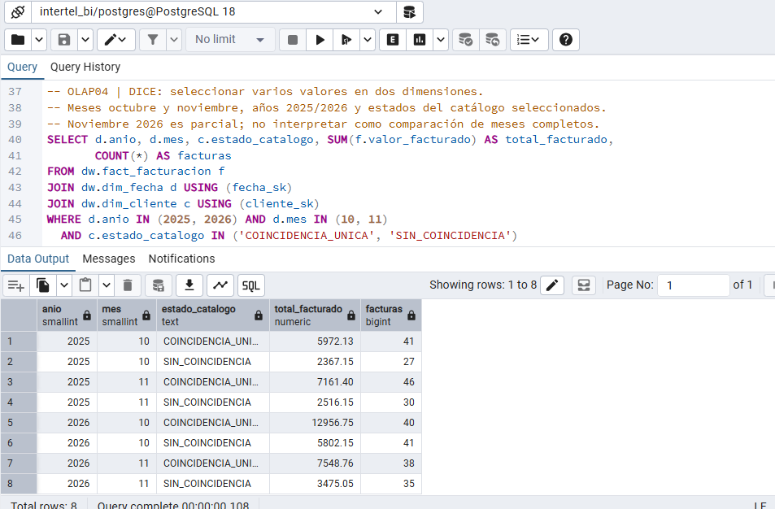

*Dice ejecutado en PostgreSQL.*

</details>

<details><summary>OLAP05 — Pivot: consulta y resultado</summary>

```sql
-- OLAP05 | PIVOT: poner los años en columnas, meses en filas.
-- Enero-octubre de ambos años para comparar períodos equivalentes.
SELECT d.mes, d.nombre_mes,
       SUM(f.valor_facturado) FILTER (WHERE d.anio = 2025) AS facturado_2025,
       SUM(f.valor_facturado) FILTER (WHERE d.anio = 2026) AS facturado_2026
FROM dw.fact_facturacion f JOIN dw.dim_fecha d USING (fecha_sk)
WHERE d.anio IN (2025, 2026) AND d.mes BETWEEN 1 AND 10
GROUP BY d.mes, d.nombre_mes ORDER BY d.mes;
```


*Pivot ejecutado en PostgreSQL.*

</details>

<details><summary>OLAP06 — Cube: consulta y resultado</summary>

```sql
-- OLAP06 | CUBE: todas las combinaciones de grupo y estado de datos GPS.
-- El filtro del reporte evita mezclar instantáneas de distintos días.
SELECT CASE WHEN GROUPING(g.grupo_sk) = 1 THEN 'TODOS LOS GRUPOS'
            ELSE g.nombre_grupo END AS grupo,
       CASE WHEN GROUPING(f.estado_datos) = 1 THEN 'TODOS LOS ESTADOS'
            ELSE f.estado_datos END AS estado,
       GROUPING(g.grupo_sk, f.estado_datos) AS nivel_agrupacion,
       COUNT(*) AS registros
FROM dw.fact_estado_gps f JOIN dw.dim_grupo g USING (grupo_sk)
WHERE f.fecha_reporte_sk = 20261119
GROUP BY CUBE ((g.grupo_sk, g.nombre_grupo), f.estado_datos)
ORDER BY nivel_agrupacion, grupo, estado;
```

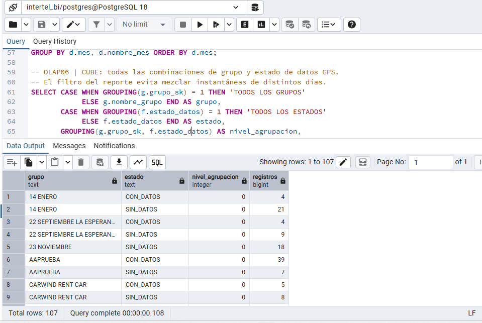

*Cube ejecutado en PostgreSQL.*

</details>

<details><summary>OLAP07 — Grouping sets: consulta y resultado</summary>

```sql
-- OLAP07 | GROUPING SETS: elegir explícitamente los niveles de agregación.
SELECT d.anio, c.estado_catalogo,
       CASE GROUPING(d.anio, c.estado_catalogo)
         WHEN 0 THEN 'AÑO Y ESTADO' WHEN 1 THEN 'AÑO'
         WHEN 2 THEN 'ESTADO' WHEN 3 THEN 'TOTAL GENERAL' END AS nivel,
       SUM(f.valor_facturado) AS total_facturado,
       COUNT(*) AS facturas
FROM dw.fact_facturacion f
JOIN dw.dim_fecha d USING (fecha_sk)
JOIN dw.dim_cliente c USING (cliente_sk)
GROUP BY GROUPING SETS ((d.anio, c.estado_catalogo), (d.anio), (c.estado_catalogo), ())
ORDER BY GROUPING(d.anio, c.estado_catalogo), d.anio, c.estado_catalogo;
```

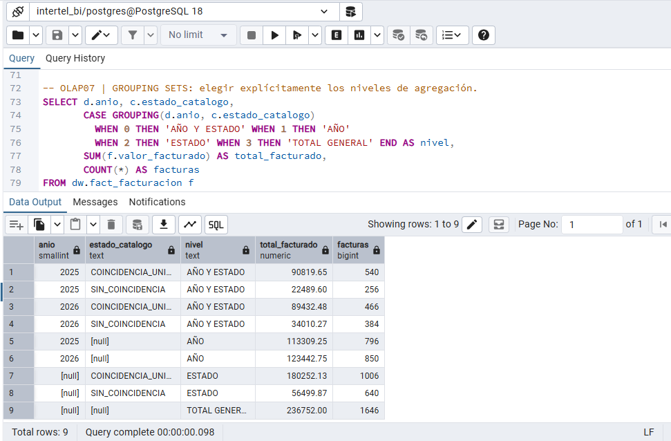

*Grouping sets ejecutado en PostgreSQL.*

</details>

### 10.2. Operaciones interactivas en Power BI

| Operación | Procedimiento | Interpretación |
|---|---|---|
| Drill-down | Comercial: activar exploración; seleccionar 2026, trimestre 3 y septiembre | Identificar períodos que explican cambios del total |
| Roll-up | Usar la flecha superior para regresar de fecha a mes, trimestre y año | Recuperar la visión agregada |
| Slice | Seleccionar únicamente 2026 en el segmentador Año | Analizar una sección temporal |
| Dice | Combinar año, trimestre y clientes con facturación | Comparar subconjuntos multidimensionales |
| Pivot | Intercambiar filas y columnas de la matriz o campos de los ejes X y Z del cubo | Cambiar la perspectiva sin modificar la medida |

En el análisis comercial, el tercer trimestre de 2026 acumula USD 29.746,68: julio USD 12.480,55, agosto USD 4.746,17 y septiembre USD 12.519,96. El Drill-down permite identificar agosto como el mes de menor facturación del trimestre; el Roll-up vuelve a mostrar el total trimestral. El ejemplo no demuestra por sí mismo las causas de la caída.

**Evidencias principales:**

> **Captura pendiente:** Drill-down: año a trimestre.
>
> Archivo: `Intertel_BI/docs/capturas/07_operaciones_olap/olap_drilldown_trimestre.png`

<!-- Cuando se suba la captura, sustituir el bloque anterior por la línea siguiente, sin los delimitadores de comentario:

-->

*Drill-down: año a trimestre.*

> **Captura pendiente:** Drill-down: trimestre a mes.
>
> Archivo: `Intertel_BI/docs/capturas/07_operaciones_olap/olap_drilldown_mes.png`

<!-- Cuando se suba la captura, sustituir el bloque anterior por la línea siguiente, sin los delimitadores de comentario:

-->

*Drill-down: trimestre a mes.*

> **Captura pendiente:** Roll-up: retorno al nivel anual.
>
> Archivo: `Intertel_BI/docs/capturas/07_operaciones_olap/olap_rollup_anual.png`

<!-- Cuando se suba la captura, sustituir el bloque anterior por la línea siguiente, sin los delimitadores de comentario:

-->

*Roll-up: retorno al nivel anual.*

> **Captura pendiente:** Slice: cubo filtrado por año.
>
> Archivo: `Intertel_BI/docs/capturas/07_operaciones_olap/cubo_olap_slice.png`

<!-- Cuando se suba la captura, sustituir el bloque anterior por la línea siguiente, sin los delimitadores de comentario:
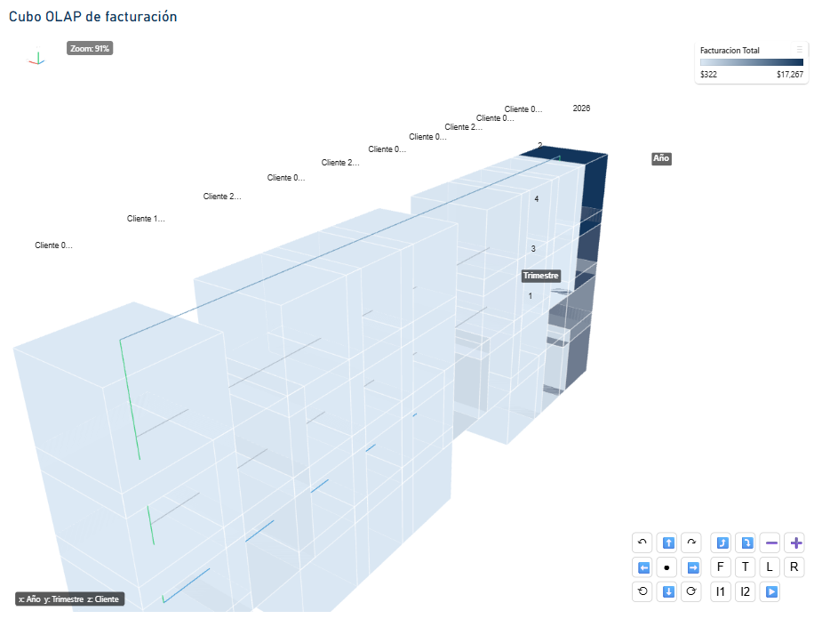
-->

*Slice: cubo filtrado por año.*

> **Captura pendiente:** Dice: combinación de filtros.
>
> Archivo: `Intertel_BI/docs/capturas/07_operaciones_olap/cubo_olap_dice.png`

<!-- Cuando se suba la captura, sustituir el bloque anterior por la línea siguiente, sin los delimitadores de comentario:
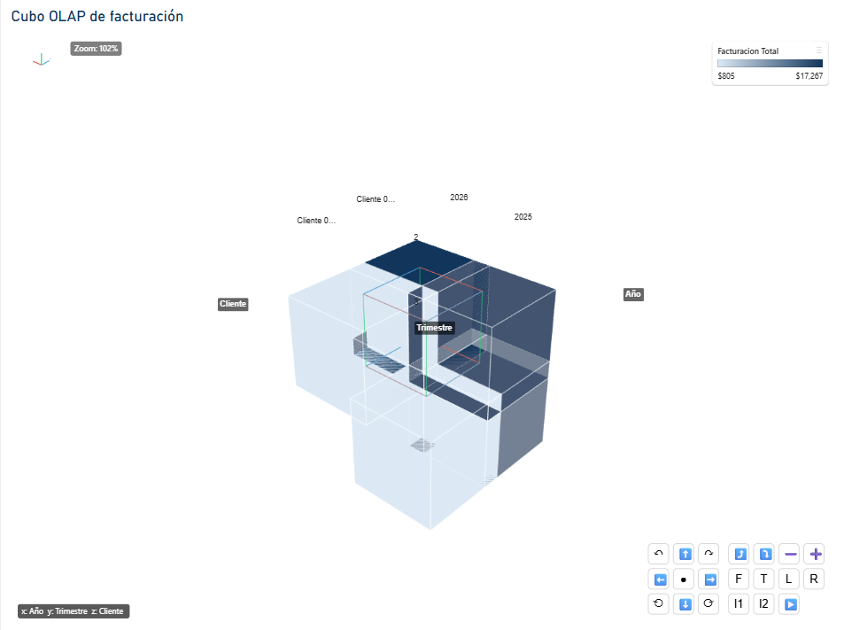
-->

*Dice: combinación de filtros.*

> **Captura pendiente:** Pivot: intercambio de dimensiones del cubo.
>
> Archivo: `Intertel_BI/docs/capturas/07_operaciones_olap/cubo_olap_pivot.png`

<!-- Cuando se suba la captura, sustituir el bloque anterior por la línea siguiente, sin los delimitadores de comentario:

-->

*Pivot: intercambio de dimensiones del cubo.*

<details><summary>Ver evidencias complementarias de las operaciones OLAP</summary>

> **Captura pendiente:** Nivel anual inicial.
>
> Archivo: `Intertel_BI/docs/capturas/07_operaciones_olap/olap_nivel_anual.png`

<!-- Cuando se suba la captura, sustituir el bloque anterior por la línea siguiente, sin los delimitadores de comentario:
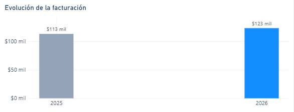
-->

*Nivel anual inicial.*

> **Captura pendiente:** Drill-down hasta fecha.
>
> Archivo: `Intertel_BI/docs/capturas/07_operaciones_olap/olap_drilldown_fecha.png`

<!-- Cuando se suba la captura, sustituir el bloque anterior por la línea siguiente, sin los delimitadores de comentario:

-->

*Drill-down hasta fecha.*

> **Captura pendiente:** Slice comercial.
>
> Archivo: `Intertel_BI/docs/capturas/07_operaciones_olap/olap_slice_comercial.png`

<!-- Cuando se suba la captura, sustituir el bloque anterior por la línea siguiente, sin los delimitadores de comentario:

-->

*Slice comercial.*

> **Captura pendiente:** Dice comercial.
>
> Archivo: `Intertel_BI/docs/capturas/07_operaciones_olap/olap_dice_comercial.png`

<!-- Cuando se suba la captura, sustituir el bloque anterior por la línea siguiente, sin los delimitadores de comentario:
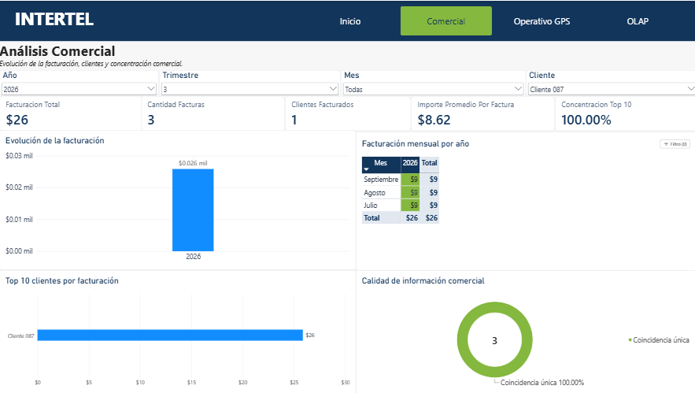
-->

*Dice comercial.*

> **Captura pendiente:** Matriz original: meses en filas.
>
> Archivo: `Intertel_BI/docs/capturas/07_operaciones_olap/olap_pivot_matriz_original.png`

<!-- Cuando se suba la captura, sustituir el bloque anterior por la línea siguiente, sin los delimitadores de comentario:

-->

*Matriz original: meses en filas.*

> **Captura pendiente:** Matriz con ejes intercambiados.
>
> Archivo: `Intertel_BI/docs/capturas/07_operaciones_olap/olap_pivot_matriz_transformada.png`

<!-- Cuando se suba la captura, sustituir el bloque anterior por la línea siguiente, sin los delimitadores de comentario:

-->

*Matriz con ejes intercambiados.*

> **Captura pendiente:** Slice operativo por grupo.
>
> Archivo: `Intertel_BI/docs/capturas/07_operaciones_olap/olap_slice_grupo_gps.png`

<!-- Cuando se suba la captura, sustituir el bloque anterior por la línea siguiente, sin los delimitadores de comentario:

-->

*Slice operativo por grupo.*

> **Captura pendiente:** Dice operativo por grupo, estado y antigüedad.
>
> Archivo: `Intertel_BI/docs/capturas/07_operaciones_olap/olap_dice_gps.png`

<!-- Cuando se suba la captura, sustituir el bloque anterior por la línea siguiente, sin los delimitadores de comentario:
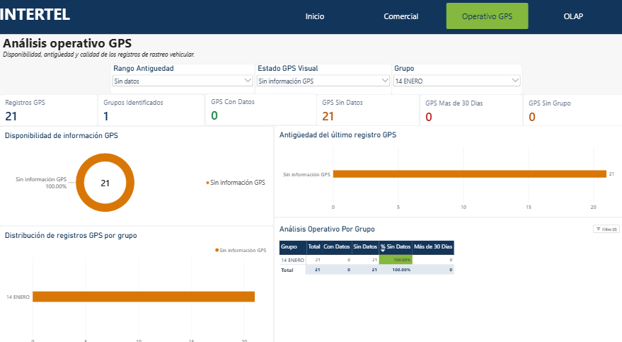
-->

*Dice operativo por grupo, estado y antigüedad.*

> **Captura pendiente:** Priorización por porcentaje de ausencia de información.
>
> Archivo: `Intertel_BI/docs/capturas/07_operaciones_olap/olap_priorizacion_grupos.png`

<!-- Cuando se suba la captura, sustituir el bloque anterior por la línea siguiente, sin los delimitadores de comentario:

-->

*Priorización por porcentaje de ausencia de información.*

> **Captura pendiente:** Cubo completo según el alcance de filtros.
>
> Archivo: `Intertel_BI/docs/capturas/07_operaciones_olap/cubo_olap_completo.png`

<!-- Cuando se suba la captura, sustituir el bloque anterior por la línea siguiente, sin los delimitadores de comentario:
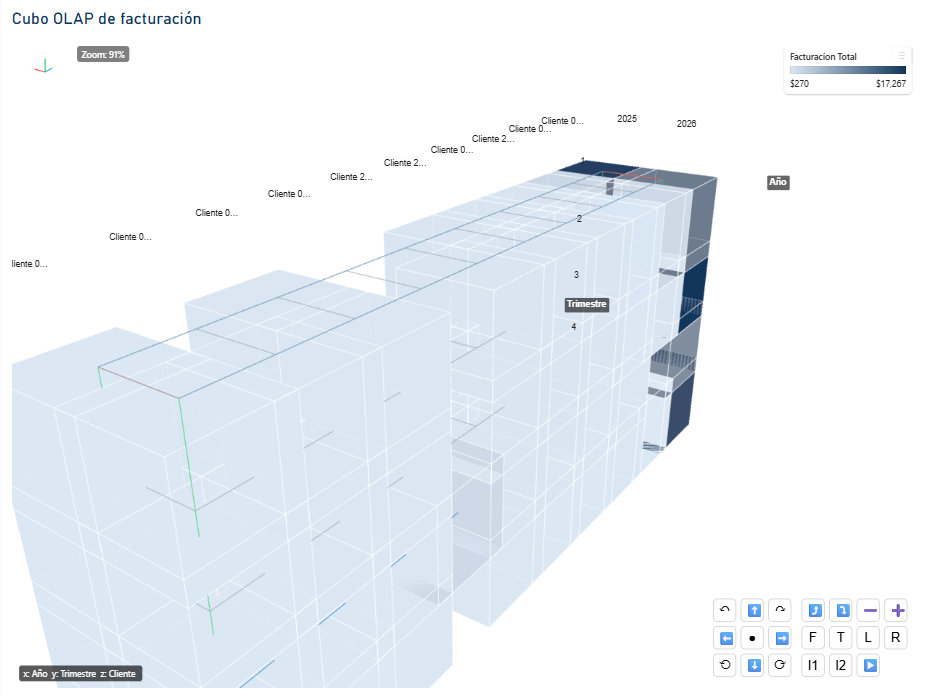
-->

*Cubo completo según el alcance de filtros.*

> **Captura pendiente:** Rotación tridimensional (ayuda visual).
>
> Archivo: `Intertel_BI/docs/capturas/07_operaciones_olap/cubo_olap_rotacion.png`

<!-- Cuando se suba la captura, sustituir el bloque anterior por la línea siguiente, sin los delimitadores de comentario:

-->

*Rotación tridimensional (ayuda visual).*

> **Captura pendiente:** Detalle de una celda del cubo.
>
> Archivo: `Intertel_BI/docs/capturas/07_operaciones_olap/cubo_olap_detalle_celda.png`

<!-- Cuando se suba la captura, sustituir el bloque anterior por la línea siguiente, sin los delimitadores de comentario:

-->

*Detalle de una celda del cubo.*

</details>

## 11. Insights y recomendaciones

| Hallazgo cuantitativo | Interpretación | Recomendación | Indicador de seguimiento |
|---|---|---|---|
| Facturación comparable +18,51 % | Mayor valor facturado enero–octubre de 2026 respecto a 2025 | Revisar composición de facturas y replicar prácticas comerciales que se confirmen efectivas | Variación interanual de períodos equivalentes |
| Octubre 2026 USD 18.758,90; agosto USD 4.746,17 | Diferencia relevante en los meses registrados | Investigar ciclos de facturación, renovaciones, instalaciones o faltantes de registros antes de atribuir causas | Facturación mensual y cobertura del archivo |
| Top 10: 70,46 % de facturación | Concentración en un grupo reducido de nombres facturados | Priorizar fidelización y evaluar diversificación; verificar identidades comerciales | Concentración Top 10 en períodos comparables |
| 480 de 666 registros sin información (72,07 %) | Baja disponibilidad de información en el reporte analizado | Confirmar alcance del reporte; revisar grupos con mayores volúmenes y proporciones, y contrastar con la plataforma | Proporción sin información por reporte y grupo |
| 105 de 186 con datos tienen más de 30 días (56,45 %) | Una parte relevante de los registros disponibles es antigua | Crear una cola de revisión por antigüedad y criticidad de servicio validada por Intertel | Registros mayores a 30 días / registros con datos |
| 640 facturas sin coincidencia (38,88 %) | Debilidad del vínculo por nombre con el catálogo | Usar identificador único y depurar homónimos, duplicados y discrepancias | Tasa de facturas con coincidencia inequívoca |
| 131 registros sin grupo; 45 sin dato SIM | Información administrativa incompleta | Completar identificadores y asignaciones en la fuente, con revisión de datos sensibles | Proporción de registros sin grupo o SIM |

### 11.1. Priorización sugerida

**Primero**, confirmar con el cliente qué representa el reporte GPS (por ejemplo, si es un listado de equipos fuera de línea o de un subconjunto), antes de generalizar el 72,07 % a la flota. Revisar los grupos con más registros sin información y con mayor antigüedad.

**Segundo**, mejorar el catálogo de clientes y el identificador común de facturación. La conciliación de importes debe mantenerse al corregir las correspondencias. La concentración comercial se interpreta sobre nombres normalizados y debe contrastarse con identidades verificadas.

**Tercero**, establecer un seguimiento mensual de facturación comparable, de concentración y de calidad de información. Definir metas y umbrales con Intertel, en lugar de considerar los rangos visuales como acuerdos de servicio.

## 12. Limitaciones y trabajo futuro

| Pregunta o análisis no resuelto | Información necesaria |
|---|---|
| Facturación y clientes por Cayambe, Quito u otra ciudad | Ciudad de cliente o contrato y vínculo verificable a facturación |
| Plan más contratado o más facturado | Suscripciones por cliente/dispositivo y detalle de factura vinculado a plan |
| Vehículos activos y cancelaciones | Historial de contratos, altas, bajas y estados de servicio |
| Rentabilidad | Costos de equipos, instalación, conectividad y operación |
| Cobros y morosidad | Pagos, vencimientos, saldos y estados de factura |
| Disponibilidad histórica real | Reportes sucesivos y alcance confirmado, identificadores estables de equipos |
| Recorridos o distancia por período | Definición de distancia, mediciones longitudinales y autorización correspondiente |

Como mejora futura se propone establecer exportaciones periódicas estandarizadas o acceso de solo lectura a los sistemas de origen, utilizar identificadores estables de clientes y dispositivos y agregar información contractual. Cuando existan nuevas fuentes autorizadas, podrán incorporarse dimensiones de plan, producto y geografía mediante relaciones válidas. También se recomienda implementar una estrategia transaccional de sustitución o carga incremental, pruebas automatizadas de duplicación, auditoría por fecha de reporte y programación del Job con actualización de Power BI. Estas ampliaciones no forman parte de los resultados demostrados en la entrega actual.

## 13. Conclusiones

1. Se implementó una solución de BI local que integra los archivos de Intertel en un Data Warehouse con dos procesos de negocio y cuatro dimensiones. El esquema de constelación respeta las distintas granularidades de facturación y GPS y evita vínculos sin soporte en las fuentes.
2. La automatización del ETL mediante nueve transformaciones y un Job de Pentaho permite reproducir la carga, aplicar reglas explícitas y registrar incidencias. Los conteos de carga y conciliación financiera permiten verificar la integridad de los resultados válidos.
3. Las consultas SQL y las páginas de Power BI permiten responder preguntas comerciales, operativas y de calidad. Los análisis muestran USD 236.752,00 facturados, un incremento comparable del 18,51 % y una concentración del 70,46 % en los diez principales nombres facturados.
4. La ausencia de información en el 72,07 % del reporte GPS y la antigüedad superior a 30 días de 105 registros permiten proponer prioridades de investigación, sin diagnosticar fallas ni extrapolar a toda la flota.
5. Las operaciones OLAP permiten cambiar niveles de detalle, filtrar subconjuntos y reorganizar dimensiones. El cubo tridimensional complementa, pero no sustituye, las consultas relacionales y las visualizaciones convencionales.
6. La calidad y disponibilidad de las fuentes condicionan el alcance de las conclusiones. La incorporación de identificadores únicos, detalle contractual y reportes históricos permitirá ampliar el análisis y fortalecer su utilidad para la toma de decisiones.

## 14. Bibliografía

- Escuela Politécnica Nacional, Facultad de Ingeniería de Sistemas. (2026). *Proyecto Primer Bimestre — Business Intelligence*. Instrucciones y rúbrica de evaluación de la asignatura.
- Intertel. (2026). *Catálogo de clientes, facturación, reporte de dispositivos GPS del 19 de noviembre y catálogo de planes de plataforma de rastreo vehicular*. Fuentes facilitadas para el proyecto académico; acceso restringido.
- Kimball, R., & Ross, M. (2013). *The Data Warehouse Toolkit: The Definitive Guide to Dimensional Modeling* (3.ª ed.). Wiley.
- PostgreSQL Global Development Group. (s. f.). *PostgreSQL documentation: Constraints*. https://www.postgresql.org/docs/current/ddl-constraints.html
- PostgreSQL Global Development Group. (s. f.). *PostgreSQL documentation: Table expressions (GROUPING SETS, CUBE, ROLLUP)*. https://www.postgresql.org/docs/current/queries-table-expressions.html
- Hitachi Vantara. (s. f.). *Pentaho documentation*. https://docs.pentaho.com/
- Microsoft. (s. f.). *Understand star schema and the importance for Power BI*. Microsoft Learn. https://learn.microsoft.com/en-us/power-bi/guidance/star-schema
- Microsoft. (s. f.). *PostgreSQL connector*. Microsoft Learn. https://learn.microsoft.com/en-us/power-query/connectors/postgresql
- Microsoft. (s. f.). *Data Analysis Expressions (DAX) reference*. Microsoft Learn. https://learn.microsoft.com/en-us/dax/
- Grupo B, Business Intelligence. (2026). *Repositorio de prácticas y proyecto*. https://github.com/Nestor-Sarmiento/business-intelligence-grupob