<p align="center">

  

</p>

<h1 align="center">Escuela Politécnica Nacional</h1>

<h2 align="center">Business Intelligence</h2>

**Curso:** GR2SW

**Integrantes:**

- Arroyo Juan

- Echeverría Gabriela

- Sarmiento Néstor

- Villavicencio Michelle

**Fecha:** 27/11/2026

---

## Índice

- [1. Descripción del negocio y problema](#seccion-1)
- [2. Objetivos](#seccion-2)
  - [2.1. Objetivo general](#seccion-3)
  - [2.2. Objetivos específicos](#seccion-4)
- [3. Fuentes de datos y problemas encontrados](#seccion-5)
  - [3.1. Fuentes de datos utilizadas](#seccion-6)
  - [3.2. Problemas encontrados y tratamiento](#seccion-7)
- [4. Preguntas de negocio](#seccion-8)
- [5. Arquitectura y modelo dimensional](#seccion-9)
  - [5.1. Arquitectura del Data Warehouse](#seccion-10)
  - [5.2. Justificación del esquema de constelación](#seccion-11)
  - [5.3. Granularidad y medidas](#seccion-12)
  - [5.4. Dimensiones y jerarquías](#seccion-13)
  - [5.5. Implementación física en PostgreSQL](#seccion-14)
- [6. Transformaciones y flujo ETL](#seccion-15)
  - [6.1. Configuración y extracción](#seccion-16)
  - [6.2. Transformaciones aplicadas](#seccion-17)
  - [6.3. Transformaciones de Pentaho](#seccion-18)
    - [01_staging_clientes](#seccion-19)
    - [02_staging_facturacion](#seccion-20)
    - [03_staging_gps](#seccion-21)
    - [04_dim_fecha](#seccion-22)
    - [05_dim_cliente](#seccion-23)
    - [06_dim_dispositivo](#seccion-24)
    - [07_dim_grupo](#seccion-25)
    - [08_fact_facturacion](#seccion-26)
    - [09_fact_estado_gps](#seccion-27)
  - [6.4. Job principal Intertel_ETL](#seccion-28)
- [7. Validación y calidad de datos](#seccion-29)
  - [7.1. Conteos y reconciliación](#seccion-30)
  - [7.2. Integridad y consistencia](#seccion-31)
  - [7.3. Resultados de calidad y auditoría](#seccion-32)
- [8. Consultas SQL y resultados](#seccion-33)
  - [8.1. Resumen de resultados comerciales](#seccion-34)
  - [8.2. Resumen de resultados operativos](#seccion-35)
  - [8.3. Detalle de consultas y trazabilidad](#seccion-36)
    - [PN01. ¿Cuánto se ha facturado por año, trimestre y mes?](#seccion-37)
    - [PN02. ¿Cómo evolucionó la facturación entre enero y octubre de 2025 y 2026?](#seccion-38)
    - [PN03. ¿Cuáles son los diez clientes facturados con mayor importe?](#seccion-39)
    - [PN04. ¿Qué porcentaje de facturación corresponde a los diez principales clientes?](#seccion-40)
    - [PN05. ¿Cuál es el importe promedio de una factura?](#seccion-41)
    - [PN06. ¿Cuántos nombres de clientes diferentes registran facturación cada mes?](#seccion-42)
    - [PN07. ¿Qué meses tienen mayor y menor facturación?](#seccion-43)
    - [PN08. ¿Con qué frecuencia se emiten facturas por nombre de cliente?](#seccion-44)
    - [PN09. ¿Cuántos registros y claves de dispositivo aparecen en el reporte?](#seccion-45)
    - [PN10. ¿Qué grupos concentran más registros de dispositivos?](#seccion-46)
    - [PN11. ¿Qué proporción de registros tiene información GPS disponible?](#seccion-47)
    - [PN12. ¿Qué grupos presentan más registros sin datos y qué proporción representan?](#seccion-48)
    - [PN13. ¿Cuál es la antigüedad de la información GPS disponible?](#seccion-49)
    - [PN14. ¿Qué grupos requieren revisión por registros con más de 30 días de antigüedad?](#seccion-50)
    - [PN15. ¿Cuántos registros cuentan con coordenadas válidas?](#seccion-51)
    - [PN16. ¿Qué proporción de facturas no coincide por nombre con el catálogo?](#seccion-52)
    - [PN17. ¿Cuántos registros GPS carecen de grupo o SIM?](#seccion-53)
    - [PN18. ¿Qué incidencias de calidad fueron detectadas en la última carga exitosa?](#seccion-54)
- [9. Implementación y dashboards en Power BI](#seccion-55)
  - [9.1. Conexión y modelo semántico](#seccion-56)
  - [9.2. Medidas e indicadores](#seccion-57)
    - [9.2.1. Medidas comerciales](#seccion-58)
      - [Cantidad Facturas](#seccion-59)
      - [Clientes Facturados](#seccion-60)
      - [Ticket Promedio](#seccion-61)
      - [Crecimiento Interanual](#seccion-62)
      - [Concentracion Top 10](#seccion-63)
      - [Facturas Sin Coincidencia](#seccion-64)
      - [Porcentaje Facturas Sin Coincidencia](#seccion-65)
    - [9.2.2. Medidas operativas GPS](#seccion-66)
  - [9.3. Diseño UI/UX](#seccion-67)
  - [9.4. Página 01 — Resumen ejecutivo](#seccion-68)
  - [9.5. Página 02 — Análisis comercial](#seccion-69)
  - [9.6. Página 03 — Análisis operativo GPS](#seccion-70)
  - [9.7. Página 04 — Análisis multidimensional OLAP](#seccion-71)
- [10. Análisis OLAP](#seccion-72)
  - [10.1. Operaciones implementadas mediante SQL (ROLAP)](#seccion-73)
  - [10.2. Operaciones interactivas en Power BI](#seccion-74)
- [11. Insights y recomendaciones](#seccion-75)
  - [11.1. Priorización sugerida](#seccion-76)
- [12. Limitaciones y trabajo futuro](#seccion-77)
- [13. Conclusiones](#seccion-78)
- [14. Bibliografía](#seccion-79)

- [Índice de figuras](#indice-de-figuras)

<a name="indice-de-figuras"></a>
## Índice de figuras

- [Figura 1. Arquitectura del Data Warehouse](#figura-1)
- [Figura 2. Modelo lógico de constelación](#figura-2)
- [Figura 3. Modelo de constelación implementado en PostgreSQL](#figura-3)
- [Figura 4. Base de datos intertel_bi](#figura-4)
- [Figura 5. Esquemas staging, dw y audit](#figura-5)
- [Figura 6. Tablas de staging](#figura-6)
- [Figura 7. Dimensiones](#figura-7)
- [Figura 8. Tablas de hechos](#figura-8)
- [Figura 9. Tablas de auditoría](#figura-9)
- [Figura 10. Restricciones de claves primarias y foráneas](#figura-10)
- [Figura 11. Conexión JDBC de Pentaho a PostgreSQL (sin credenciales)](#figura-11)
- [Figura 12. Parametrización de rutas de archivos](#figura-12)
- [Figura 13. Transformación 01_staging_clientes en Pentaho](#figura-13)
- [Figura 14. Transformación 02_staging_facturacion en Pentaho](#figura-14)
- [Figura 15. Transformación 03_staging_gps en Pentaho](#figura-15)
- [Figura 16. Transformación 04_dim_fecha en Pentaho](#figura-16)
- [Figura 17. Transformación 05_dim_cliente en Pentaho](#figura-17)
- [Figura 18. Transformación 06_dim_dispositivo en Pentaho](#figura-18)
- [Figura 19. Transformación 09_fact_estado_gps en Pentaho](#figura-19)
- [Figura 20. Flujo del Job Intertel_ETL](#figura-20)
- [Figura 21. Job principal con transformaciones y rutas de control](#figura-21)
- [Figura 22. Validación integral de la carga dimensional](#figura-22)
- [Figura 23. Validación de consistencia de fechas y antigüedad GPS](#figura-23)
- [Figura 24. Incidencias detectadas en la última carga exitosa](#figura-24)
- [Figura 25. Historial de ejecuciones del ETL](#figura-25)
- [Figura 26. Conteos de staging](#figura-26)
- [Figura 27. Conteos de dimensiones](#figura-27)
- [Figura 28. Conteos de tablas de hechos](#figura-28)
- [Figura 29. Coincidencias por nombre en el catálogo](#figura-29)
- [Figura 30. Disponibilidad de información SIM](#figura-30)
- [Figura 31. PN01 — Facturación por período](#figura-31)
- [Figura 32. PN02 — Crecimiento interanual](#figura-32)
- [Figura 33. PN03 — Top 10 de clientes](#figura-33)
- [Figura 34. PN04 — Concentración comercial](#figura-34)
- [Figura 35. PN05 — Ticket promedio](#figura-35)
- [Figura 36. PN06 — Clientes facturados por mes](#figura-36)
- [Figura 37. PN07 — Mayor y menor facturación](#figura-37)
- [Figura 38. PN08 — Frecuencia de facturación](#figura-38)
- [Figura 39. PN09 — Total de registros GPS](#figura-39)
- [Figura 40. PN10 — Dispositivos por grupo](#figura-40)
- [Figura 41. PN11 — Disponibilidad GPS](#figura-41)
- [Figura 42. PN12 — Grupos sin datos](#figura-42)
- [Figura 43. PN13 — Antigüedad de registros GPS](#figura-43)
- [Figura 44. PN14 — Grupos con registros antiguos](#figura-44)
- [Figura 45. PN15 — Posiciones GPS válidas](#figura-45)
- [Figura 46. PN16 — Facturas sin coincidencia](#figura-46)
- [Figura 47. PN17 — Registros sin grupo o SIM](#figura-47)
- [Figura 48. PN18 — Incidencias de calidad](#figura-48)
- [Figura 49. Conexión a PostgreSQL en Power BI](#figura-49)
- [Figura 50. Modelo semántico y cardinalidades](#figura-50)
- [Figura 51. Jerarquía temporal](#figura-51)
- [Figura 52. Medida DAX Facturacion Total](#figura-52)
- [Figura 53. Dashboard final — Resumen ejecutivo](#figura-53)
- [Figura 54. Dashboard final — Análisis comercial](#figura-54)
- [Figura 55. Dashboard final — Análisis operativo GPS](#figura-55)
- [Figura 56. Dashboard final — Análisis multidimensional OLAP](#figura-56)
- [Figura 57. Roll-up ejecutado en PostgreSQL](#figura-57)
- [Figura 58. Drill-down en PostgreSQL](#figura-58)
- [Figura 59. Slice ejecutado en PostgreSQL](#figura-59)
- [Figura 60. Dice ejecutado en PostgreSQL](#figura-60)
- [Figura 61. Pivot ejecutado en PostgreSQL](#figura-61)
- [Figura 62. Cube ejecutado en PostgreSQL](#figura-62)
- [Figura 63. Grouping sets ejecutado en PostgreSQL](#figura-63)
- [Figura 64. Drill-down: año a trimestre](#figura-64)
- [Figura 65. Drill-down: trimestre a mes](#figura-65)
- [Figura 66. Roll-up: retorno al nivel anual](#figura-66)
- [Figura 67. Slice: cubo filtrado por año](#figura-67)
- [Figura 68. Dice: combinación de filtros](#figura-68)
- [Figura 69. Nivel anual inicial](#figura-69)
- [Figura 70. Drill-down hasta fecha](#figura-70)
- [Figura 71. Slice comercial](#figura-71)
- [Figura 72. Dice comercial](#figura-72)
- [Figura 73. Slice operativo por grupo](#figura-73)
- [Figura 74. Dice operativo por grupo, estado y antigüedad](#figura-74)
- [Figura 75. Priorización por porcentaje de ausencia de información](#figura-75)
- [Figura 76. Cubo completo según el alcance de filtros](#figura-76)
- [Figura 77. Detalle de una celda del cubo](#figura-77)

---

<a name="seccion-1"></a>
## 1. Descripción del negocio y problema

Intertel ofrece servicios de localización y rastreo vehicular mediante GPS y comercializa planes de acceso a su plataforma. Durante la reunión inicial, el cliente indicó que atiende principalmente a cooperativas, que gestiona aproximadamente 700 vehículos y que su actividad se concentra en Cayambe y, en segundo lugar, Quito. Estas afirmaciones corresponden al contexto proporcionado por la empresa, no a indicadores geográficos verificados mediante el Data Warehouse.

La información comercial y operativa se encuentra dispersa en archivos exportados o preparados manualmente. La facturación contiene el valor total de cada documento, pero no sus líneas de detalle. Tampoco existe un identificador común confiable entre facturas, clientes, dispositivos, planes y ciudades. Por lo tanto, obtener tendencias comerciales o identificar grupos con información GPS incompleta requiere consolidación, depuración y análisis.

**Problema:** ausencia de una estructura integrada y reproducible que permita consultar indicadores comerciales y operativos, identificar deficiencias en los datos y apoyar decisiones de gestión.

**Alcance:** análisis descriptivo de las facturas de la hoja principal de 2025–2026 y de la instantánea GPS del 19/11/2026. El proyecto se implementa localmente y no constituye un sistema de monitoreo GPS en tiempo real.

<a name="seccion-2"></a>
## 2. Objetivos

<a name="seccion-3"></a>
### 2.1. Objetivo general

Desarrollar una solución de Business Intelligence para Intertel que integre, depure y analice datos comerciales y operativos mediante Pentaho, PostgreSQL y Power BI, con el fin de responder preguntas de negocio y apoyar la toma de decisiones.

<a name="seccion-4"></a>
### 2.2. Objetivos específicos

- Identificar las fuentes disponibles, sus limitaciones y las preguntas de negocio que pueden responderse.
- Diseñar e implementar un modelo dimensional con granularidad explícita, dimensiones conformadas y restricciones de integridad.
- Automatizar la extracción, transformación y carga mediante transformaciones y un Job de Pentaho, con auditoría de ejecuciones e incidencias.
- Validar la consistencia, los conteos y la conciliación de importes entre el origen limpio y el destino.
- Elaborar consultas SQL y visualizaciones interactivas que permitan análisis comercial, operativo y multidimensional.
- Formular recomendaciones sustentadas en los resultados y distinguir las conclusiones verificadas de las hipótesis que requieren información adicional.

<a name="seccion-5"></a>
## 3. Fuentes de datos y problemas encontrados

<a name="seccion-6"></a>
### 3.1. Fuentes de datos utilizadas

| Fuente | Contenido | Filas cargadas en staging | Uso |
|---|---|---:|---|
| `CLIENTES INTERTEL.xlsx` | Código, nombre, RUC | 93 | Catálogo de referencia para identificar coincidencias por nombre |
| `FACTURACION INTERTEL.xlsx` | Número de factura, nombre, total, fecha | 1.651 | Análisis de facturación; se procesa la hoja principal |
| `offline_device_report_2026_11_19.xls` | Dispositivo, grupo, SIM, hora, posición, velocidad, altitud, ángulo, duración, distancia, odómetro y horas del motor | 666 | Instantánea operativa y calidad de datos GPS |
| `PLANES DE PLATAFORMA DE RASTREO VEHICULAR GPS.docx` | Planes Básico, Plus y Premium, tarifas y prestaciones | No aplica | Contexto comercial; sin relación individual con facturas o suscripciones |

La hoja de cálculo de facturación contiene otras hojas; el alcance del ETL se restringió a la hoja principal seleccionada. Los conteos de staging no son necesariamente los conteos físicos de todas las filas de Excel, debido a encabezados, filas vacías y hojas excluidas. No se incorporaron las otras hojas sin validar su propósito y posibles solapamientos. La estructura de las fuentes se documenta en las tablas anteriores y se materializa en las transformaciones y scripts del repositorio; no se reproducen capturas de los datos de origen.

| Plan | Mensual (USD) | Anual (USD) | Instalación (USD) |
|---|---:|---:|---:|
| Básico | 9,90 | 118,80 | 39,00 |
| Plus | 12,90 | 154,80 | 39,00 |
| Premium | 14,50 | 174,00 | 39,00 |

Las tarifas son las del documento suministrado, no precios inferidos de la facturación. No es válido deducir el plan de una factura por similitud de importe: puede incluir instalaciones, otros cargos o acuerdos particulares.

<a name="seccion-7"></a>
### 3.2. Problemas encontrados y tratamiento

| Problema | Tratamiento | Consecuencia analítica |
|---|---|---|
| Nombres con diferencias de escritura | Normalización de mayúsculas, acentos y espacios | Coincidencia textual, no identidad legal verificada |
| Facturas sin correspondencia en catálogo | Conservar factura válida y clasificar `SIN_COINCIDENCIA` | Evitar pérdida de importes válidos |
| Coincidencia múltiple | Clasificar `COINCIDENCIA_MULTIPLE`; no asignar código arbitrario | No confundir homónimos con identidad cierta |
| Número o importe inválido | Validación y rechazo, conservando regla y fila de origen | Cinco filas rechazadas en la carga observada |
| Formatos de fecha y número | Funciones de conversión explícitas; no interpretar formatos ambiguos | Fechas e importes consistentes |
| GPS sin hora o mensaje de ausencia de resultados | Clasificar `SIN_DATOS` | Ausencia de información, no diagnóstico de falla |
| Fecha GPS futura o no interpretable | Clasificar `FECHA_INVALIDA` y no calcular antigüedad | No inventar fecha válida |
| Grupo faltante | Miembro `SIN GRUPO` | Conservar registro para análisis de calidad |
| SIM ausente | Indicador `tiene_sim = false` y clave provisional por reporte/fila | No afirmar identidad persistente del equipo |
| Coordenadas ausentes o inválidas | Validar rangos de latitud/longitud y guardar indicador booleano | No exponer ubicación ni inferir ciudad |
| Datos sin detalle de planes, pagos o contratos | Excluir dimensiones y métricas que no pueden relacionarse | Evitar resultados especulativos |

<a name="seccion-8"></a>
## 4. Preguntas de negocio

Las preguntas se organizan en tres áreas. La numeración corresponde al script `05_intertel_consultas_negocio.sql` y se mantiene en las evidencias para asegurar trazabilidad.

| ID | Pregunta | Área | Evidencia de respuesta |
|---|---|---|---|
| PN01 | ¿Cuánto se ha facturado por año, trimestre y mes? | Comercial | Evolución temporal y matriz |
| PN02 | ¿Cómo evolucionó la facturación entre enero y octubre de 2025 y 2026? | Comercial | Inicio: crecimiento interanual |
| PN03 | ¿Cuáles son los diez clientes facturados con mayor importe? | Comercial | Ranking Top 10 |
| PN04 | ¿Qué porcentaje de facturación corresponde a los diez principales clientes? | Comercial | Tarjeta concentración Top 10 |
| PN05 | ¿Cuál es el importe promedio de una factura? | Comercial | Inicio y Comercial: ticket promedio |
| PN06 | ¿Cuántos nombres de clientes diferentes registran facturación cada mes? | Comercial | Clientes facturados + filtros |
| PN07 | ¿Qué meses tienen mayor y menor facturación? | Comercial | Gráfico mensual y matriz |
| PN08 | ¿Con qué frecuencia se emiten facturas por nombre de cliente? | Comercial | Consulta SQL y tooltip de ranking |
| PN09 | ¿Cuántos registros y claves de dispositivo aparecen en el reporte? | Operativo | Tarjetas GPS y grupos |
| PN10 | ¿Qué grupos concentran más registros de dispositivos? | Operativo | Barras por grupo |
| PN11 | ¿Qué proporción de registros tiene información GPS disponible? | Operativo | Anillo de disponibilidad |
| PN12 | ¿Qué grupos presentan más registros sin datos y qué proporción representan? | Operativo | Matriz y barras apiladas |
| PN13 | ¿Cuál es la antigüedad de la información GPS disponible? | Operativo | Gráfico de antigüedad |
| PN14 | ¿Qué grupos requieren revisión por registros con más de 30 días de antigüedad? | Operativo | Matriz y segmentadores |
| PN15 | ¿Cuántos registros cuentan con coordenadas válidas? | Operativo | Consulta SQL / GPS Con Posicion |
| PN16 | ¿Qué proporción de facturas no coincide por nombre con el catálogo? | Calidad | Anillo de calidad comercial |
| PN17 | ¿Cuántos registros GPS carecen de grupo o SIM? | Calidad | Tarjetas GPS y consulta SQL |

<a name="seccion-9"></a>
## 5. Arquitectura y modelo dimensional

<a name="seccion-10"></a>
### 5.1. Arquitectura del Data Warehouse

Se adoptó una arquitectura local de tres capas en PostgreSQL: `staging` conserva la estructura de los archivos, `dw` contiene los hechos y dimensiones, y `audit` registra ejecuciones e incidencias. Pentaho orquesta la extracción y la carga; las funciones y vistas SQL realizan parte de las transformaciones. Power BI consume el modelo dimensional y aporta una capa semántica con relaciones, medidas y filtros.

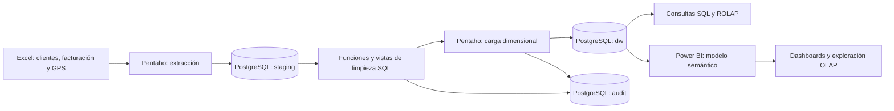

<a name="figura-1"></a>
<p align="center"><strong>Figura 1. Arquitectura del Data Warehouse</strong></p>
<p align="center"><em>Flujo de información desde los Excel, Pentaho y PostgreSQL hasta Power BI y las consultas SQL.</em></p>

El catálogo de planes se emplea como contexto de negocio, no como una entrada del flujo de carga dimensional.

<a name="seccion-11"></a>
### 5.2. Justificación del esquema de constelación

La solución integra dos procesos de negocio con granos diferentes: facturación y estado de los registros GPS. Un modelo estrella único mezclaría facturas y registros operativos o forzaría relaciones sin respaldo en los archivos. Por ello se definieron dos tablas de hechos que comparten la dimensión fecha, conformando una constelación de hechos. Las dimensiones específicas se mantienen separadas para evitar multiplicación de filas y agregaciones incorrectas.

La dimensión `dim_fecha` cumple tres roles: fecha de factura, fecha de reporte y fecha del último registro GPS. Los dos últimos corresponden a relaciones distintas hacia la misma dimensión. No se crea una relación directa entre ambas tablas de hechos ni se asume que un grupo GPS corresponde a un cliente de facturación.

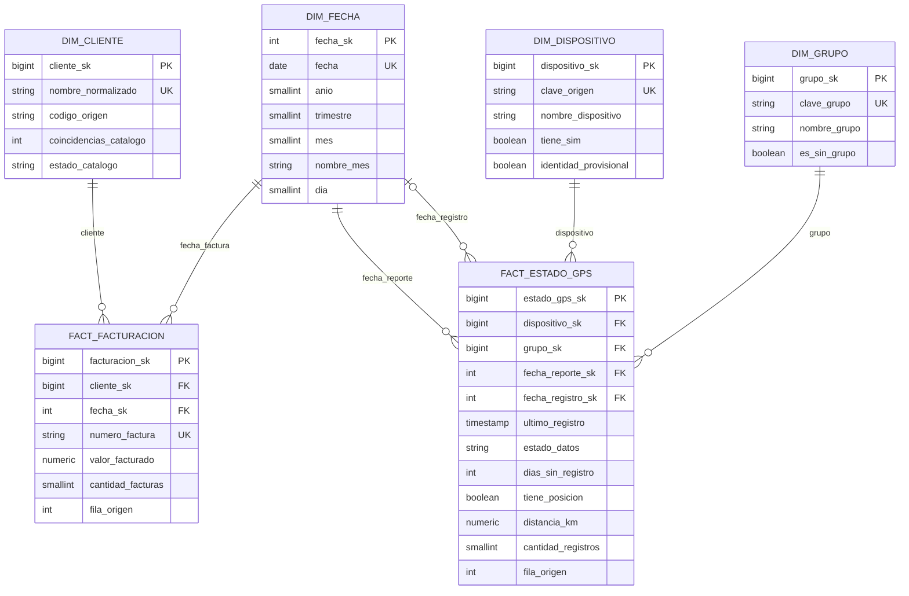

<a name="figura-2"></a>
<p align="center"><strong>Figura 2. Modelo lógico de constelación</strong></p>
<p align="center"><em>Relaciones de los dos hechos con las cuatro dimensiones y los distintos roles de fecha.</em></p>

<a name="figura-3"></a>
<p align="center">
  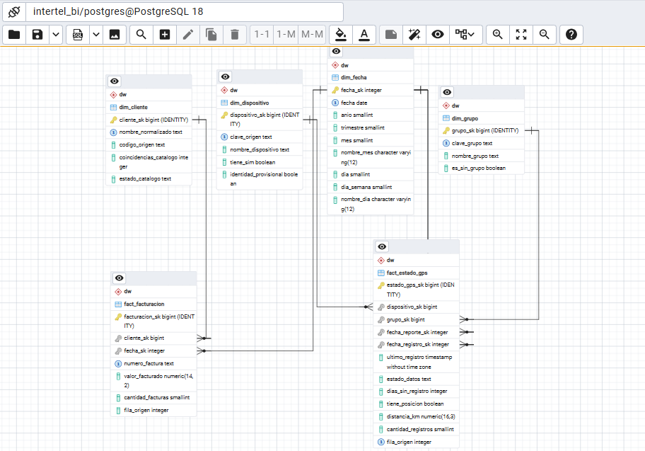
</p>
<p align="center"><strong>Figura 3. Modelo de constelación implementado en PostgreSQL</strong></p>
<p align="center"><em>Diagrama físico de la constelación con sus dimensiones y hechos relacionados.</em></p>

<a name="seccion-12"></a>
### 5.3. Granularidad y medidas

| Tabla de hechos | Granularidad | Medidas / atributos analíticos | Consideraciones |
|---|---|---|---|
| `dw.fact_facturacion` | Una fila por número de factura válido de la fuente principal | `valor_facturado`, `cantidad_facturas = 1` | Importe y cantidad aditivos; promedio y porcentajes se recalculan por contexto |
| `dw.fact_estado_gps` | Una fila por registro del reporte y fecha de extracción | `cantidad_registros = 1`, `dias_sin_registro`, `tiene_posicion`, `estado_datos`, `distancia_km` | Recuento aditivo dentro de una instantánea; no sumar antigüedad o distancia como si fueran flujos; no sumar instantáneas para contar vehículos únicos |

La facturación tiene granularidad de cabecera y no de detalle de productos, pues los archivos no contienen líneas de factura. La tabla GPS funciona como una instantánea periódica potencial; en la entrega solo existe una fecha de reporte analizada. La combinación `(fecha_reporte_sk, fila_origen)` impide duplicar la misma fila del reporte. `fecha_registro_sk` admite nulos cuando no existe fecha válida.

<a name="seccion-13"></a>
### 5.4. Dimensiones y jerarquías

| Dimensión | Clave primaria | Grano | Atributos principales | Filas |
|---|---|---|---|---:|
| `dim_fecha` | `fecha_sk` | Día calendario | Año, trimestre, mes, día, nombres de mes y día | 1.826 |
| `dim_cliente` | `cliente_sk` | Nombre normalizado | Código de origen cuando es inequívoco, coincidencias y estado de catálogo | 232 |
| `dim_dispositivo` | `dispositivo_sk` | Identidad provisional de dispositivo | Clave de origen, nombre, existencia de SIM | 666 |
| `dim_grupo` | `grupo_sk` | Grupo normalizado o miembro sin grupo | Nombre, clave y bandera sin grupo | 40 |

La jerarquía temporal es Año → Trimestre → Mes → Fecha. Se genera un calendario continuo entre 2022 y 2026 para cubrir las fechas de los reportes y facturas. Esto no implica que existan facturas en todos esos años. La clave fecha usa el formato AAAAMMDD; las demás dimensiones emplean claves sustitutas numéricas.

<a name="seccion-14"></a>
### 5.5. Implementación física en PostgreSQL

La base `intertel_bi` contiene once tablas: tres de staging, seis dimensionales y dos de auditoría. El DDL `01_intertel_modelo.sql` establece PK, FK, restricciones `UNIQUE`, `NOT NULL`, `CHECK` e índices de acceso para los hechos. El script `02_intertel_verificar.sql` consulta el catálogo de PostgreSQL para comprobar la estructura.

| Tabla de hechos | FK | Referencia | Nulabilidad |
|---|---|---|---|
| `fact_facturacion` | `cliente_sk` | `dim_cliente.cliente_sk` | No |
| `fact_facturacion` | `fecha_sk` | `dim_fecha.fecha_sk` | No |
| `fact_estado_gps` | `dispositivo_sk` | `dim_dispositivo.dispositivo_sk` | No |
| `fact_estado_gps` | `grupo_sk` | `dim_grupo.grupo_sk` | No |
| `fact_estado_gps` | `fecha_reporte_sk` | `dim_fecha.fecha_sk` | No |
| `fact_estado_gps` | `fecha_registro_sk` | `dim_fecha.fecha_sk` | Sí |

Las seis tablas del esquema `dw` tienen una PK cada una y seis FK en total. Auditoría incorpora adicionalmente una relación entre `incidencia_etl` y `ejecucion_etl`.

<a name="figura-4"></a>
<p align="center">
  
</p>
<p align="center"><strong>Figura 4. Base de datos intertel_bi</strong></p>
<p align="center"><em>Base de datos intertel_bi en pgAdmin y su estructura local.</em></p>

<a name="figura-5"></a>
<p align="center">
  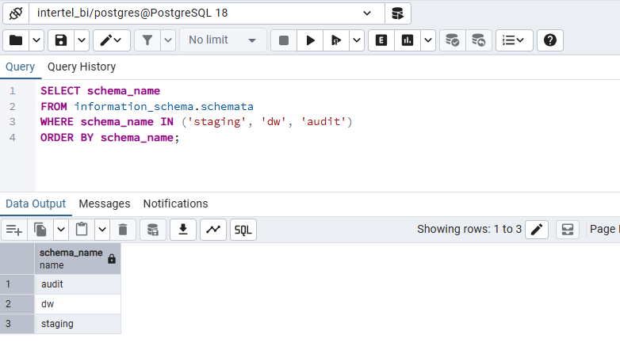
</p>
<p align="center"><strong>Figura 5. Esquemas staging, dw y audit</strong></p>
<p align="center"><em>Identificación de los esquemas staging, dw y audit.</em></p>

<a name="figura-6"></a>
<p align="center">
  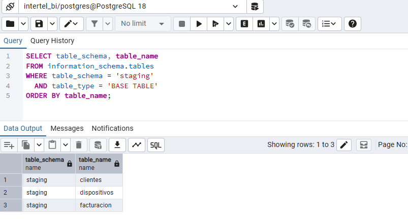
</p>
<p align="center"><strong>Figura 6. Tablas de staging</strong></p>
<p align="center"><em>Tablas receptoras de los tres archivos de origen.</em></p>

<a name="figura-7"></a>
<p align="center">
  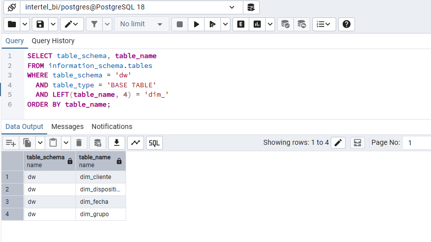
</p>
<p align="center"><strong>Figura 7. Dimensiones</strong></p>
<p align="center"><em>Dimensiones de fecha, cliente, dispositivo y grupo.</em></p>

<a name="figura-8"></a>
<p align="center">
  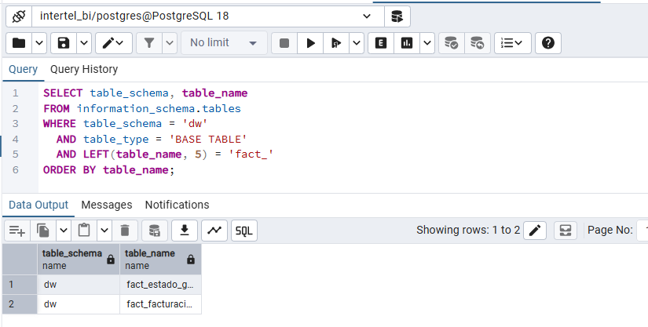
</p>
<p align="center"><strong>Figura 8. Tablas de hechos</strong></p>
<p align="center"><em>Tablas de hechos de facturación y estado GPS.</em></p>

<a name="figura-9"></a>
<p align="center">
  
</p>
<p align="center"><strong>Figura 9. Tablas de auditoría</strong></p>
<p align="center"><em>Tablas destinadas al control de ejecuciones e incidencias.</em></p>

<a name="figura-10"></a>
<p align="center">
  
</p>
<p align="center"><strong>Figura 10. Restricciones de claves primarias y foráneas</strong></p>
<p align="center"><em>Restricciones de claves primarias y foráneas del modelo dimensional.</em></p>

<a name="seccion-15"></a>
## 6. Transformaciones y flujo ETL

<a name="seccion-16"></a>
### 6.1. Configuración y extracción

Pentaho Data Integration (Spoon) se conecta a PostgreSQL por JDBC. Las rutas de archivos se parametrizan con `DIR_ORIGEN` para facilitar el traslado del proyecto entre equipos. Cada transformación de extracción utiliza Microsoft Excel Input, selecciona los campos necesarios y carga una tabla de staging, preservando `fila_origen` para la trazabilidad. Los campos de origen se mantienen como texto en staging antes de su conversión y validación.

La preparación local requiere PostgreSQL, Pentaho y los archivos autorizados. El modelo debe instalarse en una base vacía; para una base existente no se debe volver a inicializar ni eliminar información sin respaldo. La fecha del reporte se configura en `staging.v_config_reporte` y corresponde a la extracción, no a la ejecución del Job.

<a name="figura-11"></a>
<p align="center">
  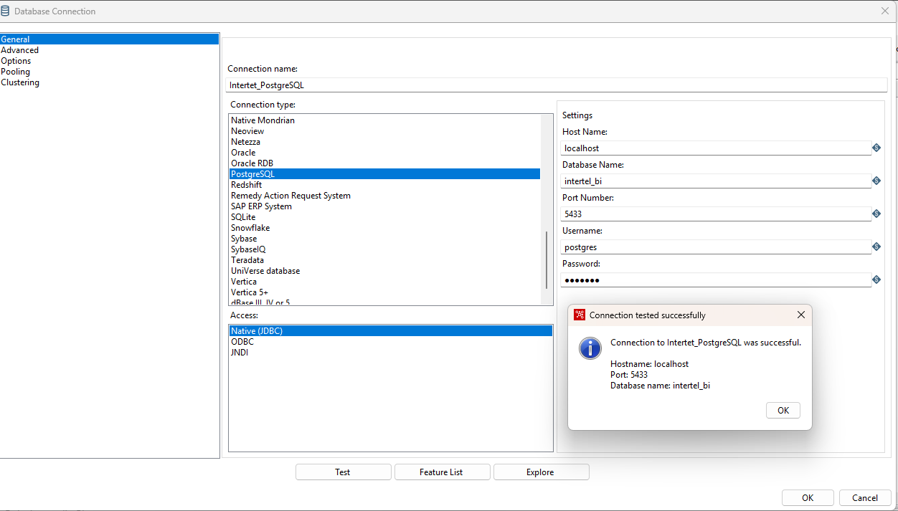
</p>
<p align="center"><strong>Figura 11. Conexión JDBC de Pentaho a PostgreSQL (sin credenciales)</strong></p>
<p align="center"><em>Configuración de acceso de Pentaho al motor PostgreSQL.</em></p>

<a name="figura-12"></a>
<p align="center">
  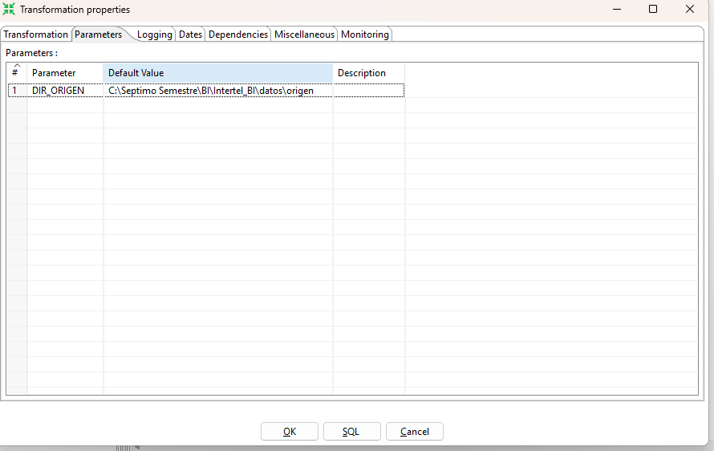
</p>
<p align="center"><strong>Figura 12. Parametrización de rutas de archivos</strong></p>
<p align="center"><em>Uso de variables para parametrizar la ubicación de los archivos de entrada.</em></p>

<a name="seccion-17"></a>
### 6.2. Transformaciones aplicadas

El script `03_intertel_transformaciones.sql` implementa funciones y vistas reutilizables, que Pentaho consulta con nodos Table Input para cargar las dimensiones y hechos. La separación permite inspeccionar las reglas en SQL y controlar la secuencia desde Spoon.

| Función / vista | Finalidad |
|---|---|
| `staging.normalizar_texto` | Mayúsculas, eliminación de acentos definidos y reducción de espacios |
| `staging.leer_timestamp` | Conversión controlada de fechas ISO o día-mes-año; nulo si son inválidas |
| `staging.leer_decimal` | Conversión decimal con coma o punto; rechazo de formatos ambiguos |
| `staging.v_factura_revision` | Detectar errores básicos, números duplicados o facturas conflictivas |
| `staging.v_factura_limpia` | Exponer únicamente registros sin regla de rechazo |
| `staging.v_carga_dim_cliente` | Unión de nombres del catálogo y facturación, con clasificación de coincidencias |
| `staging.v_gps_limpio` | Clasificación de disponibilidad, antigüedad, grupos, SIM, posición y distancia |
| `staging.v_carga_dim_fecha` | Calendario y atributos de fecha |
| `staging.v_carga_dim_dispositivo` y `v_carga_dim_grupo` | Identidades provisionales y grupos únicos |
| `staging.v_carga_fact_facturacion` y `v_carga_fact_estado_gps` | Resolución de claves de dimensiones y preparación de hechos |
| `staging.v_incidencias` | Registro lógico de advertencias y rechazos |

Ejemplo de clasificación del último registro GPS (fragmento del script):

```sql
CASE
    WHEN hora_original IS NULL
      OR hora_original ILIKE '%Nada se ha encontrado%'
        THEN 'SIN_DATOS'
    WHEN fecha_leida IS NULL OR fecha_leida::date > fecha_reporte
        THEN 'FECHA_INVALIDA'
    ELSE 'CON_DATOS'
END AS estado_datos
```

La antigüedad se calcula en días calendario mediante `fecha_reporte - fecha_leida::date`, solo para registros `CON_DATOS`. La posición se valida mediante rangos geográficos y se conserva únicamente una bandera de validez. Para dispositivos con SIM se construye una clave provisional a partir del nombre normalizado y la SIM; sin SIM se utiliza fecha y fila de origen. El hash utilizado en la implementación no se considera una garantía de anonimización.

En la facturación se descartan registros con número, nombre, importe o fecha inválidos y se distinguen duplicados y conflictos. Las facturas válidas sin correspondencia en el catálogo se conservan; su rechazo produciría una pérdida de facturación legítima.

<a name="seccion-18"></a>
### 6.3. Transformaciones de Pentaho

| Transformación | Flujo | Destino | Filas procesadas |
|---|---|---|---:|
| `01_staging_clientes.ktr` | Leer Clientes → Seleccionar Campos → Cargar Staging Clientes | `staging.clientes` | 93 |
| `02_staging_facturacion.ktr` | Leer Facturación → Seleccionar Campos → Cargar Staging Facturación | `staging.facturacion` | 1651 |
| `03_staging_gps.ktr` | Leer Dispositivos GPS → Seleccionar Campos → Cargar Staging GPS | `staging.dispositivos` | 666 |
| `04_dim_fecha.ktr` | Generar Fechas → Cargar Dim Fecha | `dw.dim_fecha` | 1826 |
| `05_dim_cliente.ktr` | Integrar Clientes → Cargar Dim Cliente | `dw.dim_cliente` | 232 |
| `06_dim_dispositivo.ktr` | Limpiar Dispositivos → Cargar Dim Dispositivo | `dw.dim_dispositivo` | 666 |
| `07_dim_grupo.ktr` | Obtener Grupos → Cargar Dim Grupo | `dw.dim_grupo` | 40 |
| `08_fact_facturacion.ktr` | Transformar Facturación → Cargar Fact Facturación | `dw.fact_facturacion` | 1646 |
| `09_fact_estado_gps.ktr` | Transformar Estado GPS → Cargar Fact Estado GPS | `dw.fact_estado_gps` | 666 |

<a name="seccion-19"></a>
#### 01_staging_clientes

La transformación prepara y carga `staging.clientes`. En la ejecución documentada procesó 93 filas. Su flujo es: Leer Clientes → Seleccionar Campos → Cargar Staging Clientes.

<a name="figura-13"></a>
<p align="center">
  
</p>
<p align="center"><strong>Figura 13. Transformación 01_staging_clientes en Pentaho</strong></p>
<p align="center"><em>Extracción de clientes, selección de campos y carga a staging.</em></p>

<a name="seccion-20"></a>
#### 02_staging_facturacion

La transformación prepara y carga `staging.facturacion`. En la ejecución documentada procesó 1651 filas. Su flujo es: Leer Facturación → Seleccionar Campos → Cargar Staging Facturación.

<a name="figura-14"></a>
<p align="center">
  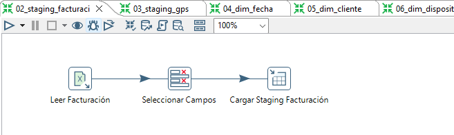
</p>
<p align="center"><strong>Figura 14. Transformación 02_staging_facturacion en Pentaho</strong></p>
<p align="center"><em>Extracción de facturación, selección de campos y carga a staging.</em></p>

<a name="seccion-21"></a>
#### 03_staging_gps

La transformación prepara y carga `staging.dispositivos`. En la ejecución documentada procesó 666 filas. Su flujo es: Leer Dispositivos GPS → Seleccionar Campos → Cargar Staging GPS.

<a name="figura-15"></a>
<p align="center">
  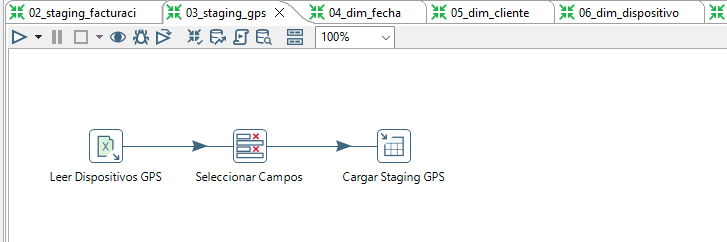
</p>
<p align="center"><strong>Figura 15. Transformación 03_staging_gps en Pentaho</strong></p>
<p align="center"><em>Lectura del reporte de dispositivos GPS y carga al esquema staging.</em></p>

<a name="seccion-22"></a>
#### 04_dim_fecha

La transformación prepara y carga `dw.dim_fecha`. En la ejecución documentada procesó 1826 filas. Su flujo es: Generar Fechas → Cargar Dim Fecha.

<a name="figura-16"></a>
<p align="center">
  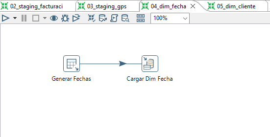
</p>
<p align="center"><strong>Figura 16. Transformación 04_dim_fecha en Pentaho</strong></p>
<p align="center"><em>Generación del calendario y carga de la dimensión fecha.</em></p>

<a name="seccion-23"></a>
#### 05_dim_cliente

La transformación prepara y carga `dw.dim_cliente`. En la ejecución documentada procesó 232 filas. Su flujo es: Integrar Clientes → Cargar Dim Cliente.

<a name="figura-17"></a>
<p align="center">
  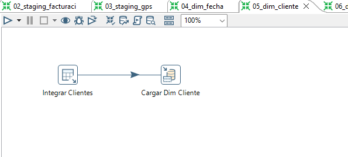
</p>
<p align="center"><strong>Figura 17. Transformación 05_dim_cliente en Pentaho</strong></p>
<p align="center"><em>Integración de nombres del catálogo y de facturación en la dimensión cliente.</em></p>

<a name="seccion-24"></a>
#### 06_dim_dispositivo

La transformación prepara y carga `dw.dim_dispositivo`. En la ejecución documentada procesó 666 filas. Su flujo es: Limpiar Dispositivos → Cargar Dim Dispositivo.

<a name="figura-18"></a>
<p align="center">
  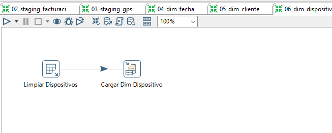
</p>
<p align="center"><strong>Figura 18. Transformación 06_dim_dispositivo en Pentaho</strong></p>
<p align="center"><em>Normalización de las claves de dispositivo y carga de la dimensión.</em></p>

<a name="seccion-25"></a>
#### 07_dim_grupo

La transformación prepara y carga `dw.dim_grupo`. En la ejecución documentada procesó 40 filas. Su flujo es: Obtener Grupos → Cargar Dim Grupo.

[Ver transformación 07_dim_grupo.ktr](pentaho/transformaciones/07_dim_grupo.ktr).

<a name="seccion-26"></a>
#### 08_fact_facturacion

La transformación prepara y carga `dw.fact_facturacion`. En la ejecución documentada procesó 1646 filas. Su flujo es: Transformar Facturación → Cargar Fact Facturación.

[Ver transformación 08_fact_facturacion.ktr](pentaho/transformaciones/08_fact_facturacion.ktr).

<a name="seccion-27"></a>
#### 09_fact_estado_gps

La transformación prepara y carga `dw.fact_estado_gps`. En la ejecución documentada procesó 666 filas. Su flujo es: Transformar Estado GPS → Cargar Fact Estado GPS.

<a name="figura-19"></a>
<p align="center">
  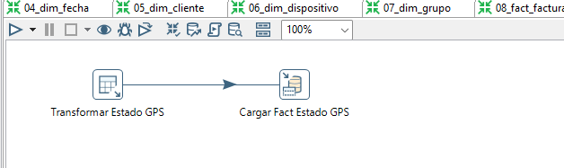
</p>
<p align="center"><strong>Figura 19. Transformación 09_fact_estado_gps en Pentaho</strong></p>
<p align="center"><em>Transformación y carga de la instantánea operativa GPS.</em></p>

<a name="seccion-28"></a>
### 6.4. Job principal `Intertel_ETL`

El Job encadena las nueve transformaciones en orden de dependencia. Inicia un registro de auditoría, carga staging, carga dimensiones antes que hechos, valida el Data Warehouse y registra el resultado. Las rutas de error deben impedir que una carga fallida sea declarada exitosa.

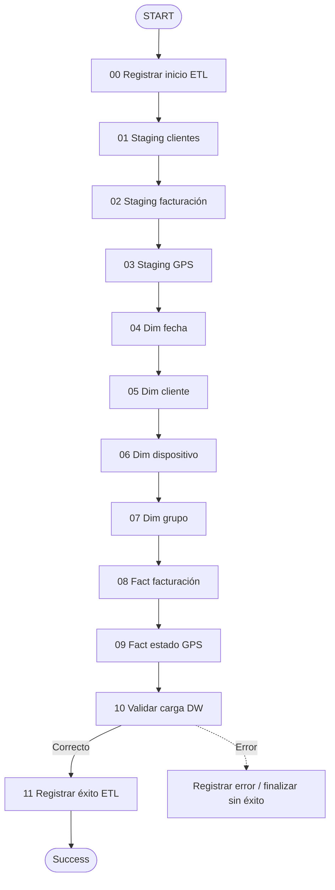

<a name="figura-20"></a>
<p align="center"><strong>Figura 20. Flujo del Job Intertel_ETL</strong></p>
<p align="center"><em>Representación de la secuencia principal y del control de fallos.</em></p>

El log registrado el 25/11/2026 evidencia la secuencia completa con `result=[true]` en las entradas ejecutadas y finalización de Job. En el historial de auditoría se observaron dos ejecuciones exitosas, de aproximadamente 3,17 y 2,38 segundos según las marcas registradas en la base. Estas duraciones son observaciones del entorno local y no un benchmark de rendimiento. Reejecutar el flujo con los mismos archivos permite comprobar la repetibilidad; no demuestra que exista un planificador automático o actualización en tiempo real.

<a name="figura-21"></a>
<p align="center">
  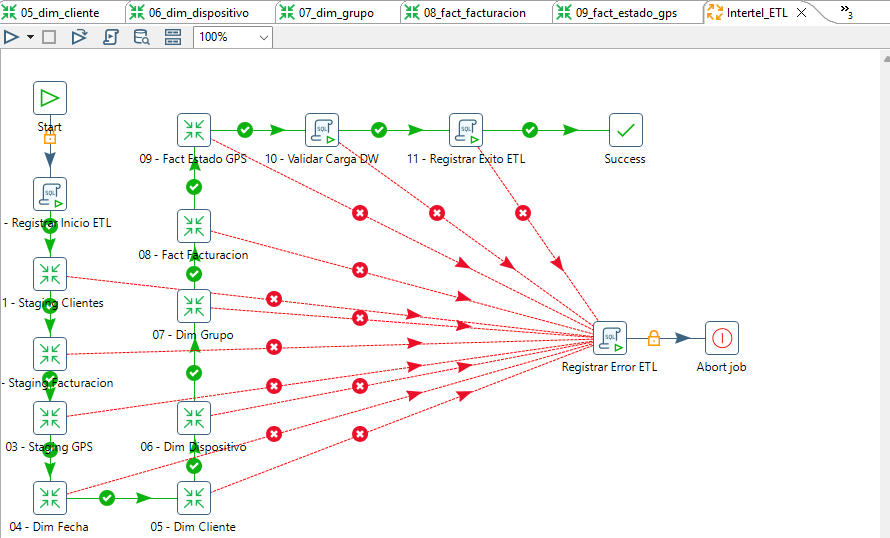
</p>
<p align="center"><strong>Figura 21. Job principal con transformaciones y rutas de control</strong></p>
<p align="center"><em>Orquestación de las nueve transformaciones, validación y control de ejecución.</em></p>

<a name="seccion-29"></a>
## 7. Validación y calidad de datos

<a name="seccion-30"></a>
### 7.1. Conteos y reconciliación

El script `04_intertel_validar_carga.sql` compara las vistas limpias con el destino, concilia importes, resume incidencias y verifica consistencia de antigüedad. Según las ejecuciones y validaciones realizadas durante el proyecto:

| Capa / tabla | Filas esperadas | Filas cargadas |
|---|---:|---:|
| staging.clientes | 93 | 93 |
| staging.facturacion | 1.651 | 1.651 |
| staging.dispositivos | 666 | 666 |
| dw.dim_fecha | 1.826 | 1.826 |
| dw.dim_cliente | 232 | 232 |
| dw.dim_dispositivo | 666 | 666 |
| dw.dim_grupo | 40 | 40 |
| dw.fact_facturacion | 1.646 | 1.646 |
| dw.fact_estado_gps | 666 | 666 |

De las 1.651 filas de staging de facturación, cinco fueron rechazadas. La carga preservó 1.646 registros válidos (99,70 %). La conciliación compara el total limpio con el DW, no con filas rechazadas ni otras hojas excluidas.

```sql
SELECT
    (SELECT SUM(valor_facturado) FROM staging.v_factura_limpia) AS total_origen_limpio,
    (SELECT SUM(valor_facturado) FROM dw.fact_facturacion) AS total_dw,
    (SELECT SUM(valor_facturado) FROM staging.v_factura_limpia) -
    (SELECT SUM(valor_facturado) FROM dw.fact_facturacion) AS diferencia;
```

Resultado de referencia: ambos totales USD 236.752,00; diferencia esperada y reportada en las validaciones: USD 0,00. El bloque de conciliación se conserva en el [script de validación](postgresql/04_intertel_validar_carga.sql). La evidencia gráfica de integración compara los conteos esperados y cargados, no los importes.

<a name="figura-22"></a>
<p align="center">
  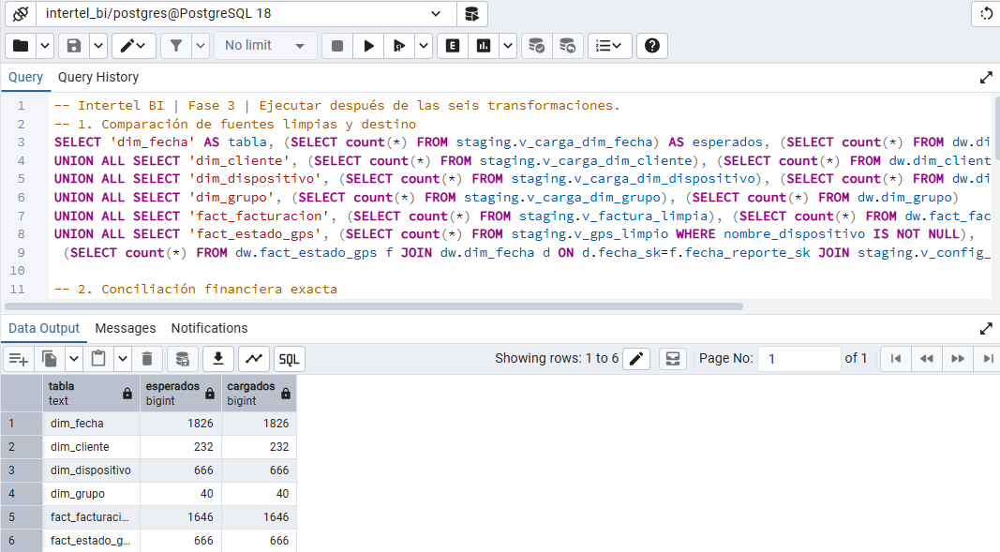
</p>
<p align="center"><strong>Figura 22. Validación integral de la carga dimensional</strong></p>
<p align="center"><em>Comparación de los conteos esperados y cargados de las seis tablas del Data Warehouse.</em></p>

<a name="seccion-31"></a>
### 7.2. Integridad y consistencia

La consulta devolvió cero inconsistencias. Esto comprueba la regla de antigüedad para los registros con datos; la integridad referencial se asegura además por las FK definidas en el DDL, no únicamente por esta consulta.

<a name="figura-23"></a>
<p align="center">
  
</p>
<p align="center"><strong>Figura 23. Validación de consistencia de fechas y antigüedad GPS</strong></p>
<p align="center"><em>Comprobación de consistencia de fechas y antigüedad en registros GPS.</em></p>

<a name="seccion-32"></a>
### 7.3. Resultados de calidad y auditoría

| Fuente | Regla | Severidad | Cantidad |
|---|---|---|---:|
| FACTURACION | SIN_COINCIDENCIA | ADVERTENCIA | 640 |
| FACTURACION | IMPORTE_INVALIDO | RECHAZO | 2 |
| FACTURACION | NUMERO_FACTURA_INVALIDO | RECHAZO | 3 |
| GPS | SIN_DATOS | ADVERTENCIA | 480 |
| GPS | SIN_GRUPO | ADVERTENCIA | 131 |
| GPS | SIN_SIM | ADVERTENCIA | 45 |

Las advertencias no impiden conservar registros válidos. Una fila puede activar varias reglas, de modo que el total de incidencias no representa necesariamente el total de filas afectadas. Se consulta solo la última ejecución exitosa para evitar duplicaciones entre cargas.

La dimensión cliente contiene 90 nombres con coincidencia única, 141 sin coincidencia y uno con coincidencia múltiple. Los 232 miembros incluyen nombres provenientes de las dos fuentes; no equivalen a 232 clientes facturados o identidades legales verificadas. En el reporte GPS se registraron 621 dispositivos con dato de SIM y 45 sin ese dato; se identificaron 39 grupos y un miembro técnico `SIN GRUPO`.

<a name="figura-24"></a>
<p align="center">
  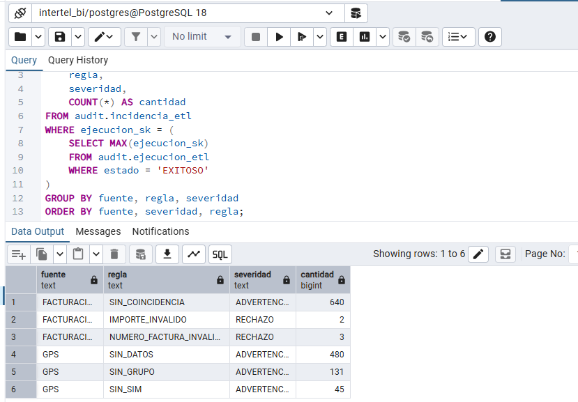
</p>
<p align="center"><strong>Figura 24. Incidencias detectadas en la última carga exitosa</strong></p>
<p align="center"><em>Resumen de advertencias y rechazos por fuente y regla de calidad.</em></p>

<a name="figura-25"></a>
<p align="center">
  
</p>
<p align="center"><strong>Figura 25. Historial de ejecuciones del ETL</strong></p>
<p align="center"><em>Historial de ejecuciones y estado registrado por el proceso ETL.</em></p>

<a name="figura-26"></a>
<p align="center">
  
</p>
<p align="center"><strong>Figura 26. Conteos de staging</strong></p>
<p align="center"><em>Conteos de las tres tablas de entrada en staging.</em></p>

<a name="figura-27"></a>
<p align="center">
  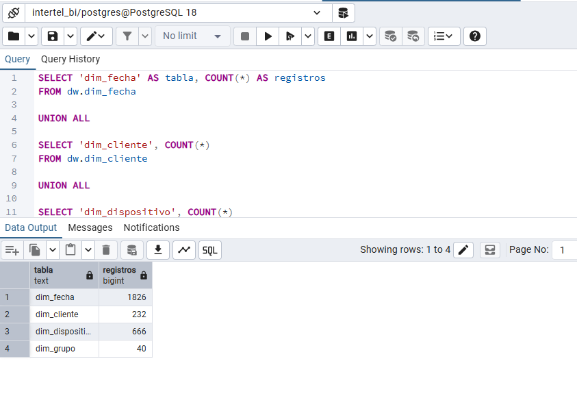
</p>
<p align="center"><strong>Figura 27. Conteos de dimensiones</strong></p>
<p align="center"><em>Conteos de los miembros de las cuatro dimensiones.</em></p>

<a name="figura-28"></a>
<p align="center">
  
</p>
<p align="center"><strong>Figura 28. Conteos de tablas de hechos</strong></p>
<p align="center"><em>Conteos de registros de las dos tablas de hechos.</em></p>

<a name="figura-29"></a>
<p align="center">
  
</p>
<p align="center"><strong>Figura 29. Coincidencias por nombre en el catálogo</strong></p>
<p align="center"><em>Distribución de coincidencias únicas, múltiples y ausentes por nombre.</em></p>

<a name="figura-30"></a>
<p align="center">
  
</p>
<p align="center"><strong>Figura 30. Disponibilidad de información SIM</strong></p>
<p align="center"><em>Conteo de dispositivos con y sin información SIM.</em></p>

<a name="seccion-33"></a>
## 8. Consultas SQL y resultados

Las 18 consultas se ejecutan sobre `dw` y `audit`, sin modificar los datos. Se utilizan agregaciones, JOIN, filtros, funciones de ventana y expresiones comunes de tabla (CTE). Para evitar duplicidad, se presentan las capturas de las consultas ejecutadas y su interpretación. El código completo se conserva en [05_intertel_consultas_negocio.sql](postgresql/05_intertel_consultas_negocio.sql).

Los importes comerciales se contrastaron también con la hoja principal de facturación: 1.646 números válidos y únicos, total acumulado USD 236.752,00 y 205 nombres normalizados distintos con facturación. Los valores operativos se basan en las ejecuciones y capturas documentadas del proyecto. La tarjeta de clientes facturados de la versión final de Power BI muestra 206, mientras que el contraste previo del Excel indicó 205 nombres normalizados; son resultados de procedimientos de conteo diferentes que requieren reconciliación antes de utilizarlos como un único indicador.

<a name="seccion-34"></a>
### 8.1. Resumen de resultados comerciales

| Indicador | Resultado |
|---|---:|
| Facturación acumulada | USD 236.752,00 |
| Facturas válidas | 1.646 |
| Nombres facturados distintos | 205 |
| Ticket promedio | USD 143,83 |
| Facturación 2025 | USD 113.309,25 |
| Facturación 2026 (parcial) | USD 123.442,75 |
| Enero–octubre 2025 | USD 94.861,49 |
| Enero–octubre 2026 | USD 112.418,94 |
| Variación interanual comparable | +18,51 % |
| Facturación Top 10 | USD 166.804,02 |
| Concentración Top 10 | 70,46 % |

| Mes | 2025 (USD) | 2026 (USD) |
|---|---:|---:|
| Enero | 11.535,91 | 11.598,40 |
| Febrero | 11.566,91 | 7.916,17 |
| Marzo | 7.599,43 | 10.376,22 |
| Abril | 7.484,63 | 11.466,12 |
| Mayo | 12.058,93 | 11.884,84 |
| Junio | 8.279,72 | 10.671,61 |
| Julio | 9.692,97 | 12.480,55 |
| Agosto | 8.954,00 | 4.746,17 |
| Septiembre | 9.349,71 | 12.519,96 |
| Octubre | 8.339,28 | 18.758,90 |
| Noviembre | 9.677,55 | 11.023,81 (parcial) |
| Diciembre | 8.770,21 | Sin registros en el corte |
| **Total registrado** | **113.309,25** | **123.442,75** |

<a name="seccion-35"></a>
### 8.2. Resumen de resultados operativos

| Indicador | Resultado |
|---|---:|
| Registros del reporte | 666 |
| Grupos identificados | 39 |
| Registros con información | 186 (27,93 %) |
| Registros sin información | 480 (72,07 %) |
| Último registro superior a 30 días | 105 (56,45 % de los que tienen datos) |
| Registros sin grupo | 131 (19,67 %) |
| Registros sin dato SIM | 45 (6,76 %) |

<a name="seccion-36"></a>
### 8.3. Detalle de consultas y trazabilidad

<a name="seccion-37"></a>
#### PN01. ¿Cuánto se ha facturado por año, trimestre y mes?

**Interpretación:** PN01 muestra la distribución mensual. Los totales registrados son USD 113.309,25 en 2025 y USD 123.442,75 en 2026 (parcial).

**Visualización asociada:** Evolución temporal y matriz.

<a name="figura-31"></a>
<p align="center">
  
</p>
<p align="center"><strong>Figura 31. PN01 — Facturación por período</strong></p>
<p align="center"><em>Agregación de importes y facturas por año, trimestre y mes.</em></p>

<a name="seccion-38"></a>
#### PN02. ¿Cómo evolucionó la facturación entre enero y octubre de 2025 y 2026?

**Interpretación:** USD 94.861,49 frente a USD 112.418,94: diferencia de USD 17.557,45 y crecimiento de 18,51 %. Comparar meses equivalentes evita incorporar noviembre parcial.

**Visualización asociada:** Inicio: crecimiento interanual.

<a name="figura-32"></a>
<p align="center">
  
</p>
<p align="center"><strong>Figura 32. PN02 — Crecimiento interanual</strong></p>
<p align="center"><em>Comparación de facturación de enero a octubre de ambos años.</em></p>

<a name="seccion-39"></a>
#### PN03. ¿Cuáles son los diez clientes facturados con mayor importe?

**Interpretación:** Permite identificar las etiquetas de clientes prioritarias para seguimiento comercial. El ranking se presenta por claves técnicas, no por nombres reales.

**Visualización asociada:** Ranking Top 10.

<a name="figura-33"></a>
<p align="center">
  
</p>
<p align="center"><strong>Figura 33. PN03 — Top 10 de clientes</strong></p>
<p align="center"><em>Ranking de los diez nombres de cliente con mayor importe facturado.</em></p>

<a name="seccion-40"></a>
#### PN04. ¿Qué porcentaje de facturación corresponde a los diez principales clientes?

**Interpretación:** Los diez principales nombres normalizados acumulan USD 166.804,02 (70,46 % del importe total), según recálculo de la hoja principal. Confirmar el mismo valor en PN04 y Power BI sin filtros.

**Visualización asociada:** Tarjeta concentración Top 10.

<a name="figura-34"></a>
<p align="center">
  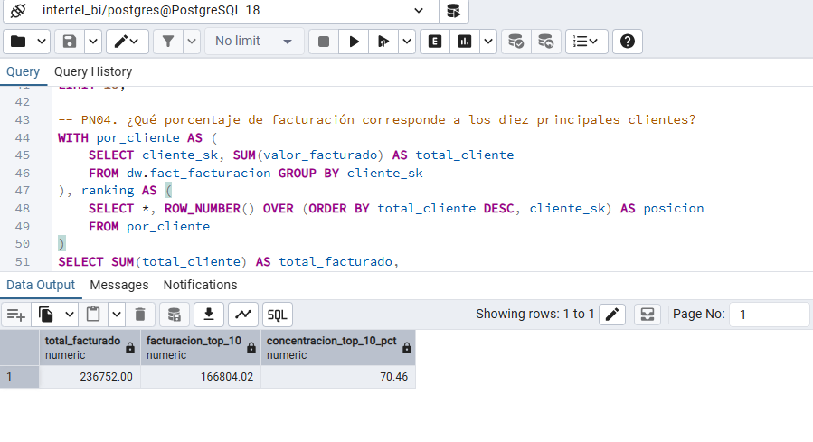
</p>
<p align="center"><strong>Figura 34. PN04 — Concentración comercial</strong></p>
<p align="center"><em>Participación de los diez principales clientes respecto a la facturación total.</em></p>

<a name="seccion-41"></a>
#### PN05. ¿Cuál es el importe promedio de una factura?

**Interpretación:** 1.646 facturas; USD 236.752,00 acumulados; USD 143,83 por factura. No es el ingreso promedio por cliente ni el precio promedio de un plan.

**Visualización asociada:** Inicio y Comercial: ticket promedio.

<a name="figura-35"></a>
<p align="center">
  
</p>
<p align="center"><strong>Figura 35. PN05 — Ticket promedio</strong></p>
<p align="center"><em>Cálculo del importe promedio por factura válida.</em></p>

<a name="seccion-42"></a>
#### PN06. ¿Cuántos nombres de clientes diferentes registran facturación cada mes?

**Interpretación:** El recuento distinto de cliente_sk debe calcularse en cada mes; los recuentos mensuales no se suman para obtener clientes únicos anuales.

**Visualización asociada:** Clientes facturados + filtros.

<a name="figura-36"></a>
<p align="center">
  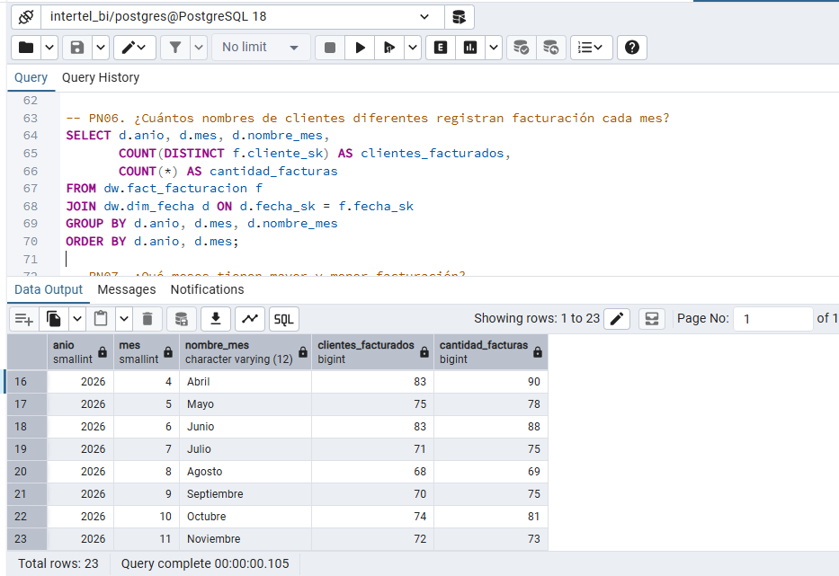
</p>
<p align="center"><strong>Figura 36. PN06 — Clientes facturados por mes</strong></p>
<p align="center"><em>Recuento de clientes distintos facturados por período mensual.</em></p>

<a name="seccion-43"></a>
#### PN07. ¿Qué meses tienen mayor y menor facturación?

**Interpretación:** Octubre de 2026: USD 18.758,90 (máximo); agosto de 2026: USD 4.746,17 (mínimo), entre meses con registros y excluyendo noviembre de 2026.

**Visualización asociada:** Gráfico mensual y matriz.

<a name="figura-37"></a>
<p align="center">
  
</p>
<p align="center"><strong>Figura 37. PN07 — Mayor y menor facturación</strong></p>
<p align="center"><em>Identificación de los períodos de mayor y menor facturación.</em></p>

<a name="seccion-44"></a>
#### PN08. ¿Con qué frecuencia se emiten facturas por nombre de cliente?

**Interpretación:** Permite identificar recurrencia documental mediante facturas, meses con actividad y promedio por mes activo; no demuestra suscripciones activas.

**Visualización asociada:** Consulta SQL y tooltip de ranking.

<a name="figura-38"></a>
<p align="center">
  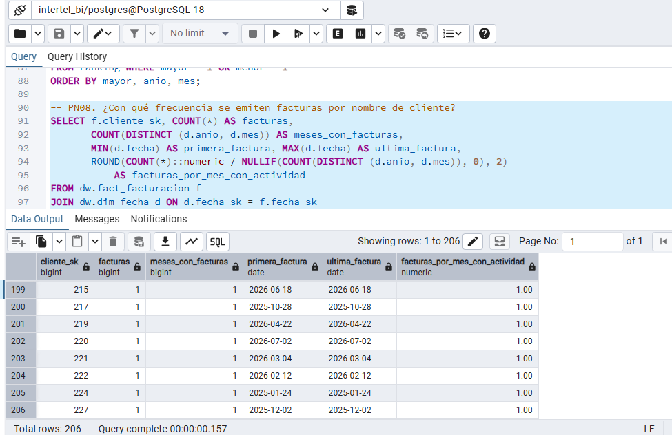
</p>
<p align="center"><strong>Figura 38. PN08 — Frecuencia de facturación</strong></p>
<p align="center"><em>Frecuencia de emisión de facturas por nombre de cliente.</em></p>

<a name="seccion-45"></a>
#### PN09. ¿Cuántos registros y claves de dispositivo aparecen en el reporte?

**Interpretación:** 666 registros, 666 claves provisionales en la dimensión de dispositivos y 39 grupos identificados (excluye SIN GRUPO). No equivale a una verificación de 666 vehículos activos.

**Visualización asociada:** Tarjetas GPS y grupos.

<a name="figura-39"></a>
<p align="center">
  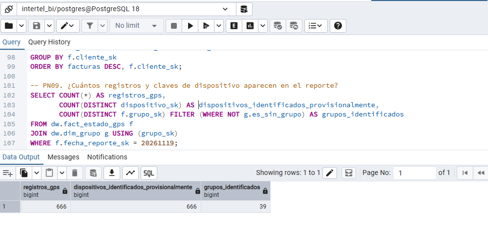
</p>
<p align="center"><strong>Figura 39. PN09 — Total de registros GPS</strong></p>
<p align="center"><em>Conteo de registros, identidades de dispositivo y grupos del reporte.</em></p>

<a name="seccion-46"></a>
#### PN10. ¿Qué grupos concentran más registros de dispositivos?

**Interpretación:** El ranking permite identificar los grupos con mayor volumen, separando SIN GRUPO de los grupos identificados. No todos los grupos son necesariamente cooperativas.

**Visualización asociada:** Barras por grupo.

<a name="figura-40"></a>
<p align="center">
  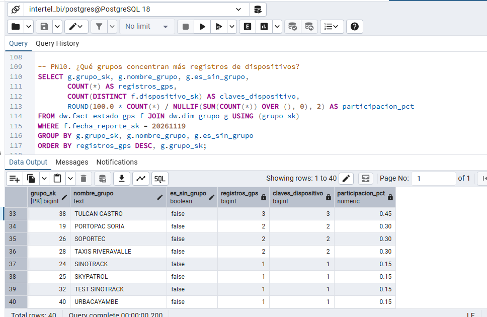
</p>
<p align="center"><strong>Figura 40. PN10 — Dispositivos por grupo</strong></p>
<p align="center"><em>Distribución de los registros GPS por grupo.</em></p>

<a name="seccion-47"></a>
#### PN11. ¿Qué proporción de registros tiene información GPS disponible?

**Interpretación:** 186 con información (27,93 %) y 480 sin información (72,07 %).

**Visualización asociada:** Anillo de disponibilidad.

<a name="figura-41"></a>
<p align="center">
  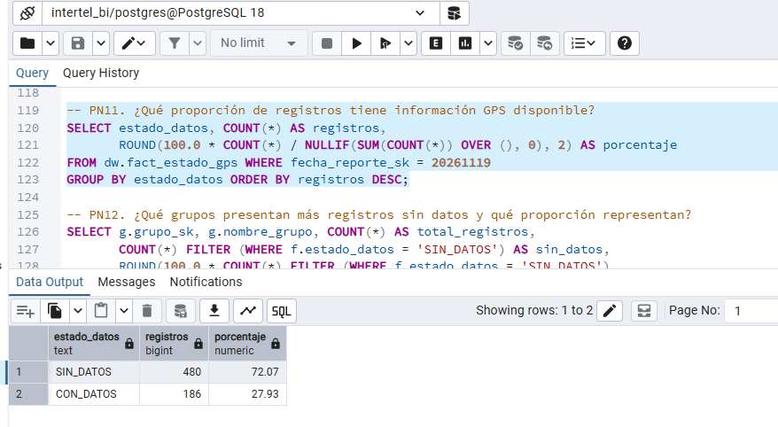
</p>
<p align="center"><strong>Figura 41. PN11 — Disponibilidad GPS</strong></p>
<p align="center"><em>Cantidad y proporción de registros con y sin información.</em></p>

<a name="seccion-48"></a>
#### PN12. ¿Qué grupos presentan más registros sin datos y qué proporción representan?

**Interpretación:** Compara cantidad absoluta y porcentaje dentro de cada grupo; un grupo pequeño con 100 % no siempre tiene el mayor impacto absoluto.

**Visualización asociada:** Matriz y barras apiladas.

<a name="figura-42"></a>
<p align="center">
  
</p>
<p align="center"><strong>Figura 42. PN12 — Grupos sin datos</strong></p>
<p align="center"><em>Comparación de cantidades y proporciones de ausencia de datos por grupo.</em></p>

<a name="seccion-49"></a>
#### PN13. ¿Cuál es la antigüedad de la información GPS disponible?

**Interpretación:** 105 registros presentan más de 30 días de antigüedad; equivalen al 56,45 % de los 186 registros con datos.

**Visualización asociada:** Gráfico de antigüedad.

<a name="figura-43"></a>
<p align="center">
  
</p>
<p align="center"><strong>Figura 43. PN13 — Antigüedad de registros GPS</strong></p>
<p align="center"><em>Distribución de registros según la antigüedad de la última información.</em></p>

<a name="seccion-50"></a>
#### PN14. ¿Qué grupos requieren revisión por registros con más de 30 días de antigüedad?

**Interpretación:** Identifica grupos por cantidad y proporción de registros antiguos entre aquellos con información válida. No es un diagnóstico de desconexión.

**Visualización asociada:** Matriz y segmentadores.

<a name="figura-44"></a>
<p align="center">
  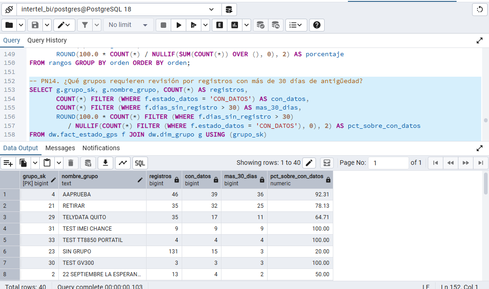
</p>
<p align="center"><strong>Figura 44. PN14 — Grupos con registros antiguos</strong></p>
<p align="center"><em>Identificación de grupos con registros de más de treinta días.</em></p>

<a name="seccion-51"></a>
#### PN15. ¿Cuántos registros cuentan con coordenadas válidas?

**Interpretación:** Se evalúa la cobertura del indicador tiene_posicion, no la ubicación geográfica de clientes ni un mapa de vehículos. El valor exacto se evidencia en PN15.

**Visualización asociada:** Consulta SQL / GPS Con Posicion.

<a name="figura-45"></a>
<p align="center">
  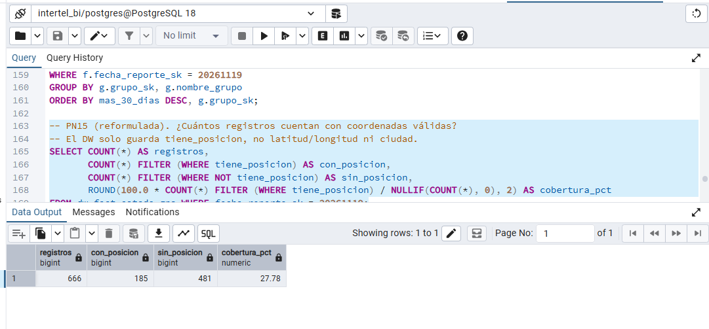
</p>
<p align="center"><strong>Figura 45. PN15 — Posiciones GPS válidas</strong></p>
<p align="center"><em>Recuento de registros con y sin posición GPS válida.</em></p>

<a name="seccion-52"></a>
#### PN16. ¿Qué proporción de facturas no coincide por nombre con el catálogo?

**Interpretación:** 640 facturas sin coincidencia (38,88 % de las 1.646 válidas). Distinguir facturas de nombres únicos.

**Visualización asociada:** Anillo de calidad comercial.

<a name="figura-46"></a>
<p align="center">
  
</p>
<p align="center"><strong>Figura 46. PN16 — Facturas sin coincidencia</strong></p>
<p align="center"><em>Distribución de facturas e importes según el estado de coincidencia con el catálogo.</em></p>

<a name="seccion-53"></a>
#### PN17. ¿Cuántos registros GPS carecen de grupo o SIM?

**Interpretación:** 131 sin grupo y 45 sin SIM; las categorías pueden solaparse, por lo que no se deben sumar para contar casos únicos.

**Visualización asociada:** Tarjetas GPS y consulta SQL.

<a name="figura-47"></a>
<p align="center">
  
</p>
<p align="center"><strong>Figura 47. PN17 — Registros sin grupo o SIM</strong></p>
<p align="center"><em>Conteos de registros con información administrativa incompleta.</em></p>

<a name="seccion-54"></a>
#### PN18. ¿Qué incidencias de calidad fueron detectadas en la última carga exitosa?

**Interpretación:** Se contabilizan advertencias y rechazos de la última ejecución exitosa para no duplicar incidencias de cargas repetidas.

**Visualización asociada:** Auditoría SQL.

<a name="figura-48"></a>
<p align="center">
  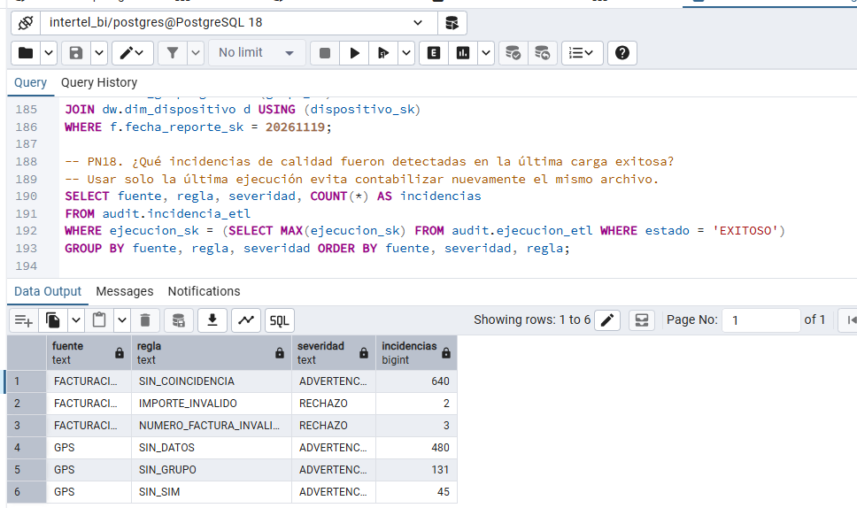
</p>
<p align="center"><strong>Figura 48. PN18 — Incidencias de calidad</strong></p>
<p align="center"><em>Incidencias de calidad de la última ejecución exitosa.</em></p>

<a name="seccion-55"></a>
## 9. Implementación y dashboards en Power BI

<a name="seccion-56"></a>
### 9.1. Conexión y modelo semántico

Power BI Desktop se conectó a PostgreSQL y utiliza las cuatro dimensiones y las dos tablas de hechos del esquema `dw`. El modelo semántico conserva relaciones de uno a muchos de dimensiones hacia hechos. La doble relación de fechas GPS requiere distinguir la relación de fecha de reporte de la de último registro; en Power BI una relación alternativa puede permanecer inactiva y activarse mediante DAX cuando sea necesario. Se debe verificar la configuración efectiva en la vista de modelo, evitando caminos ambiguos o relaciones directas entre hechos.

Los filtros comerciales operan sobre la facturación; los operativos sobre la instantánea GPS. Se ordena el nombre de mes por su número y se utiliza la jerarquía Año → Trimestre → Mes → Fecha para las operaciones de navegación temporal. Las etiquetas de clientes y nombres de categorías se adaptaron para la presentación sin modificar las reglas de negocio originales.

<a name="figura-49"></a>
<p align="center">
  
</p>
<p align="center"><strong>Figura 49. Conexión a PostgreSQL en Power BI</strong></p>
<p align="center"><em>Origen PostgreSQL utilizado por Power BI Desktop.</em></p>

<a name="figura-50"></a>
<p align="center">
  
</p>
<p align="center"><strong>Figura 50. Modelo semántico y cardinalidades</strong></p>
<p align="center"><em>Modelo semántico con tablas de hechos, dimensiones y relaciones.</em></p>

<a name="figura-51"></a>
<p align="center">
  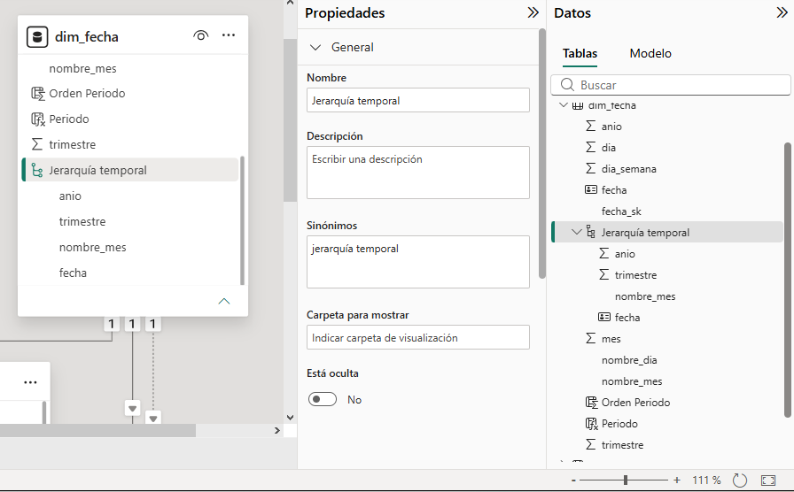
</p>
<p align="center"><strong>Figura 51. Jerarquía temporal</strong></p>
<p align="center"><em>Jerarquía de año, trimestre, mes y fecha para la exploración.</em></p>

<a name="seccion-57"></a>
### 9.2. Medidas e indicadores

| Indicador | Definición |
|---|---|
| Facturación total | Suma de `valor_facturado` |
| Facturas emitidas | Suma de `cantidad_facturas` o recuento de hechos válidos |
| Clientes facturados | Recuento distinto de `cliente_sk` en los hechos filtrados |
| Ticket promedio | Facturación total / cantidad de facturas |
| Crecimiento interanual | Diferencia entre enero–octubre de ambos años / total enero–octubre de 2025 |
| Concentración Top 10 | Importe de diez clientes con mayor facturación / importe del contexto de referencia |
| Total registros GPS | Suma de `cantidad_registros` para la fecha del reporte |
| GPS con/sin datos | Recuento por `estado_datos` |
| Porcentaje GPS sin datos | GPS sin datos / total de registros en contexto |
| GPS más de 30 días | Recuento con `dias_sin_registro > 30` |
| Grupos identificados | Recuento distinto de grupos excluyendo el miembro `SIN GRUPO` |

<a name="seccion-58"></a>
#### 9.2.1. Medidas comerciales

La medida **Facturacion Total** se evidencia en la siguiente captura de Power BI.

<a name="figura-52"></a>
<p align="center">
  
</p>
<p align="center"><strong>Figura 52. Medida DAX Facturacion Total</strong></p>
<p align="center"><em>Definición de la medida Facturacion Total mediante SUM sobre valor_facturado.</em></p>

Las siguientes expresiones documentan las medidas restantes conforme a las instrucciones de implementación y las definiciones de negocio. Se presentan expresiones funcionalmente equivalentes cuando no se dispone de una captura de la fórmula individual; no constituyen una extracción literal del archivo PBIX.

<a name="seccion-59"></a>
##### Cantidad Facturas

Cuenta las filas de facturas válidas, cuyo grano es una factura por fila.

```dax
Cantidad Facturas = COUNTROWS(fact_facturacion)
```

<a name="seccion-60"></a>
##### Clientes Facturados

Cuenta las claves distintas de cliente presentes en las facturas del contexto de filtros.

```dax
Clientes Facturados = DISTINCTCOUNT(fact_facturacion[cliente_sk])
```

<a name="seccion-61"></a>
##### Ticket Promedio

Calcula el importe promedio por factura.

```dax
Ticket Promedio = DIVIDE([Facturacion Total], [Cantidad Facturas], 0)
```

<a name="seccion-62"></a>
##### Crecimiento Interanual

Compara enero–octubre de 2025 y 2026, excluyendo noviembre parcial. Las dos primeras medidas son auxiliares; el indicador compara períodos fijos y elimina los filtros de la dimensión fecha.

```dax
Facturacion Ene Oct 2025 =
CALCULATE(
    [Facturacion Total],
    FILTER(ALL(dim_fecha), dim_fecha[anio] = 2025 && dim_fecha[mes] <= 10)
)

Facturacion Ene Oct 2026 =
CALCULATE(
    [Facturacion Total],
    FILTER(ALL(dim_fecha), dim_fecha[anio] = 2026 && dim_fecha[mes] <= 10)
)

Crecimiento Interanual =
DIVIDE(
    [Facturacion Ene Oct 2026] - [Facturacion Ene Oct 2025],
    [Facturacion Ene Oct 2025]
)
```

<a name="seccion-63"></a>
##### Concentracion Top 10

La medida auxiliar obtiene el importe de los diez clientes con mayor facturación en el contexto de selección; la clave de cliente resuelve empates. La segunda calcula su participación en la facturación total del contexto.

```dax
Facturacion Top 10 =
VAR TopClientes =
    TOPN(
        10,
        ADDCOLUMNS(
            VALUES(dim_cliente[cliente_sk]),
            "@Facturacion", [Facturacion Total]
        ),
        [@Facturacion], DESC,
        dim_cliente[cliente_sk], ASC
    )
RETURN
    SUMX(TopClientes, [@Facturacion])

Concentracion Top 10 =
DIVIDE([Facturacion Top 10], [Facturacion Total], 0)
```

<a name="seccion-64"></a>
##### Facturas Sin Coincidencia

Cuenta las facturas vinculadas a miembros cuyo nombre no coincide con el catálogo de clientes.

```dax
Facturas Sin Coincidencia =
CALCULATE(
    [Cantidad Facturas],
    dim_cliente[estado_catalogo] = "SIN_COINCIDENCIA"
)
```

<a name="seccion-65"></a>
##### Porcentaje Facturas Sin Coincidencia

Calcula la proporción de facturas sin coincidencia respecto al total del contexto.

```dax
Porcentaje Facturas Sin Coincidencia =
DIVIDE([Facturas Sin Coincidencia], [Cantidad Facturas], 0)
```

<a name="seccion-66"></a>
#### 9.2.2. Medidas operativas GPS

Las medidas operativas se documentan mediante sus definiciones y expresiones DAX de referencia.

```dax
Total Registros GPS = SUM(fact_estado_gps[cantidad_registros])

GPS Sin Datos =
CALCULATE([Total Registros GPS], fact_estado_gps[estado_datos] = "SIN_DATOS")

Porcentaje GPS Sin Datos =
DIVIDE([GPS Sin Datos], [Total Registros GPS])
```

Los porcentajes, promedios y recuentos distintos son medidas no aditivas; se recalculan según el contexto de filtros. Seleccionar únicamente la categoría sin datos puede alterar el denominador y producir 100 %. Para comparar tasas entre grupos, se deben mantener abiertos los filtros de estado y antigüedad, o definir una medida con denominador fijo.

<a name="seccion-67"></a>
### 9.3. Diseño UI/UX

Las cuatro páginas utilizan un encabezado con navegación, fondo claro, tarjetas blancas, tipografía Segoe UI y colores consistentes. El color azul corporativo propuesto (`#12355B`) representa información comercial; gris azulado (`#94A3B8`) distingue períodos anteriores; verde y naranja (`#84B83E`, `#D97706`) representan disponibilidad y ausencia de información. El rojo se emplea para destacar los registros de antigüedad elevada; en la matriz de priorización se aplican reglas de color para distinguir la proporción de registros sin datos. Los colores constituyen decisiones visuales del proyecto, no niveles de servicio oficiales.

Se aplicaron principios de jerarquía, contraste, alineación, agrupación, consistencia y reducción de carga cognitiva. Los gráficos incluyen etiquetas textuales y los filtros facilitan la exploración; el menú indica la página activa. El diseño distingue facturación, calidad operativa y análisis OLAP, evitando repetir visualizaciones sin una finalidad específica.

<a name="seccion-68"></a>
### 9.4. Página 01 — Resumen ejecutivo

Presenta los indicadores generales de facturación, cantidad de facturas, ticket promedio, crecimiento comparable, registros GPS y porcentaje sin información. El gráfico de líneas compara meses entre años; las columnas presentan importes anuales registrados, y el anillo muestra disponibilidad GPS. Responde principalmente PN01, PN02, PN05, PN07, PN09 y PN11.

**Interpretación:** el valor facturado creció entre períodos equivalentes, mientras que el reporte GPS evidencia una importante falta de información. Los dos procesos son independientes: no se afirma que la situación GPS explique los ingresos.

<a name="figura-53"></a>
<p align="center">
  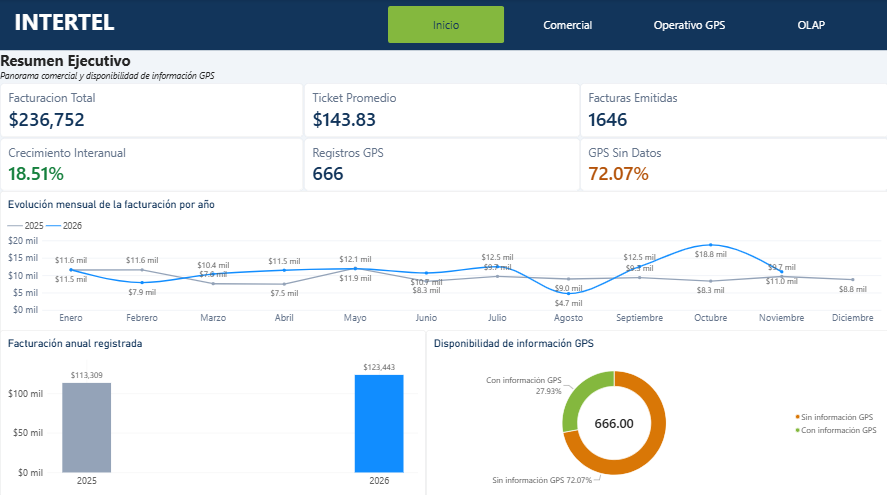
</p>
<p align="center"><strong>Figura 53. Dashboard final — Resumen ejecutivo</strong></p>
<p align="center"><em>Indicadores generales, evolución mensual, comparación anual y disponibilidad GPS.</em></p>

<a name="seccion-69"></a>
### 9.5. Página 02 — Análisis comercial

Incluye segmentadores por año, trimestre, mes y cliente; tarjetas de facturación, facturas, clientes, ticket y concentración; gráfico temporal jerárquico, ranking Top 10, matriz mensual y calidad de coincidencia con catálogo, según la configuración final. Permite responder PN01–PN08 y PN16 mediante consultas, filtros y visualizaciones.

**Interpretación:** el ranking identifica la concentración de facturación, mientras que la matriz permite comparar períodos. La clasificación de catálogo muestra las limitaciones del cruce de nombres y permite plantear mejoras en el registro de clientes. La comparación anual completa no debe confundirse con el indicador comparable enero–octubre.

<a name="figura-54"></a>
<p align="center">
  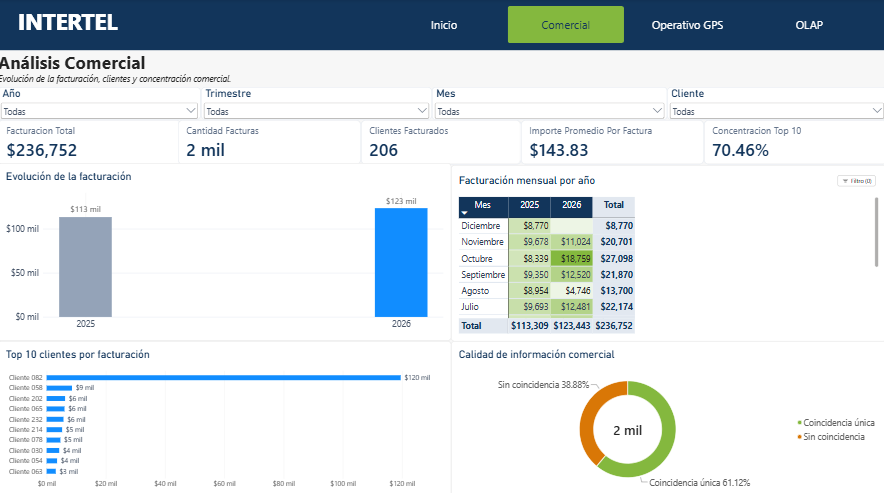
</p>
<p align="center"><strong>Figura 54. Dashboard final — Análisis comercial</strong></p>
<p align="center"><em>Segmentadores, indicadores comerciales, ranking de clientes, matriz mensual y calidad del catálogo.</em></p>

<a name="seccion-70"></a>
### 9.6. Página 03 — Análisis operativo GPS

Presenta indicadores de registros, grupos, disponibilidad, antigüedad elevada y ausencia de grupo. Los segmentadores permiten explorar grupos, estados y rangos de antigüedad. Los gráficos de anillos y barras, junto con la matriz operativa y su formato condicional, permiten priorizar casos para revisión. Responde principalmente PN09–PN14 y PN17; PN15 se complementa con SQL.

**Interpretación:** comparar la cantidad y proporción de registros sin información permite dimensionar el volumen y la intensidad del problema. La fecha de referencia es el 19/11/2026; no se representa una conexión en vivo con los GPS.

<a name="figura-55"></a>
<p align="center">
  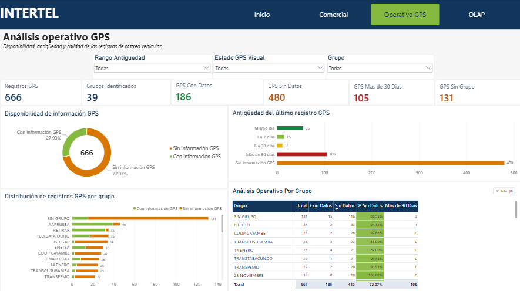
</p>
<p align="center"><strong>Figura 55. Dashboard final — Análisis operativo GPS</strong></p>
<p align="center"><em>Disponibilidad, antigüedad, distribución por grupo y matriz de análisis operativo.</em></p>

<a name="seccion-71"></a>
### 9.7. Página 04 — Análisis multidimensional OLAP

Se utiliza un objeto visual tridimensional DataCube 3D para explorar la facturación por año, trimestre y cliente. Cada celda representa la agregación de `valor_facturado` para una combinación de esos atributos. Los segmentadores permiten Slice y Dice; el intercambio de campos de los ejes permite Pivot. La escala secuencial facilita distinguir importes de menor a mayor. La rotación y el zoom son ayudas visuales, no operaciones OLAP independientes.

La versión final concentra la exploración en un cubo principal de gran tamaño y tres segmentadores laterales. El alcance del visual depende de sus filtros, incluido el Top 10 si se encuentra aplicado. La escala de color y el detalle de cada celda permiten interpretar la facturación.

<a name="figura-56"></a>
<p align="center">
  
</p>
<p align="center"><strong>Figura 56. Dashboard final — Análisis multidimensional OLAP</strong></p>
<p align="center"><em>Cubo tridimensional de facturación con segmentadores de año, trimestre y cliente.</em></p>

<a name="seccion-72"></a>
## 10. Análisis OLAP

<a name="seccion-73"></a>
### 10.1. Operaciones implementadas mediante SQL (ROLAP)

El análisis multidimensional se realiza sobre las tablas relacionales de PostgreSQL mediante el script `06_intertel_consultas_olap.sql`. No se implementó un servidor MOLAP independiente. El código íntegro está disponible en [06_intertel_consultas_olap.sql](postgresql/06_intertel_consultas_olap.sql); las figuras muestran las ejecuciones disponibles. `ROLLUP`, `CUBE` y `GROUPING SETS` generan agregaciones a distintos niveles; `GROUPING` permite distinguir las filas agregadas de los valores nulos reales.

| Operación | Bloque | Aplicación al negocio |
|---|---|---|
| Roll-up | OLAP01 | Resumir mes, trimestre, año y total general |
| Drill-down | OLAP02 | Desglosar 2026 desde año hacia trimestre y mes |
| Slice | OLAP03 | Analizar exclusivamente 2026 |
| Dice | OLAP04 | Combinar años, meses y estados de catálogo |
| Pivot | OLAP05 | Comparar años en columnas y meses en filas (enero–octubre) |
| Cube | OLAP06 | Obtener combinaciones y subtotales de grupo y estado GPS |
| Grouping sets | OLAP07 | Seleccionar agrupaciones por año, estado y total |

<a name="figura-57"></a>
<p align="center">
  
</p>
<p align="center"><strong>Figura 57. Roll-up ejecutado en PostgreSQL</strong></p>
<p align="center"><em>Agregación jerárquica por mes, trimestre, año y total mediante ROLLUP.</em></p>

<a name="figura-58"></a>
<p align="center">
  
</p>
<p align="center"><strong>Figura 58. Drill-down en PostgreSQL</strong></p>
<p align="center"><em>Desglose de facturación de 2026 en niveles de mayor detalle.</em></p>

<a name="figura-59"></a>
<p align="center">
  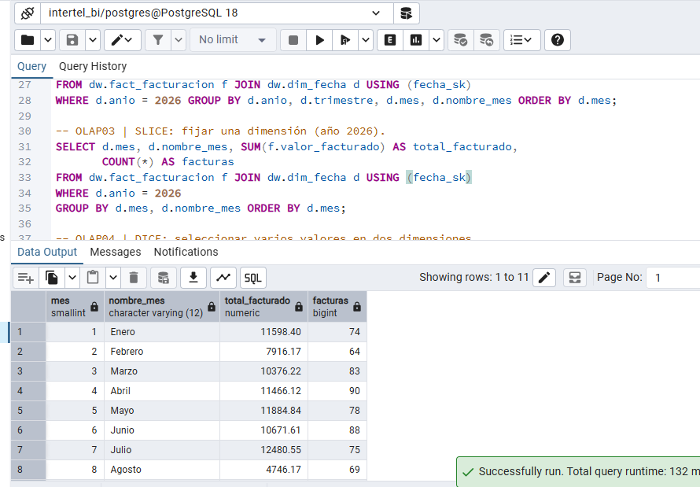
</p>
<p align="center"><strong>Figura 59. Slice ejecutado en PostgreSQL</strong></p>
<p align="center"><em>Restricción del análisis a un año de facturación.</em></p>

<a name="figura-60"></a>
<p align="center">
  
</p>
<p align="center"><strong>Figura 60. Dice ejecutado en PostgreSQL</strong></p>
<p align="center"><em>Selección de un subconjunto mediante filtros de varias dimensiones.</em></p>

<a name="figura-61"></a>
<p align="center">
  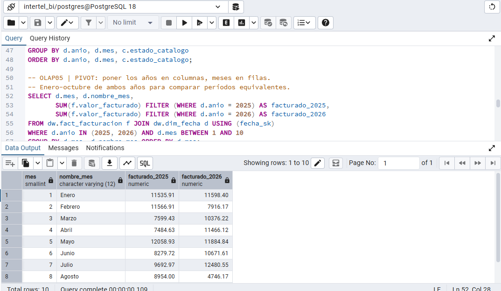
</p>
<p align="center"><strong>Figura 61. Pivot ejecutado en PostgreSQL</strong></p>
<p align="center"><em>Reorganización de períodos en filas y columnas para facilitar la comparación.</em></p>

<a name="figura-62"></a>
<p align="center">
  
</p>
<p align="center"><strong>Figura 62. Cube ejecutado en PostgreSQL</strong></p>
<p align="center"><em>Agregaciones y subtotales de grupo y estado GPS mediante CUBE.</em></p>

<a name="figura-63"></a>
<p align="center">
  
</p>
<p align="center"><strong>Figura 63. Grouping sets ejecutado en PostgreSQL</strong></p>
<p align="center"><em>Obtención de agrupaciones específicas por año, estado y total general.</em></p>

<a name="seccion-74"></a>
### 10.2. Operaciones interactivas en Power BI

| Operación | Procedimiento | Interpretación |
|---|---|---|
| Drill-down | Comercial: activar exploración; seleccionar 2026, trimestre 3 y septiembre | Identificar períodos que explican cambios del total |
| Roll-up | Usar la flecha superior para regresar de fecha a mes, trimestre y año | Recuperar la visión agregada |
| Slice | Seleccionar únicamente 2026 en el segmentador Año | Analizar una sección temporal |
| Dice | Combinar año, trimestre y clientes con facturación | Comparar subconjuntos multidimensionales |
| Pivot | Intercambiar filas y columnas de la matriz o campos de los ejes X y Z del cubo | Cambiar la perspectiva sin modificar la medida |

En el análisis comercial, el tercer trimestre de 2026 acumula USD 29.746,68: julio USD 12.480,55, agosto USD 4.746,17 y septiembre USD 12.519,96. El Drill-down permite identificar agosto como el mes de menor facturación del trimestre; el Roll-up vuelve a mostrar el total trimestral. El ejemplo no demuestra por sí mismo las causas de la caída.

**Evidencias de las operaciones interactivas:**

<a name="figura-64"></a>
<p align="center">
  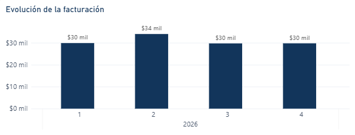
</p>
<p align="center"><strong>Figura 64. Drill-down: año a trimestre</strong></p>
<p align="center"><em>Desglose de un año en sus trimestres.</em></p>

<a name="figura-65"></a>
<p align="center">
  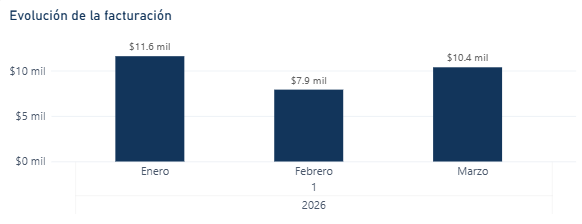
</p>
<p align="center"><strong>Figura 65. Drill-down: trimestre a mes</strong></p>
<p align="center"><em>Desglose de un trimestre en meses.</em></p>

<a name="figura-66"></a>
<p align="center">
  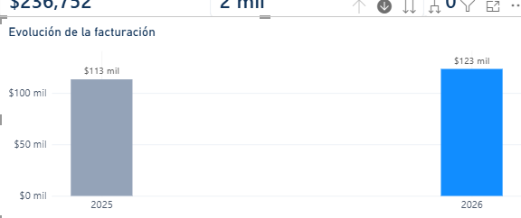
</p>
<p align="center"><strong>Figura 66. Roll-up: retorno al nivel anual</strong></p>
<p align="center"><em>Retorno a una vista agregada por año.</em></p>

<a name="figura-67"></a>
<p align="center">
  
</p>
<p align="center"><strong>Figura 67. Slice: cubo filtrado por año</strong></p>
<p align="center"><em>Reducción del cubo mediante la selección de un año.</em></p>

<a name="figura-68"></a>
<p align="center">
  
</p>
<p align="center"><strong>Figura 68. Dice: combinación de filtros</strong></p>
<p align="center"><em>Exploración de un subconjunto mediante filtros combinados.</em></p>

<a name="figura-69"></a>
<p align="center">
  
</p>
<p align="center"><strong>Figura 69. Nivel anual inicial</strong></p>
<p align="center"><em>Vista de partida del gráfico comercial en el nivel de años.</em></p>

<a name="figura-70"></a>
<p align="center">
  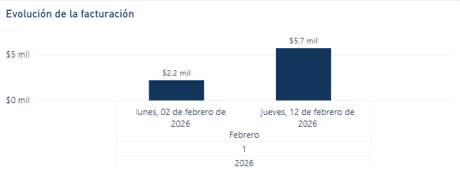
</p>
<p align="center"><strong>Figura 70. Drill-down hasta fecha</strong></p>
<p align="center"><em>Exploración del nivel diario de la jerarquía temporal.</em></p>

<a name="figura-71"></a>
<p align="center">
  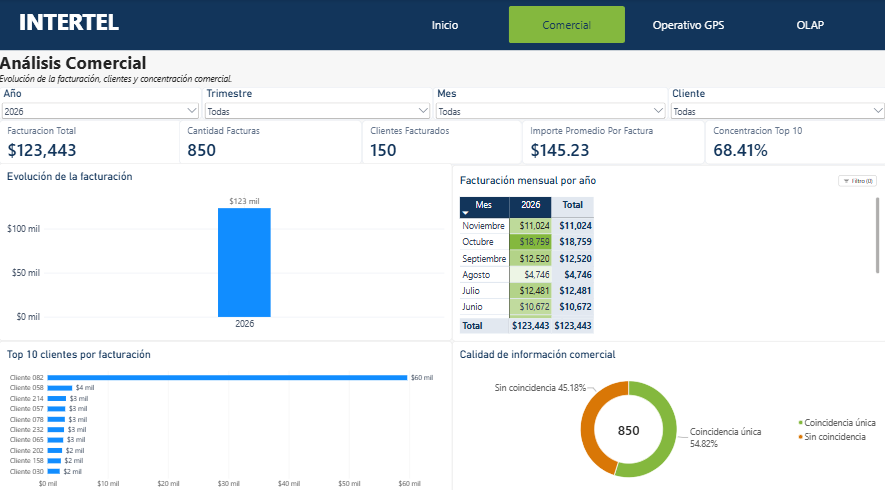
</p>
<p align="center"><strong>Figura 71. Slice comercial</strong></p>
<p align="center"><em>Filtrado de la facturación por una dimensión temporal.</em></p>

<a name="figura-72"></a>
<p align="center">
  
</p>
<p align="center"><strong>Figura 72. Dice comercial</strong></p>
<p align="center"><em>Combinación de filtros comerciales para explorar un subconjunto.</em></p>

<a name="figura-73"></a>
<p align="center">
  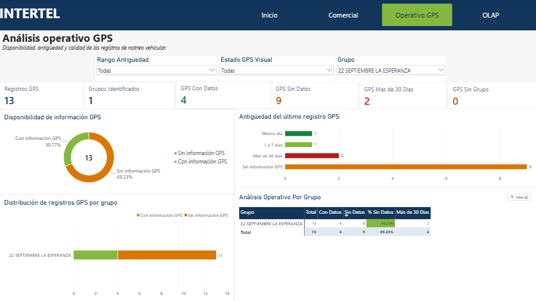
</p>
<p align="center"><strong>Figura 73. Slice operativo por grupo</strong></p>
<p align="center"><em>Selección de un grupo para analizar sus registros operativos.</em></p>

<a name="figura-74"></a>
<p align="center">
  
</p>
<p align="center"><strong>Figura 74. Dice operativo por grupo, estado y antigüedad</strong></p>
<p align="center"><em>Combinación de grupo 14 ENERO, estado sin información y rango sin datos; devuelve 21 registros.</em></p>

<a name="figura-75"></a>
<p align="center">
  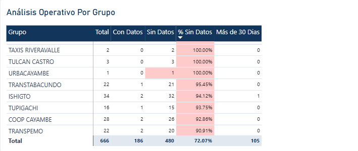
</p>
<p align="center"><strong>Figura 75. Priorización por porcentaje de ausencia de información</strong></p>
<p align="center"><em>Matriz ordenada por porcentaje de registros sin datos para orientar la revisión.</em></p>

<a name="figura-76"></a>
<p align="center">
  
</p>
<p align="center"><strong>Figura 76. Cubo completo según el alcance de filtros</strong></p>
<p align="center"><em>Vista general del cubo de facturación dentro del alcance de sus filtros.</em></p>

<a name="figura-77"></a>
<p align="center">
  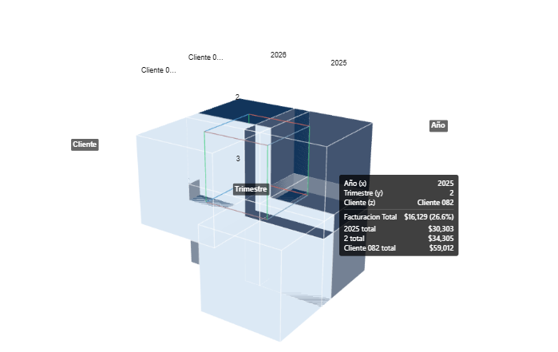
</p>
<p align="center"><strong>Figura 77. Detalle de una celda del cubo</strong></p>
<p align="center"><em>Detalle de una combinación de dimensiones y su importe de facturación.</em></p>

La operación Pivot se documenta mediante la ejecución SQL de OLAP05 de la sección 10.1. El procedimiento de intercambio de dimensiones en Power BI se describe en la tabla anterior, sin atribuirle una evidencia gráfica adicional. La rotación es una ayuda visual distinta de Pivot.

<a name="seccion-75"></a>
## 11. Insights y recomendaciones

| Hallazgo cuantitativo | Interpretación | Recomendación | Indicador de seguimiento |
|---|---|---|---|
| Facturación comparable +18,51 % | Mayor valor facturado enero–octubre de 2026 respecto a 2025 | Revisar composición de facturas y replicar prácticas comerciales que se confirmen efectivas | Variación interanual de períodos equivalentes |
| Octubre 2026 USD 18.758,90; agosto USD 4.746,17 | Diferencia relevante en los meses registrados | Investigar ciclos de facturación, renovaciones, instalaciones o faltantes de registros antes de atribuir causas | Facturación mensual y cobertura del archivo |
| Top 10: 70,46 % de facturación | Concentración en un grupo reducido de nombres facturados | Priorizar fidelización y evaluar diversificación; verificar identidades comerciales | Concentración Top 10 en períodos comparables |
| 480 de 666 registros sin información (72,07 %) | Baja disponibilidad de información en el reporte analizado | Confirmar alcance del reporte; revisar grupos con mayores volúmenes y proporciones, y contrastar con la plataforma | Proporción sin información por reporte y grupo |
| 105 de 186 con datos tienen más de 30 días (56,45 %) | Una parte relevante de los registros disponibles es antigua | Crear una cola de revisión por antigüedad y criticidad de servicio validada por Intertel | Registros mayores a 30 días / registros con datos |
| 640 facturas sin coincidencia (38,88 %) | Debilidad del vínculo por nombre con el catálogo | Usar identificador único y depurar homónimos, duplicados y discrepancias | Tasa de facturas con coincidencia inequívoca |
| 131 registros sin grupo; 45 sin dato SIM | Información administrativa incompleta | Completar identificadores y asignaciones en la fuente, con revisión de datos sensibles | Proporción de registros sin grupo o SIM |

<a name="seccion-76"></a>
### 11.1. Priorización sugerida

**Primero**, confirmar con el cliente qué representa el reporte GPS (por ejemplo, si es un listado de equipos fuera de línea o de un subconjunto), antes de generalizar el 72,07 % a la flota. Revisar los grupos con más registros sin información y con mayor antigüedad.

**Segundo**, mejorar el catálogo de clientes y el identificador común de facturación. La conciliación de importes debe mantenerse al corregir las correspondencias. La concentración comercial se interpreta sobre nombres normalizados y debe contrastarse con identidades verificadas.

**Tercero**, establecer un seguimiento mensual de facturación comparable, de concentración y de calidad de información. Definir metas y umbrales con Intertel, en lugar de considerar los rangos visuales como acuerdos de servicio.

<a name="seccion-77"></a>
## 12. Limitaciones y trabajo futuro

| Pregunta o análisis no resuelto | Información necesaria |
|---|---|
| Facturación y clientes por Cayambe, Quito u otra ciudad | Ciudad de cliente o contrato y vínculo verificable a facturación |
| Plan más contratado o más facturado | Suscripciones por cliente/dispositivo y detalle de factura vinculado a plan |
| Vehículos activos y cancelaciones | Historial de contratos, altas, bajas y estados de servicio |
| Rentabilidad | Costos de equipos, instalación, conectividad y operación |
| Cobros y morosidad | Pagos, vencimientos, saldos y estados de factura |
| Disponibilidad histórica real | Reportes sucesivos y alcance confirmado, identificadores estables de equipos |
| Recorridos o distancia por período | Definición de distancia, mediciones longitudinales y autorización correspondiente |

Como mejora futura se propone establecer exportaciones periódicas estandarizadas o acceso de solo lectura a los sistemas de origen, utilizar identificadores estables de clientes y dispositivos y agregar información contractual. Cuando existan nuevas fuentes autorizadas, podrán incorporarse dimensiones de plan, producto y geografía mediante relaciones válidas. También se recomienda implementar una estrategia transaccional de sustitución o carga incremental, pruebas automatizadas de duplicación, auditoría por fecha de reporte y programación del Job con actualización de Power BI. Estas ampliaciones no forman parte de los resultados demostrados en la entrega actual.

<a name="seccion-78"></a>
## 13. Conclusiones

1. Se implementó una solución de BI local que integra los archivos de Intertel en un Data Warehouse con dos procesos de negocio y cuatro dimensiones. El esquema de constelación respeta las distintas granularidades de facturación y GPS y evita vínculos sin soporte en las fuentes.
2. La automatización del ETL mediante nueve transformaciones y un Job de Pentaho permite reproducir la carga, aplicar reglas explícitas y registrar incidencias. Los conteos de carga y conciliación financiera permiten verificar la integridad de los resultados válidos.
3. Las consultas SQL y las páginas de Power BI permiten responder preguntas comerciales, operativas y de calidad. Los análisis muestran USD 236.752,00 facturados, un incremento comparable del 18,51 % y una concentración del 70,46 % en los diez principales nombres facturados.
4. La ausencia de información en el 72,07 % del reporte GPS y la antigüedad superior a 30 días de 105 registros permiten proponer prioridades de investigación, sin diagnosticar fallas ni extrapolar a toda la flota.
5. Las operaciones OLAP permiten cambiar niveles de detalle, filtrar subconjuntos y reorganizar dimensiones. El cubo tridimensional complementa, pero no sustituye, las consultas relacionales y las visualizaciones convencionales.
6. La calidad y disponibilidad de las fuentes condicionan el alcance de las conclusiones. La incorporación de identificadores únicos, detalle contractual y reportes históricos permitirá ampliar el análisis y fortalecer su utilidad para la toma de decisiones.

<a name="seccion-79"></a>
## 14. Bibliografía

- Escuela Politécnica Nacional, Facultad de Ingeniería de Sistemas. (2026). *Proyecto Primer Bimestre — Business Intelligence*. Instrucciones y rúbrica de evaluación de la asignatura.
- Intertel. (2026). *Catálogo de clientes, facturación, reporte de dispositivos GPS del 19 de noviembre y catálogo de planes de plataforma de rastreo vehicular*. Fuentes facilitadas para el proyecto académico; acceso restringido.
- Kimball, R., & Ross, M. (2013). *The Data Warehouse Toolkit: The Definitive Guide to Dimensional Modeling* (3.ª ed.). Wiley.
- PostgreSQL Global Development Group. (s. f.). *PostgreSQL documentation: Constraints*. https://www.postgresql.org/docs/current/ddl-constraints.html
- PostgreSQL Global Development Group. (s. f.). *PostgreSQL documentation: Table expressions (GROUPING SETS, CUBE, ROLLUP)*. https://www.postgresql.org/docs/current/queries-table-expressions.html
- Hitachi Vantara. (s. f.). *Pentaho documentation*. https://docs.pentaho.com/
- Microsoft. (s. f.). *Understand star schema and the importance for Power BI*. Microsoft Learn. https://learn.microsoft.com/en-us/power-bi/guidance/star-schema
- Microsoft. (s. f.). *PostgreSQL connector*. Microsoft Learn. https://learn.microsoft.com/en-us/power-query/connectors/postgresql
- Microsoft. (s. f.). *Data Analysis Expressions (DAX) reference*. Microsoft Learn. https://learn.microsoft.com/en-us/dax/
- Grupo B, Business Intelligence. (2026). *Repositorio de prácticas y proyecto*. https://github.com/Nestor-Sarmiento/business-intelligence-grupob