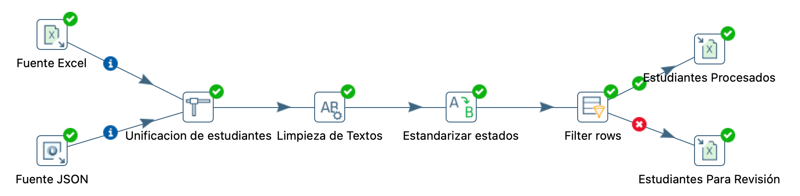
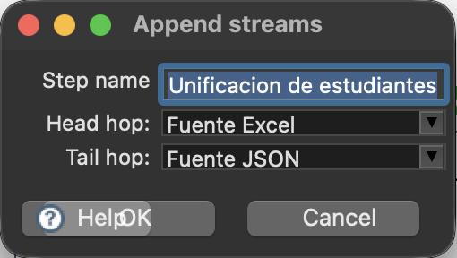
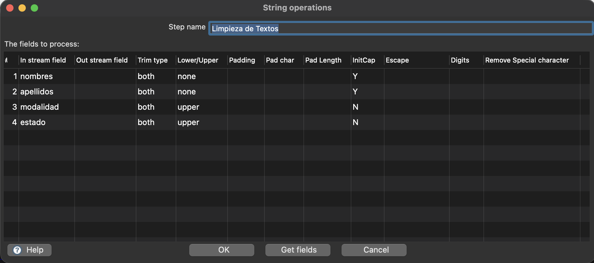
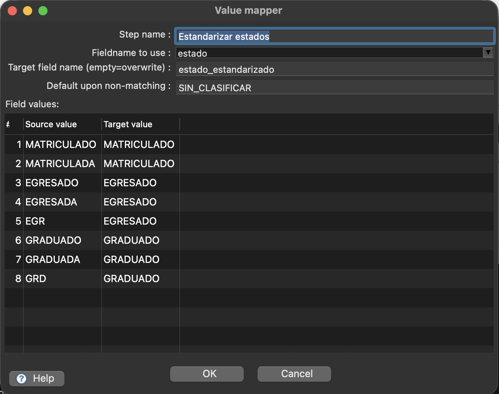
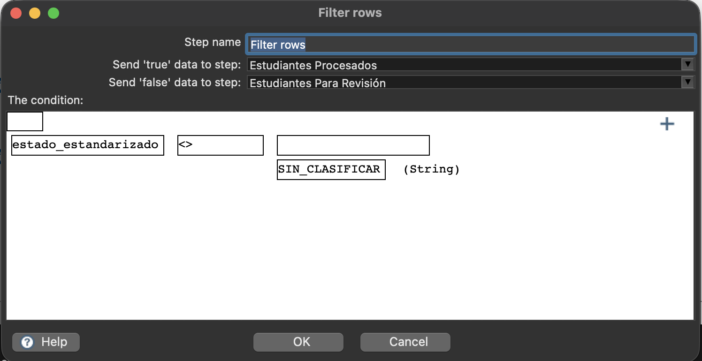
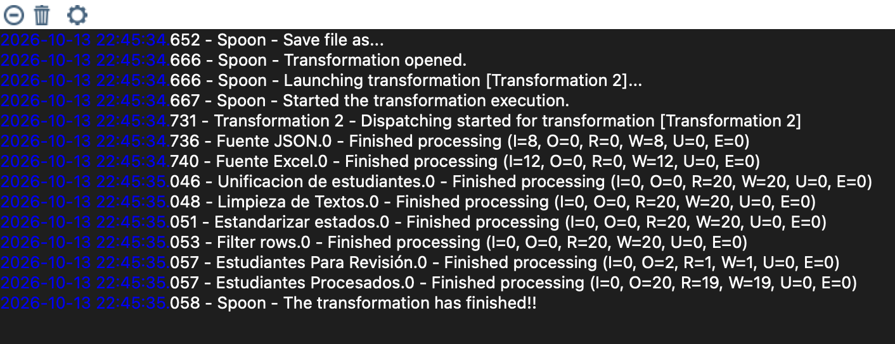
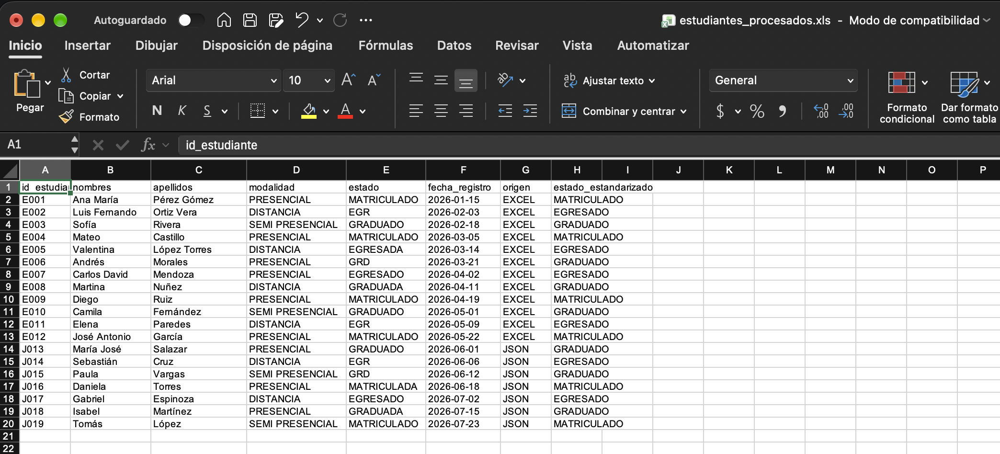
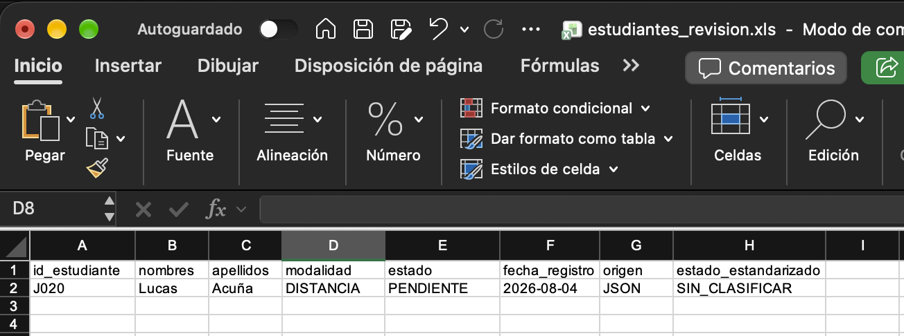

  

<h1 align="center">Escuela Politécnica Nacional</h1>

<h2 align="center">Business Intelligence</h2>

**Curso:** GR2SW

**Integrantes:**

- Arroyo Juan

- Echeverría Gabriela

- Sarmiento Néstor

- Villavicencio Michelle

**Fecha:** 13/10/2026

---

## Índice de contenidos

- [1. Introducción](#1-introducción)
- [2. Objetivos](#2-objetivos)
  - [2.1. Objetivo general](#21-objetivo-general)
  - [2.2. Objetivos específicos](#22-objetivos-específicos)
- [3. Fuentes de datos utilizadas](#3-fuentes-de-datos-utilizadas)
  - [3.1. Flujo 1: Datos de estudiantes](#31-flujo-1-datos-de-estudiantes)
  - [3.2. Flujo 2: Fuentes de datos heterogéneas](#32-flujo-2-fuentes-de-datos-heterogéneas)
- [4. Problemas identificados en los datos](#4-problemas-identificados-en-los-datos)
  - [4.1. Problemas del flujo 1](#41-problemas-del-flujo-1)
  - [4.2. Problemas del flujo 2](#42-problemas-del-flujo-2)
- [5. Transformaciones aplicadas](#5-transformaciones-aplicadas)
  - [5.1. Transformaciones del flujo 1](#51-transformaciones-del-flujo-1)
    - [5.1.1. Vista general del flujo ETL](#511-vista-general-del-flujo-etl)
    - [5.1.2. Procesamiento de datos (transformación)](#512-procesamiento-de-datos-transformación)
  - [5.2. Transformaciones del flujo 2](#52-transformaciones-del-flujo-2)
    - [5.2.1. Vista general del flujo ETL](#521-vista-general-del-flujo-etl)
    - [5.2.2. Unificación de fuentes](#522-unificación-de-fuentes)
    - [5.2.3. Limpieza y estandarización de datos](#523-limpieza-y-estandarización-de-datos)
    - [5.2.4. Clasificación de registros](#524-clasificación-de-registros)
- [6. Evidencias y resultados](#6-evidencias-y-resultados)
  - [6.1. Resultados del flujo 1](#61-resultados-del-flujo-1)
  - [6.2. Resultados del flujo 2](#62-resultados-del-flujo-2)
    - [6.2.1. Ejecución del flujo ETL](#621-ejecución-del-flujo-etl)
    - [6.2.2. Registros procesados](#622-registros-procesados)
    - [6.2.3. Registros enviados a revisión](#623-registros-enviados-a-revisión)
- [7. Relación con una arquitectura Data Warehouse](#7-relación-con-una-arquitectura-data-warehouse)
- [8. Conclusiones](#8-conclusiones)
- [9. Referencias bibliográficas](#9-referencias-bibliográficas)
- [10. Declaración de uso de Inteligencia Artificial](#10-declaración-de-uso-de-inteligencia-artificial)

---

## 1. Introducción

Este informe documenta el uso de **Pentaho Data Integration (Spoon)** para desarrollar procesos ETL de limpieza, validación e integración de datos.

El primer flujo procesa registros de estudiantes con inconsistencias en nombres, apellidos y fechas. El segundo flujo integra registros de estudiantes procedentes de archivos Excel y JSON.

Se presentan las fuentes, las transformaciones, los resultados y su relación con una arquitectura de Data Warehouse. La práctica se desarrolló tomando como referencia la guía proporcionada en el Aula Virtual de la EPN [1].

---

## 2. Objetivos

### 2.1. Objetivo general

Desarrollar procesos ETL mediante Pentaho Data Integration (Spoon) para la limpieza, transformación, validación e integración de datos provenientes de diferentes fuentes, garantizando una mayor calidad y consistencia de la información para su posterior análisis.

### 2.2. Objetivos específicos

- Identificar los problemas de calidad presentes en las fuentes de datos, reconociendo inconsistencias que requieran procesos de limpieza, validación o transformación.

- Implementar dos flujos ETL en Pentaho Data Integration (Spoon): uno orientado a la limpieza y validación de registros de estudiantes y otro a la integración de datos provenientes de fuentes de diferentes tipos.

- Verificar los resultados obtenidos mediante la revisión de los archivos de salida, evaluando la consistencia de los datos procesados y su utilidad dentro de una arquitectura de Data Warehouse.

---

## 3. Fuentes de datos utilizadas

### 3.1. Flujo 1: Datos de estudiantes

El primer flujo utiliza el archivo [Caso Estudiantes Fechas Cedula.xls](Fuentes%20Datos/Caso%20Estudiantes%20Fechas%20Cedula.xls), que contiene registros de estudiantes con campos de nombres, apellidos y fechas.

### 3.2. Flujo 2: Fuentes de datos heterogéneas

Para el segundo flujo se utilizaron dos fuentes de datos de diferentes formatos:

- **Fuente Excel:** [fuente_estudiantes_excel.xlsx](Fuentes%20Datos/fuente_estudiantes_excel.xlsx)

- **Fuente JSON:** [fuente_estudiantes_json.json](Fuentes%20Datos/fuente_estudiantes_json.json)

Estas fuentes contienen información de estudiantes que se integró y estandarizó mediante el segundo flujo ETL.

---

## 4. Problemas identificados en los datos

### 4.1. Problemas del flujo 1

- **Inconsistencias en nombres y apellidos:** presencia de errores de escritura, caracteres acentuados incorrectos y diferencias en el uso de mayúsculas y minúsculas.

- **Formatos de fecha inconsistentes:** registros con fechas que requieren estandarización para mantener un formato uniforme.

- **Fechas no válidas:** valores que no cumplen las condiciones de validación establecidas y que deben separarse para su revisión.

### 4.2. Problemas del flujo 2

- **Espacios innecesarios:** algunos nombres y apellidos contienen espacios al inicio o al final del texto.

- **Diferencias en mayúsculas y minúsculas:** los campos de nombres, apellidos, modalidad y estado presentan formatos de escritura distintos.

- **Estados académicos no uniformes:** se utilizan variantes como `MATRICULADA`, `EGRESADA` y `GRADUADA`, además de abreviaturas como `EGR` y `GRD`.

- **Valores no contemplados:** el registro `J020`, procedente de JSON, contiene el estado `PENDIENTE`, que no corresponde a las categorías definidas para la estandarización.

---

## 5. Transformaciones aplicadas

### 5.1. Transformaciones del flujo 1

Las principales operaciones realizadas fueron:

1. **Selección de campos (Select Values):** se seleccionaron los campos necesarios para el procesamiento de los registros, preparando la información para las siguientes etapas.

2. **Limpieza de nombres (JavaScript):** se aplicaron reglas de corrección y estandarización de nombres y apellidos, incluyendo el tratamiento de caracteres acentuados y la normalización del uso de mayúsculas y minúsculas.

3. **Validación de fechas (JavaScript):** se procesaron los valores correspondientes a fechas para estandarizar su representación y comprobar que cumplieran las condiciones de validez establecidas.

4. **Clasificación de registros (Filter Rows):** se separaron los registros que superaron las validaciones de aquellos que presentaron inconsistencias y requerían revisión.

5. **Generación de archivos de salida (Microsoft Excel Output):** se almacenaron los registros procesados en archivos Excel, diferenciando los datos válidos de los observados.

#### 5.1.1. Vista general del flujo ETL

La figura 1 presenta la secuencia de pasos implementados para procesar los datos de estudiantes.

**Figura 1. Flujo general de limpieza y validación de estudiantes.**

  

*Descripción: Flujo ETL desarrollado en Pentaho Spoon. El proceso inicia en Staging con la lectura del archivo Excel, continúa con la selección de campos (Select), la limpieza de nombres y apellidos y la validación de fechas. Finalmente, Filter rows clasifica los registros y los dirige hacia dos salidas independientes: Estudiantes Válidos y Estudiantes Observados.*

#### 5.1.2. Procesamiento de datos (transformación)

Las figuras 2 a 4 muestran la configuración de las reglas de limpieza, validación y clasificación.

**Figura 2. Configuración de la transformación Limpieza de Nombres.**

  

*Descripción: Configuración del paso Modified JavaScript Value, donde se utiliza un script para corregir caracteres especiales y estandarizar nombres y apellidos. Se generan los campos `nombres_limpios` y `apellidos_limpios`.*

**Figura 3. Configuración de la transformación Validar Fechas.**

  

*Descripción: Configuración del paso Modified JavaScript Value, donde se validan las fechas de admisión y de estado, comprobando que correspondan a fechas reales y estandarizando su formato a AAAA-MM-DD. Se generan los campos `fecha_admision_std`, `fecha_estado_std` y `fechas_validas`, este último para identificar si el registro cumple las validaciones.*

**Figura 4. Configuración del filtro de registros de estudiantes.**

  

*Descripción: Configuración del paso Filter rows, que evalúa el campo booleano `fechas_validas`. Los registros con valor verdadero (Y) se envían a Estudiantes Válidos, mientras que aquellos con valor falso se dirigen a Estudiantes Observados para su revisión.*

### 5.2. Transformaciones del flujo 2

Las principales operaciones realizadas fueron:

1. **Extracción de datos (Microsoft Excel Input y JSON Input):** se obtuvieron los registros de estudiantes desde dos fuentes de diferentes formatos, Excel y JSON.

2. **Unificación de registros (Append streams):** se concatenaron los datos de ambas fuentes en un único flujo, conservando el campo `origen` para identificar su procedencia.

3. **Limpieza de textos (String operations):** se eliminaron los espacios al inicio y al final de nombres, apellidos, modalidad y estado. Además, se normalizó el uso de mayúsculas y minúsculas.

4. **Estandarización de estados (Value mapper):** se unificaron las variantes y abreviaturas de los estados académicos en las categorías `MATRICULADO`, `EGRESADO` y `GRADUADO`. Los valores no reconocidos se identificaron como `SIN_CLASIFICAR`.

5. **Clasificación de registros (Filter rows):** se separaron los estudiantes con estados reconocidos de aquellos que requerían revisión.

6. **Generación de archivos de salida (Microsoft Excel Output):** se almacenaron los registros en dos archivos Excel: `estudiantes_procesados.xls` y `estudiantes_revision.xls`.

#### 5.2.1. Vista general del flujo ETL

**Figura 5. Flujo general de integración y procesamiento de estudiantes.**

  

*Descripción: Flujo desarrollado en Pentaho Spoon que extrae datos de Excel y JSON, unifica los registros, aplica operaciones de limpieza y estandarización y los clasifica en Estudiantes Procesados y Estudiantes Para Revisión.*

#### 5.2.2. Unificación de fuentes

**Figura 6. Configuración de la unificación de estudiantes.**

  

*Descripción: Configuración del paso Append streams, que concatena los registros de Fuente Excel y Fuente JSON en un único flujo de datos para su posterior procesamiento.*

#### 5.2.3. Limpieza y estandarización de datos

**Figura 7. Configuración de la limpieza de textos.**

  

*Descripción: El paso String operations elimina espacios al inicio y al final de los campos `nombres`, `apellidos`, `modalidad` y `estado`. Además, aplica iniciales en mayúscula a nombres y apellidos, y convierte modalidad y estado a mayúsculas.*

**Figura 8. Configuración de la estandarización de estados académicos.**

  

*Descripción: El paso Value mapper unifica variantes y abreviaturas de los estados académicos en las categorías `MATRICULADO`, `EGRESADO` y `GRADUADO`. Los valores no reconocidos reciben `SIN_CLASIFICAR` en el campo `estado_estandarizado`.*

#### 5.2.4. Clasificación de registros

**Figura 9. Configuración del filtro de estados académicos.**

  

*Descripción: El paso Filter rows evalúa la condición `estado_estandarizado <> SIN_CLASIFICAR`. Los registros que cumplen la condición se envían a Estudiantes Procesados, mientras que los demás se dirigen a Estudiantes Para Revisión.*

---

## 6. Evidencias y resultados

### 6.1. Resultados del flujo 1

Los archivos generados por el primer flujo ETL se encuentran disponibles para su consulta:

- **Estudiantes válidos:** [estudiantes_validos.xls](Salidas%20Obtenidas/estudiantes_validos.xls)

- **Estudiantes observados:** [estudiantes_observados.xls](Salidas%20Obtenidas/estudiantes_observados.xls)

Las siguientes evidencias muestran la ejecución del flujo y los registros válidos obtenidos.

**Figura 10. Registro de ejecución del flujo ETL de estudiantes.**

  

*Descripción: Registro de ejecución de Pentaho Spoon que muestra el procesamiento de 99 registros y la finalización de la transformación sin errores (E = 0). Se confirma la ejecución de los pasos de limpieza, validación, clasificación y generación de archivos Excel.*

**Figura 11. Archivo Excel generado con los registros de estudiantes válidos.**

  

*Descripción: Archivo `estudiantes_validos.xls` generado por el flujo ETL. Se observan los registros procesados con los campos `nombres_limpios`, `apellidos_limpios`, `fecha_admision_std` y `fecha_estado_std`, además del indicador `fechas_validas` con valor VERDADERO, que confirma el cumplimiento de las condiciones de validación de fechas.*

### 6.2. Resultados del flujo 2

La ejecución del segundo flujo ETL permitió integrar 20 registros provenientes de Excel y JSON. De ellos, **19 fueron clasificados como procesados** y **1 fue enviado a revisión** por presentar un estado académico no contemplado en las reglas de estandarización.

Los archivos generados están disponibles para su consulta:

- **Estudiantes procesados:** [estudiantes_procesados.xls](Salidas%20Obtenidas/estudiantes_procesados.xls)

- **Estudiantes para revisión:** [estudiantes_revision.xls](Salidas%20Obtenidas/estudiantes_revision.xls)

#### 6.2.1. Ejecución del flujo ETL

**Figura 12. Resultado de la ejecución del segundo flujo en Pentaho Spoon.**

  

*Descripción: El registro de ejecución muestra la lectura de 12 estudiantes desde Excel y 8 desde JSON. Los 20 registros recorrieron las etapas de transformación y se distribuyeron en 19 procesados y 1 enviado a revisión, sin errores de ejecución (E = 0).*

#### 6.2.2. Registros procesados

**Figura 13. Archivo Excel con los estudiantes procesados.**

  

*Descripción: El archivo estudiantes_procesados.xls contiene 19 registros con estados académicos reconocidos y estandarizados. Se conserva el estado original y se incorpora el campo estado_estandarizado, junto con el origen de cada registro.*

#### 6.2.3. Registros enviados a revisión

**Figura 14. Archivo Excel con el estudiante enviado a revisión.**

  

*Descripción: El archivo estudiantes_revision.xls contiene el registro J020, procedente de JSON, cuyo estado original PENDIENTE fue clasificado como SIN_CLASIFICAR al no encontrarse entre los valores definidos en la transformación.*

---

## 7. Relación con una arquitectura Data Warehouse

Ambos flujos representan la etapa ETL de una arquitectura Data Warehouse, en la que los datos se preparan antes de su almacenamiento y análisis.

La integración de fuentes Excel y JSON, junto con las reglas de limpieza y validación, permite obtener datos más consistentes. La separación de registros observados evita que los valores no reconocidos se incorporen sin revisión.

Los resultados podrían utilizarse en una zona de preparación (*staging*) antes de la carga a un Data Warehouse. En esta práctica, la salida se limitó a archivos Excel; no se realizó dicha carga.

---

## 8. Conclusiones

1. Se identificaron inconsistencias en los registros de estudiantes, principalmente en nombres, apellidos, fechas y estados académicos. Esto permitió definir reglas de limpieza, validación y estandarización según los problemas de cada fuente.

2. Se implementaron dos flujos ETL en Pentaho Spoon: el primero para limpiar y validar datos de estudiantes, y el segundo para integrar archivos Excel y JSON. Ambos finalizaron su ejecución sin errores, lo que permitió generar archivos de salida diferenciados según las reglas aplicadas.

3. La revisión de los resultados permitió comprobar la clasificación de los registros. En el segundo flujo, de 20 estudiantes, 19 fueron procesados y uno fue enviado a revisión por presentar el estado `PENDIENTE`. Esta separación demuestra la utilidad de las validaciones para preparar información más consistente antes de una posible carga a un Data Warehouse.

---

## 9. Referencias bibliográficas

[1] Escuela Politécnica Nacional, Facultad de Ingeniería de Sistemas, *Práctica 1. Implementación de un proceso ETL y Staging Area con Pentaho Data Integration*, material de clase disponible en el Aula Virtual de la EPN, s. f. Acceso institucional.

[2] Pentaho, *Pentaho Data Integration Documentation*. [En línea]. Disponible: https://docs.pentaho.com/pdia-data-integration. [Accedido: 13-oct-2026].

[3] Oracle, *Java Platform, Standard Edition 18 Documentation*. [En línea]. Disponible: https://docs.oracle.com/en/java/javase/18/. [Accedido: 13-oct-2026].

## 10. Declaración de uso de Inteligencia Artificial

Se declara un uso estimado del **15 % de inteligencia artificial generativa**, empleada como apoyo en la redacción, organización y formato Markdown del informe. El desarrollo de los flujos ETL en Pentaho, las transformaciones aplicadas y las evidencias obtenidas corresponden al trabajo realizado por los integrantes del grupo.
