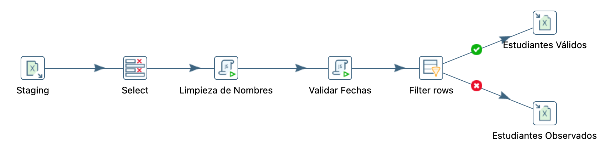
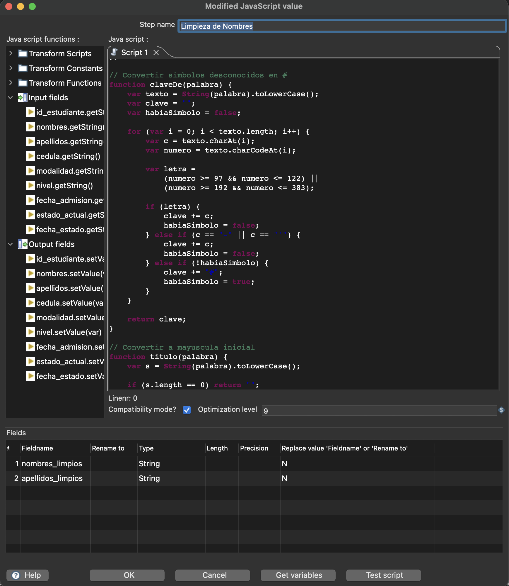
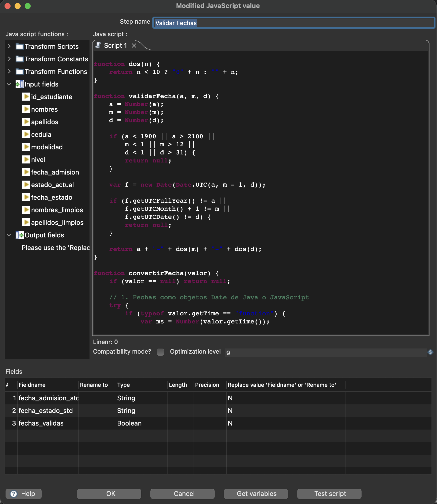
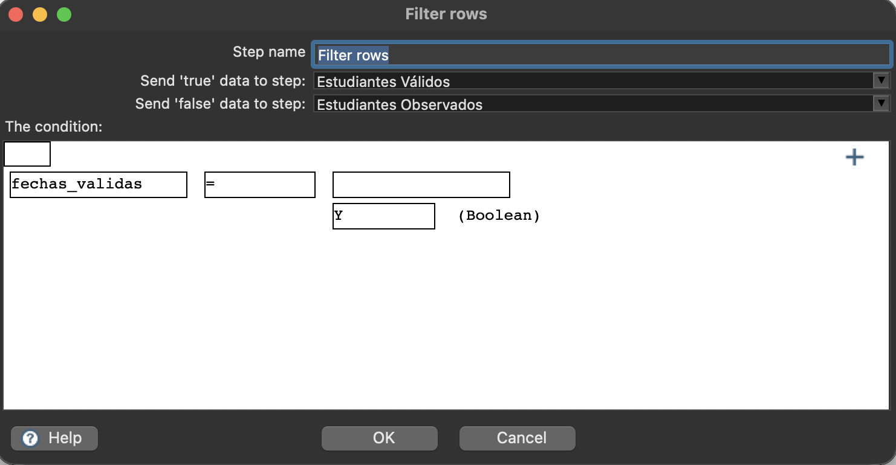
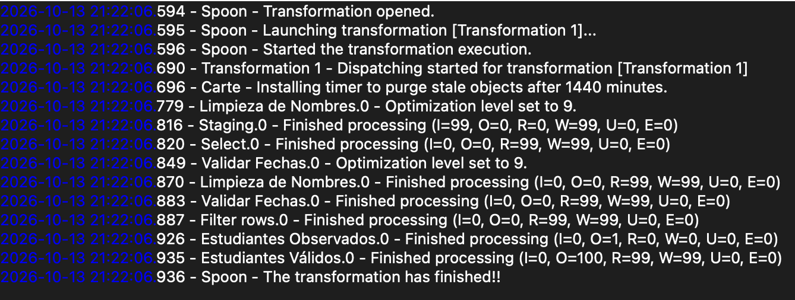
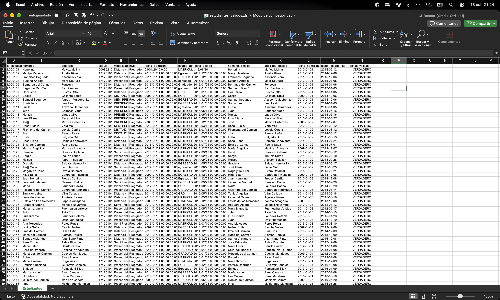

  

<h1 align="center">Escuela Politécnica Nacional</h1>

<h2 align="center">Business Intelligence</h2>

**Curso:** GR2SW

**Integrantes:**

- Arroyo Juan
- Echeverria Gabriela
- Sarmiento Néstor
- Villavicencio Michelle

**Fecha:** 13/10/2026

---

## Índice de contenidos

1. [Introducción](#1-introducción)
2. [Objetivos](#2-objetivos)
   - [Objetivo general](#21-objetivo-general)
   - [Objetivos específicos](#22-objetivos-específicos)
3. [Herramientas y tecnologías utilizadas](#3-herramientas-y-tecnologías-utilizadas)
4. [Fuentes de datos utilizadas](#4-fuentes-de-datos-utilizadas)
   - [Flujo 1: Datos de estudiantes](#41-flujo-1-datos-de-estudiantes)
   - [Flujo 2: Fuentes de datos heterogéneas](#42-flujo-2-fuentes-de-datos-heterogéneas)
5. [Problemas identificados en los datos](#5-problemas-identificados-en-los-datos)
   - [Problemas del flujo 1](#51-problemas-del-flujo-1)
   - [Problemas del flujo 2](#52-problemas-del-flujo-2)
6. [Transformaciones aplicadas](#6-transformaciones-aplicadas)
   - [Transformaciones del flujo 1](#61-transformaciones-del-flujo-1)
   - [Transformaciones del flujo 2](#62-transformaciones-del-flujo-2)
7. [Desarrollo de los flujos ETL](#7-desarrollo-de-los-flujos-etl)
   - [Flujo 1: Limpieza y validación de estudiantes](#71-flujo-1-limpieza-y-validación-de-estudiantes)
   - [Flujo 2: Integración de fuentes de datos](#72-flujo-2-integración-de-fuentes-de-datos)
8. [Evidencias y resultados](#8-evidencias-y-resultados)
   - [Resultados del flujo 1](#81-resultados-del-flujo-1)
   - [Resultados del flujo 2](#82-resultados-del-flujo-2)
9. [Relación con una arquitectura Data Warehouse](#9-relación-con-una-arquitectura-data-warehouse)
10. [Conclusiones](#10-conclusiones)
11. [Referencias bibliográficas](#11-referencias-bibliográficas)
12. [Declaración de uso de inteligencia artificial](#12-declaración-de-uso-de-inteligencia-artificial)

---

## 1. Introducción

En el presente informe se documenta el desarrollo de dos procesos ETL (Extract, Transform, Load) utilizando la herramienta **Pentaho Data Integration (Spoon)**, con el propósito de aplicar técnicas de limpieza, transformación, validación e integración de datos.

El primer flujo se enfoca en la limpieza y validación de registros de estudiantes, corrigiendo inconsistencias en nombres, apellidos y fechas. El segundo flujo contempla la integración de información proveniente de dos tipos diferentes de fuentes de datos.

Se describen las fuentes utilizadas, los problemas identificados, las transformaciones realizadas, los flujos desarrollados y los resultados obtenidos, así como su relación con una arquitectura de Data Warehouse.

---

## 2. Objetivos

### 2.1. Objetivo general

Desarrollar procesos ETL mediante Pentaho Data Integration (Spoon) para la limpieza, transformación, validación e integración de datos provenientes de diferentes fuentes, garantizando una mayor calidad y consistencia de la información para su posterior análisis.

### 2.2. Objetivos específicos

- Identificar los problemas de calidad presentes en las fuentes de datos, reconociendo inconsistencias que requieran procesos de limpieza, validación o transformación.

- Implementar dos flujos ETL en Pentaho Data Integration (Spoon): uno orientado a la limpieza y validación de registros de estudiantes y otro a la integración de datos provenientes de fuentes de diferentes tipos.

- Verificar los resultados obtenidos mediante la revisión de los archivos de salida, evaluando la consistencia de los datos procesados y su utilidad dentro de una arquitectura de Data Warehouse.

---

## 3. Fuentes de datos utilizadas

### 3.1. Flujo 1: Datos de estudiantes

Para el primer flujo ETL se utiliza el archivo [Caso Estudiantes Fechas Cedula.xls](Fuentes%20Datos/Caso%20Estudiantes%20Fechas%20Cedula.xls), una fuente de datos que contiene registros de estudiantes.

Este archivo constituye la fuente de entrada para el proceso de limpieza y validación, en el que se trabajan principalmente los campos correspondientes a nombres, apellidos y fechas, con el propósito de corregir inconsistencias y obtener registros estandarizados.

### 3.2. Flujo 2: Fuentes de datos heterogéneas

Para el segundo flujo ETL se contempla el uso de **dos fuentes de datos de diferentes tipos**, con el objetivo de extraer e integrar información en un mismo proceso.

Las fuentes específicas y sus características se documentarán una vez que sean seleccionadas, considerando sus formatos, estructuras y los datos que se utilizarán para la integración.

---
## 4. Problemas identificados en los datos

### 4.1. Problemas del flujo 1

- **Inconsistencias en nombres y apellidos:** presencia de errores de escritura, caracteres acentuados incorrectos y diferencias en el uso de mayúsculas y minúsculas.
- **Formatos de fecha inconsistentes:** registros con fechas que requieren estandarización para mantener un formato uniforme.
- **Fechas no válidas:** valores que no cumplen las condiciones de validación establecidas y que deben separarse para su revisión.

### 4.2. Problemas del flujo 2

Los problemas de calidad e integración del segundo flujo se identificarán una vez seleccionadas y analizadas las dos fuentes de datos que se utilizarán.

---

## 5. Transformaciones aplicadas

### 5.1. Transformaciones del flujo 1

Las principales operaciones realizadas fueron:

1. **Selección de campos (Select Values):** se seleccionaron los campos necesarios para el procesamiento de los registros, preparando la información para las siguientes etapas.

2. **Limpieza de nombres (JavaScript):** se aplicaron reglas de corrección y estandarización de nombres y apellidos, incluyendo el tratamiento de caracteres acentuados y la normalización del uso de mayúsculas y minúsculas.

3. **Validación de fechas (JavaScript):** se procesaron los valores correspondientes a fechas para estandarizar su representación y comprobar que cumplieran las condiciones de validez establecidas.

4. **Clasificación de registros (Filter Rows):** se separaron los registros que superaron las validaciones de aquellos que presentaron inconsistencias y requerían revisión.

5. **Generación de archivos de salida (Microsoft Excel Output):** se almacenaron los registros procesados en archivos Excel, diferenciando los datos válidos de los observados.

#### 5.1.1. Vista general del flujo ETL

La Figura 1 presenta la secuencia de pasos implementados para procesar los datos de estudiantes.

**Figura 1. Flujo general de limpieza y validación de estudiantes.**

  

*Descripción: Flujo ETL desarrollado en Pentaho Spoon. El proceso inicia en Staging con la lectura del archivo Excel, continúa con la selección de campos (Select), la limpieza de nombres y apellidos y la validación de fechas. Finalmente, Filter rows clasifica los registros y los dirige hacia dos salidas independientes: Estudiantes Válidos y Estudiantes Observados.*

#### 5.1.2. Procesamiento de datos (transformación)

En esta etapa se aplican las reglas de limpieza y validación necesarias para corregir las inconsistencias identificadas en los registros de estudiantes.

**Figura 2. Configuración de la transformación Limpieza de Nombres.**

  

*Descripción: Configuración del paso Modified JavaScript Value, donde se utiliza un script para corregir caracteres especiales y estandarizar nombres y apellidos. Se generan los campos `nombres_limpios` y `apellidos_limpios`.*

**Figura 3. Configuración de la transformación Validar Fechas.**

  

*Descripción: Configuración del paso Modified JavaScript Value, donde se validan las fechas de admisión y de estado, comprobando que correspondan a fechas reales y estandarizando su formato a AAAA-MM-DD. Se generan los campos `fecha_admision_std`, `fecha_estado_std` y `fechas_validas`, este último para identificar si el registro cumple las validaciones.*

**Figura 4. Configuración del filtro de registros de estudiantes.**

  

*Descripción: Configuración del paso Filter rows, que evalúa el campo booleano `fechas_validas`. Los registros con valor verdadero (Y) se envían a Estudiantes Válidos, mientras que aquellos con valor falso se dirigen a Estudiantes Observados para su revisión.*

### 5.2. Transformaciones del flujo 2

Las transformaciones correspondientes al segundo flujo se documentarán una vez que se definan las fuentes de datos y se implemente el proceso de integración.

---

## 6. Evidencias y resultados

### 6.1. Resultados del flujo 1

La ejecución del flujo ETL permitió procesar los registros de estudiantes y generar los archivos de salida correspondientes.

**Figura 5. Registro de ejecución del flujo ETL de estudiantes.**

  

*Descripción: Registro de ejecución de Pentaho Spoon que muestra el procesamiento de 99 registros y la finalización de la transformación sin errores (E=0). Se confirma la ejecución de los pasos de limpieza, validación, clasificación y generación de archivos Excel.*

**Figura 6. Archivo Excel generado con los registros de estudiantes válidos.**

  

*Descripción: Archivo `estudiantes_validos.xls` generado por el flujo ETL. Se observan los registros procesados con los campos `nombres_limpios`, `apellidos_limpios`, `fecha_admision_std` y `fecha_estado_std`, además del indicador `fechas_validas` con valor VERDADERO, que confirma el cumplimiento de las condiciones de validación de fechas.*

### 6.2. Resultados del flujo 2

Las evidencias y resultados del segundo flujo se incorporarán una vez desarrollado y ejecutado el proceso de integración.

---

## 7. Relación con una arquitectura Data Warehouse

El proceso desarrollado se relaciona con una arquitectura de Data Warehouse porque permite preparar datos confiables antes de incorporarlos a un repositorio centralizado. La limpieza de nombres, la estandarización de fechas y la identificación de registros observados contribuyen a mejorar la calidad de la información que posteriormente podría utilizarse para el análisis.

Dentro de esta arquitectura, los datos procesados representarían una fuente de información depurada, mientras que los registros observados permitirían identificar inconsistencias que deben corregirse antes de su integración. Esto favorece la consistencia de los datos y reduce el riesgo de obtener resultados incorrectos en reportes e indicadores de Business Intelligence.

Aunque el flujo genera archivos Excel y no realiza una carga directa a un Data Warehouse, constituye una etapa previa de preparación y control de calidad de los datos, necesaria para construir una base de información adecuada para el análisis.
