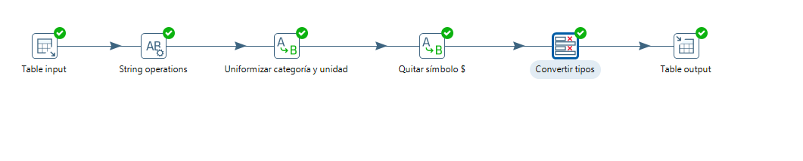
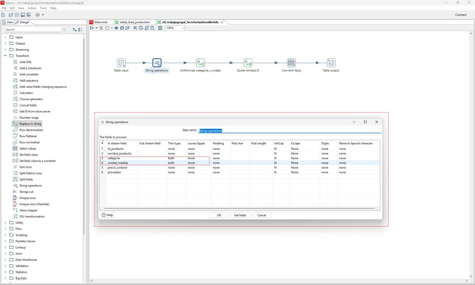
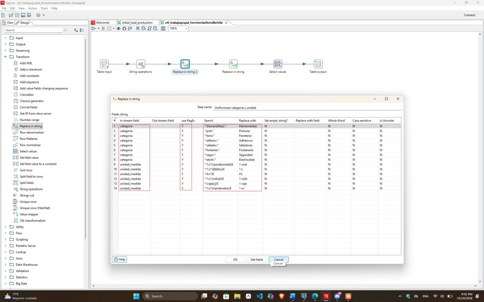
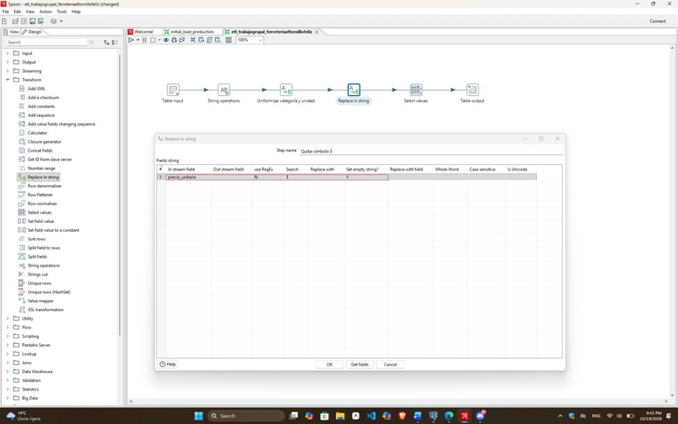
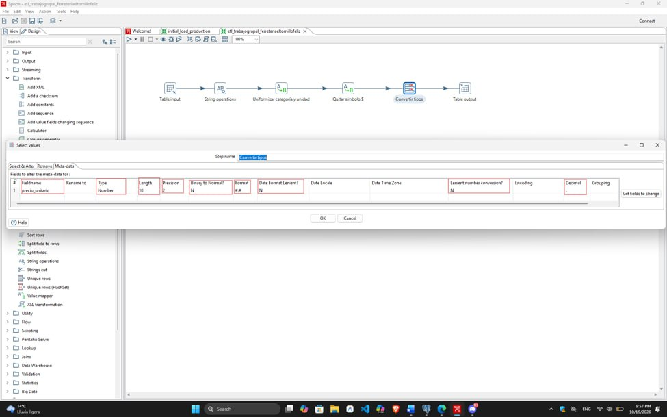
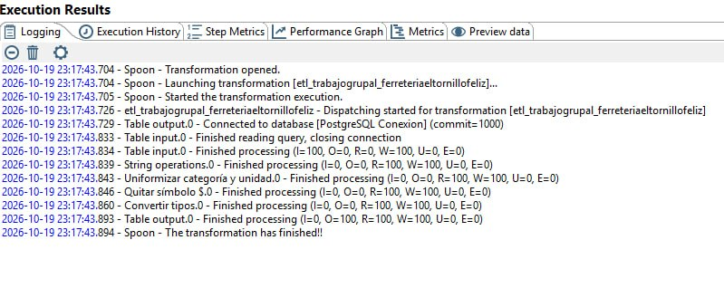
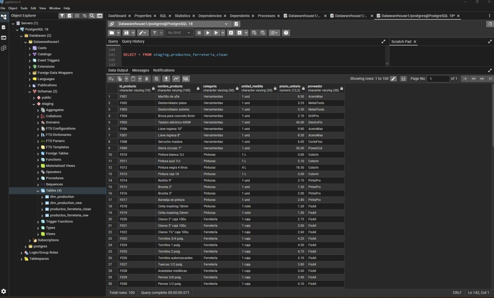
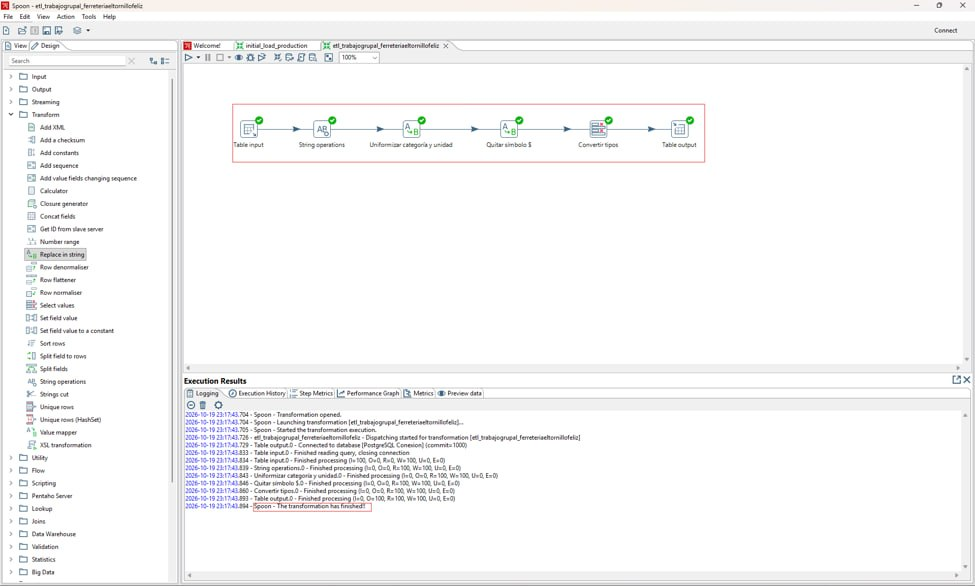

  

<h1 align="center">Escuela Politécnica Nacional</h1>

<h2 align="center">Business Intelligence</h2>

**Curso:** GR2SW

**Integrantes:**

- Arroyo Juan

- Echeverría Gabriela

- Sarmiento Néstor

- Villavicencio Michelle

**Fecha:** 20/10/2026

---

## Índice de contenidos

- [1. Introducción](#1-introducción)
- [2. Objetivos](#2-objetivos)
  - [2.1. Objetivo general](#21-objetivo-general)
  - [2.2. Objetivos específicos](#22-objetivos-específicos)
- [3. Fuentes de datos utilizadas](#3-fuentes-de-datos-utilizadas)
  - [3.1. Fuente de dato: Script para PostgreSQL](#31-fuente-de-dato-script-para-postgresql)
- [4. Problemas identificados en los datos](#4-problemas-identificados-en-los-datos)
  - [4.1. Problemas del flujo 1](#41-problemas-del-flujo-1)
- [5. Transformaciones aplicadas](#5-transformaciones-aplicadas)
  - [5.1. Transformaciones del flujo](#51-transformaciones-del-flujo)
    - [5.1.1. Vista general del flujo ETL](#511-vista-general-del-flujo-etl)
    - [5.1.2. Procesamiento de datos (transformación)](#512-procesamiento-de-datos-transformación)
- [6. Evidencias y resultados](#6-evidencias-y-resultados)
  - [6.1. Resultados del flujo](#61-resultados-del-flujo)
- [7. Relación con una arquitectura Data Warehouse](#7-relación-con-una-arquitectura-data-warehouse)
- [8. Conclusiones](#8-conclusiones)
- [9. Referencias bibliográficas](#9-referencias-bibliográficas)
- [10. Declaración de uso de Inteligencia Artificial](#10-declaración-de-uso-de-inteligencia-artificial)

---

## 1. Introducción

En la actualidad, las empresas con múltiples puntos de venta como la "Ferretería El Tornillo Feliz" enfrentan problemas de inconsistencia e información descentralizada en sus registros de inventario. Para solucionar esta problemática y unificar el catálogo corporativo, el presente informe detalla la implementación de un proceso ETL (Extracción, Transformación y Carga) utilizando herramientas de integración de datos y PostgreSQL, permitiendo limpiar, estandarizar y consolidar la información de los productos para optimizar la gestión administrativa y de stock.

---

## 2. Objetivos

### 2.1. Objetivo general

 
Implementar un proceso ETL (Extracción, Transformación y Carga) automatizado en Pentaho Data Integration y PostgreSQL para estandarizar, limpiar e integrar la información dispersa del catálogo de productos de la cadena "Ferretería El Tornillo Feliz", garantizando la consistencia de los datos en una base de datos centralizada.

### 2.2. Objetivos específicos

- Configurar el entorno de almacenamiento en PostgreSQL creando el esquema staging y la tabla cruda para almacenar la información inicial proveniente de las distintas sucursales.

- Diseñar el flujo de Extracción y Transformación (ET) en Pentaho Data Integration (Spoon), empleando componentes de limpieza de cadenas de texto para unificar las categorías desestandarizadas, eliminar símbolos monetarios en los precios y normalizar las unidades de medida.

- Desarrollar la fase de Carga (Load) mediante la creación y carga automática de la tabla limpia y normalizada en la base de datos.

- Validar la integridad y correcta transformación de los datos ejecutando consultas SQL de verificación en PostgreSQL para asegurar que el catálogo final cumpla con los estándares de calidad requeridos por el departamento administrativo.

---

## 3. Fuentes de datos utilizadas

### 3.1. Fuente de dato: Script para PostgreSQL

La fuente proporcionada para la Práctica 2 consta de un script donde se aloja la creación de *schema*, tabla y la inserción de datos. Script disponible en: [datos](source_data/script_data_insert.md)

Esta fuente hace alusión a una base de datos cotidiana en donde podría alojar varios problemas para obtener un Data Warehouse funcional con datos estandarizados bajo el flujo ETL.  

La estructura de los datos están conformadas por un identificador del producto, junto al nombre, su respectiva categoría, su unidad de medida si corresponde, el precio unitario y el proveedor.

---

## 4. Problemas identificados en los datos

### 4.1. Problemas del flujo

- **Categorías no uniformes:** presencia de múltiples variantes, abreviaturas y diferencias en el uso de mayúsculas y minúsculas (como Herramientas, herramientas, Htas, Pintura, pintura, PINTURAS, etc.) que impiden una correcta clasificación de los productos.

- **Unidades de medida heterogéneas:** mezcla de nomenclaturas y abreviaturas distintas para referirse a la misma cantidad o presentación. Por ejemplo: 1 und, 1 unidad, 1u, 1 Lt, 1L, 1 litro, 1 rollo, 1 rl, entre otras.

- **Precios con símbolos:** valores monetarios que incluyen caracteres adicionales (como el símbolo $).

- **Tipos de datos inconsistentes:** campos de precios y cantidades que requieren un cambio de tipo de dato y limpieza para permitir cálculos y agregaciones adecuadas en la base de datos corporativa.

---

## 5. Transformaciones aplicadas

### 5.1. Transformaciones del flujo 

Las principales operaciones realizadas fueron:

1. **Selección de campos (Select Values):** se seleccionaron los campos necesarios para el procesamiento de los registros, preparando la información para las siguientes etapas.

2. **Pasar a minúsculas:** se aplicó la estandarización en los formatos de las columnas categoria y unidad_medida, lo que permitió unificar las denominaciones bajo una sola convención de nombres.

3. **Uniformizar nombres:** se procesaron los valores correspondientes a categoria y unidad_medida, mediante el uso de REGEX para la busqueda de valores similares obteniendo así, uniformizar los valores a un solo nombre o etiqueta.

4. **Eliminar símbolos innecesarios:** Dado que el dato *precio_unitario* es un tipo de dato numérico con el que se puede utilizar para realizar cálculos necesarios para un análisis de negocio, se requiere primero eliminar el signo que simbolíza al dólar.

5. **Convertir tipo de dato:** Una vez purgado los símbolos innecesarios en el dato *precio_unitario*, se procede a cambiar el tipo de dato de String a Number. Dejando la opción de realizar operaciones requeridas con aquel valor. 

#### 5.1.1. Vista general del flujo ETL

La figura 1 presenta la secuencia de pasos implementados para procesar los datos de la ferretería.

**Figura 1. Flujo general ETL.**

  

Descripción: Flujo ETL desarrollado en Pentaho Spoon. El proceso inicia en Table input con la lectura los datos recopilados desde una Base de datos 'PostgreSQL', continúa con la transformación de los datos contenidos. La primera operación es convertir los nombres en un formato de palabras estándar (minúsculas), la uniformación de los datos alojados en categoría y unidad. Limpieza de símbolos innecesarios junto a los datos correspondientes, y por último, la conversión de tipo de dato de String a Number. 
Generando de esta forma una salida en una tabla nueva dentro de PostgreSQL

#### 5.1.2. Procesamiento de datos (transformación)

Las figuras 2 a 5 muestran la configuración de las transformaciones que se centran en: cambiar formato de palabras, uniformizar datos, eliminar símbolos innecesarios y la conversión de datos.

**Figura 2. Configuración de la transformación Pasar a Minúsculas.**

  

*Descripción: Configuración de pasar a minúsculas, donde se utiliza la función 'Replace in string' donde Trim type esta seleccionado como 'lower'.*

**Figura 3. Configuración de la transformación Uniformización de categoría y unidad.**

  

*Descripción: Configuración del paso Replace in string, donde mediante el uso de expresiones regulares, se realiza la búsqueda de todos los datos que puedan empatar con las reglas descritas en REGEX y posterior el cambio a una etiqueta uniforme.*

**Figura 4. Configuración: Eliminación de símbolos innecesarios.**

  

*Descripción: Configuración del Replace in string para la eliminación del símbolo '$' cuando exista una coincidencia.*

**Figura 5. Configuración: Eliminación de símbolos innecesarios.**

  

*Descripción: Configuración del Select values para la conversión de tipo de datos de String a Number.*

---

## 6. Evidencias y resultados

Al ejecutar el flujo, y no presentar ningún problema por errores varios, vemos como resultado de la ejecución el log de Pentaho:

    

*Descripción: Log con resultado de la ejecución del flujo con salida exitosa y el registro de los datos en la base de datos externa PostgreSQL.*

Dado que hubo una respuesta afirmativa de la ejecución del programa, podemos revisar los datos dentro de la app PgAdmin4 donde se podrá visualizar los datos ingresados en una tabla nueva conforme lo especificado a lo largo del flujo.

    

*Descripción: Datos registrados en la app PgAdmin4 donde se puede visualizar los cambios realizados en los campos categoria, unidad_medida y precio_unitario.*

### 6.1. Resultados del flujo 

Los archivos generados por el primer flujo ETL se encuentran disponibles para su consulta:

- **Datos limpios:** [datos_salida.txt](output_data/DataFerreteriaClean.txt)

Este *txt* representa los datos extraídos satisfactoriamente del registro en PostgreSQL con los cambios realizados durante la práctica.

Las siguientes evidencias muestran la ejecución del flujo y los registros válidos obtenidos.

**Figura 6. Registro de ejecución del flujo ETL del inventario de la ferretería.**

  

*Descripción: Registro de ejecución de Pentaho Spoon que muestra el procesamiento de 100 registros y la finalización de la transformación sin errores (E = 0). Se confirma la ejecución de los pasos de limpieza, validación, clasificación y generación de los nuevos datos en la base de datos externa PostgreSQL.*

**Figura 7. Registro de ejecución del flujo ETL del inventario de la ferretería.**

  

*Descripción: Visualización de los datos ingresados mediante la app Pentaho con el flujo ETL hacia la aplicación PostgreSQL donde se puede evidenciar los cambios realizados en los campos categoria, unidad_medida y precio_unitario.*

---

## 7. Relación con una arquitectura Data Warehouse

Al tratarse del flujo ETL pero con una peculiaridad que consiste en conectarse a una base de datos, PostgreSQL, permite visionar que no únicamente se puede realizar el flujo ETL localmente, sino, mediante la conexión a un servidor de base de datos remoto, podremos realizar el mismo trabajo y generar un Data Warehouse sin comprometer los datos y los servidores físicamente. 

En esta práctica se realizó el flujo completo desde la extración de datos de una base de datos sin estructura normalizada, mediante la transformación usando Pentaho, hasta la carga de datos directamente en un servidor de base de datos. Simulando que el cliente no requiere comprar una base de datos externa para funcionar como DATA WAREHOUSE, sino utilizando el mismo servidor pero modificando los datos y manteniendo una consistencia entre las mismas.

---

## 8. Conclusiones

1. Se logró configurar satisfactoriamente la estructura en PostgreSQL mediante el esquema staging y la creación de la tabla cruda productos_ferreteria_raw, lo cual permitió centralizar e ingerir los 100 registros iniciales con sus respectivas inconsistencias operativas tal como se reportaban desde las sucursales.   
2. Mediante el uso de herramientas de transformación en Pentaho Data Integration, fue posible aplicar filtros y reglas de reemplazo que estandarizaron exitosamente las categorías dispersas (como "Htas.", "Herramientas", "Pintura"), eliminaron los caracteres especiales y unificaron las diferentes nomenclaturas de unidades de medida y precios.
3. La fase de carga se completó de manera automatizada estructurando la salida hacia una tabla limpia y normalizada en el motor de base de datos PostgreSQL, cumpliendo con la solicitud del gerente de sistemas de integrar la información corporativa.
4. A través de las consultas de verificación y pruebas de ejecución en la base de datos, se comprobó que el proceso ETL elimina los problemas de redundancia y heterogeneidad, entregando un catálogo de productos normalizado apto para mejorar la gestión de inventarios y control de existencias de la cadena. 

---

## 9. Referencias bibliográficas

[1] Escuela Politécnica Nacional, Guía de Práctica de Laboratorio: ETL - Initial Load, Facultad de Ingeniería de Sistemas, Carrera de Software / Business Intelligence, 2025.

[2] R. Kimball y J. Caserta, The Data Warehouse ETL Toolkit: Practical Techniques for Extracting, Cleaning, Conforming, and Loading Data. Indianapolis: John Wiley & Sons, 2004.

## 10. Declaración de uso de Inteligencia Artificial

Se declara un uso estimado del **15 % de inteligencia artificial generativa**, empleada como apoyo en la redacción, organización y formato Markdown del informe. El desarrollo de los flujos ETL en Pentaho, las transformaciones aplicadas y las evidencias obtenidas corresponden al trabajo realizado por los integrantes del grupo.
