

  

<h1 align="center">Escuela Politécnica Nacional</h1>

<h2 align="center">Business Intelligence</h2>

<h3 align="center">Práctica 4: Implementación física de una dimensión para un modelo estrella en PostgreSQL</h3>

**Curso:** GR2SW

**Integrantes:**

- Arroyo Juan

- Echeverría Gabriela

- Sarmiento Néstor

- Villavicencio Michelle

**Fecha:** 27/10/2026

---

## Índice de contenidos

- [1. Introducción](#1-introducción)
- [2. Objetivos](#2-objetivos)
  - [2.1. Objetivo general](#21-objetivo-general)
  - [2.2. Objetivos específicos](#22-objetivos-específicos)
- [3. Fuentes de datos utilizadas](#3-fuentes-de-datos-utilizadas)
  - [3.1. Fuente 1: products.csv](#31-fuente-1-productscsv)
  - [3.2. Fuente 2: Tabla_Desnormalizada_Ventas.xlsx](#32-fuente-2-tabla_desnormalizada_ventasxlsx)
- [4. Diseño dimensional](#4-diseño-dimensional)
  - [4.1. Análisis del dataset de productos](#41-análisis-del-dataset-de-productos)
  - [4.2. Estructura de la dimensión dim_product](#42-estructura-de-la-dimensión-dim_product)
  - [4.3. Categoría y subcategoría dentro de dim_product](#43-categoría-y-subcategoría-dentro-de-dim_product)
  - [4.4. Modelo estrella de ventas](#44-modelo-estrella-de-ventas)
- [5. Problemas identificados en los datos](#5-problemas-identificados-en-los-datos)
  - [5.1. Problemas en products.csv](#51-problemas-en-productscsv)
  - [5.2. Problemas en la tabla desnormalizada de ventas](#52-problemas-en-la-tabla-desnormalizada-de-ventas)
- [6. Proceso ETL de products.csv](#6-proceso-etl-de-productscsv)
  - [6.1. Vista general del flujo](#61-vista-general-del-flujo)
  - [6.2. Creación de la tabla de staging](#62-creación-de-la-tabla-de-staging)
  - [6.3. Importación de products.csv](#63-importación-de-productscsv)
  - [6.4. Validación del dataset importado](#64-validación-del-dataset-importado)
  - [6.5. Limpieza de los datos](#65-limpieza-de-los-datos)
  - [6.6. Creación y carga de dim_product](#66-creación-y-carga-de-dim_product)
  - [6.7. Consultas de análisis sobre dim_product](#67-consultas-de-análisis-sobre-dim_product)
    - [6.7.1. Productos por categoría](#671-productos-por-categoría)
    - [6.7.2. Productos por subcategoría](#672-productos-por-subcategoría)
    - [6.7.3. Productos de la categoría Beauty and Hygiene](#673-productos-de-la-categoría-beauty-and-hygiene)
    - [6.7.4. Productos de la subcategoría Biscuits and Cookies](#674-productos-de-la-subcategoría-biscuits-and-cookies)
    - [6.7.5. Número de subcategorías por categoría](#675-número-de-subcategorías-por-categoría)
- [7. Proceso ETL de la tabla de ventas](#7-proceso-etl-de-la-tabla-de-ventas)
  - [7.1. Vista general del flujo](#71-vista-general-del-flujo)
  - [7.2. Creación de la tabla de staging stg_ventas](#72-creación-de-la-tabla-de-staging-stg_ventas)
  - [7.3. Importación de los datos de ventas](#73-importación-de-los-datos-de-ventas)
  - [7.4. Validación de stg_ventas](#74-validación-de-stg_ventas)
  - [7.5. Limpieza de los datos de ventas](#75-limpieza-de-los-datos-de-ventas)
  - [7.6. Creación del esquema estrella dw_ventas](#76-creación-del-esquema-estrella-dw_ventas)
  - [7.7. Carga del modelo estrella](#77-carga-del-modelo-estrella)
  - [7.8. Consultas de negocio sobre el modelo estrella](#78-consultas-de-negocio-sobre-el-modelo-estrella)
    - [7.8.1. Ventas por categoría de producto y mes](#781-ventas-por-categoría-de-producto-y-mes)
    - [7.8.2. Ingreso total por cliente y género](#782-ingreso-total-por-cliente-y-género)
    - [7.8.3. Cantidad total vendida por producto](#783-cantidad-total-vendida-por-producto)
    - [7.8.4. Cantidad enviada por mes de envío](#784-cantidad-enviada-por-mes-de-envío)
    - [7.8.5. Ventas por tamaño de producto y estado civil del cliente](#785-ventas-por-tamaño-de-producto-y-estado-civil-del-cliente)
- [8. Scripts SQL entregables](#8-scripts-sql-entregables)
- [9. Relación con una arquitectura Data Warehouse](#9-relación-con-una-arquitectura-data-warehouse)
- [10. Conclusiones](#10-conclusiones)
- [11. Referencias bibliográficas](#11-referencias-bibliográficas)
- [12. Declaración de uso de Inteligencia Artificial](#12-declaración-de-uso-de-inteligencia-artificial)

---

## Índice de figuras

- [Figura 1. Diagrama del modelo estrella de ventas en Power Pivot](#figura-1)
- [Figura 2. Creación de la tabla de staging stg_products](#figura-2)
- [Figura 3. Verificación de la estructura de stg_products](#figura-3)
- [Figura 4. Importación de products.csv mediante \copy](#figura-4)
- [Figura 5. Validación del número de registros](#figura-5)
- [Figura 6. Validación de identificadores de producto únicos](#figura-6)
- [Figura 7. Validación del número de categorías y subcategorías](#figura-7)
- [Figura 8. Limpieza de texto en stg_products](#figura-8)
- [Figura 9. Verificación de identificadores duplicados](#figura-9)
- [Figura 10. Verificación de identificadores nulos o vacíos](#figura-10)
- [Figura 11. Creación de la dimensión dim_product](#figura-11)
- [Figura 12. Carga de dim_product desde staging](#figura-12)
- [Figura 13. Conteo de registros cargados en dim_product](#figura-13)
- [Figura 14. Primeros 20 registros de dim_product](#figura-14)
- [Figura 15. Productos por categoría](#figura-15)
- [Figura 16. Productos por subcategoría](#figura-16)
- [Figura 17. Productos de la categoría Beauty & Hygiene](#figura-17)
- [Figura 18. Productos de la subcategoría Biscuits & Cookies](#figura-18)
- [Figura 19. Número de subcategorías por categoría](#figura-19)
- [Figura 20. Creación de la tabla de staging stg_ventas](#figura-20)
- [Figura 21. Importación de los datos de ventas mediante \copy](#figura-21)
- [Figura 22. Conteos generales en stg_ventas](#figura-22)
- [Figura 23. Verificación de ventas duplicadas](#figura-23)
- [Figura 24. Verificación de campos obligatorios nulos](#figura-24)
- [Figura 25. Verificación de las claves de fecha](#figura-25)
- [Figura 26. Limpieza de texto en stg_ventas](#figura-26)
- [Figura 27. Creación del esquema dw_ventas](#figura-27)
- [Figura 28. Creación de dw_ventas.dim_product](#figura-28)
- [Figura 29. Creación de dw_ventas.dim_customer](#figura-29)
- [Figura 30. Creación de dw_ventas.dim_date](#figura-30)
- [Figura 31. Creación de dw_ventas.fact_sales](#figura-31)
- [Figura 32. Tablas creadas en el esquema dw_ventas](#figura-32)
- [Figura 33. Carga de dw_ventas.dim_product](#figura-33)
- [Figura 34. Carga de dw_ventas.dim_customer](#figura-34)
- [Figura 35. Carga de dw_ventas.dim_date](#figura-35)
- [Figura 36. Carga de dw_ventas.fact_sales](#figura-36)
- [Figura 37. Conteo de registros por tabla en dw_ventas](#figura-37)
- [Figura 38. Totales de cantidad y ventas en fact_sales](#figura-38)
- [Figura 39. Ventas por categoría de producto y mes](#figura-39)
- [Figura 40. Ingreso total por cliente y género](#figura-40)
- [Figura 41. Cantidad total vendida por producto](#figura-41)
- [Figura 42. Cantidad enviada por mes de envío](#figura-42)
- [Figura 43. Ventas por tamaño de producto y estado civil del cliente](#figura-43)

---

## Índice de tablas

- [Tabla 1. Estructura del archivo products.csv](#tabla-1)
- [Tabla 2. Hojas del archivo Tabla_Desnormalizada_Ventas.xlsx](#tabla-2)
- [Tabla 3. Análisis dimensional de products.csv](#tabla-3)
- [Tabla 4. Estructura física de dim_product](#tabla-4)
- [Tabla 5. Componentes del modelo estrella de ventas](#tabla-5)
- [Tabla 6. Problemas identificados en products.csv](#tabla-6)
- [Tabla 7. Problemas identificados en la tabla desnormalizada de ventas](#tabla-7)
- [Tabla 8. Transformaciones aplicadas sobre stg_products](#tabla-8)
- [Tabla 9. Configuración de la importación de products.csv](#tabla-9)
- [Tabla 10. Resultados de validación de stg_products](#tabla-10)
- [Tabla 11. Transformaciones aplicadas en el proceso de ventas](#tabla-11)
- [Tabla 12. Configuración de la importación de Tabla_Desnormalizada_Ventas.csv](#tabla-12)
- [Tabla 13. Resultados de validación de stg_ventas](#tabla-13)
- [Tabla 14. Estructura de las tablas del esquema dw_ventas](#tabla-14)
- [Tabla 15. Registros cargados en el esquema dw_ventas](#tabla-15)

---

## 1. Introducción

En esta práctica se cargaron datos en PostgreSQL pasando primero por un área de staging, donde se validaron y limpiaron, y luego hacia un modelo dimensional. Se trabajó con dos fuentes. Con products.csv se construyó la dimensión de producto que pide la guía. Como ese archivo no tiene ventas, para responder las cinco preguntas del trabajo en grupo se aplicó el mismo proceso a Tabla_Desnormalizada_Ventas.xlsx y se armó con ella un esquema estrella completo.

---

## 2. Objetivos

### 2.1. Objetivo general

Implementar en PostgreSQL un flujo de staging, limpieza y carga hacia un modelo dimensional, primero para la dimensión de producto y luego para un esquema estrella de ventas.

### 2.2. Objetivos específicos

- Crear tablas de staging e importar los archivos fuente.
- Validar y limpiar los datos antes de cargarlos al modelo.
- Implementar dim_product con una clave sustituta.
- Justificar por qué categoría y subcategoría se mantienen en la dimensión.
- Modelar las ventas como esquema estrella y responder las cinco preguntas de negocio con SQL.

---

## 3. Fuentes de datos utilizadas

### 3.1. Fuente 1: products.csv

El archivo <a href="source_data/products.csv">products.csv</a> tiene 699 productos, 10 categorías y 53 subcategorías. Solo contiene atributos descriptivos, sin ventas ni medidas. Sus columnas se muestran en la Tabla 1.

**Tabla 1. Estructura del archivo products.csv.**

| Columna en el CSV | Columna en staging | Ejemplo |
| --- | --- | --- |
| product_id | product_id | P0001 |
| product (brand) | product_name | hand wash - moisture Shield (Savlon) |
| category | category | Beauty & Hygiene |
| sub_category | subcategory | Hair Care |

*Descripción: columnas del archivo y su nombre en staging.*

### 3.2. Fuente 2: Tabla_Desnormalizada_Ventas.xlsx

El archivo <a href="source_data/Tabla_Desnormalizada_Ventas.xlsx">Tabla_Desnormalizada_Ventas.xlsx</a> registra 100 ventas entre enero de 2022 y diciembre de 2025, con datos de producto, cliente, fechas y montos en una sola hoja de 26 columnas. Sus productos (P104 a P143) no tienen relación con los de products.csv. Las hojas del libro se describen en la Tabla 2.

**Tabla 2. Hojas del archivo Tabla_Desnormalizada_Ventas.xlsx.**

| Hoja | Filas | Uso |
| --- | --- | --- |
| VentasDesnormalizada | 100 | Fuente cargada en staging |
| fact_sales | 100 | Tabla de hechos en Power Pivot |
| dim_product | 9 | Dimensión de producto en Power Pivot |
| dim_costumer | 10 | Dimensión de cliente en Power Pivot |
| dim_date | 61 | Dimensión de fecha en Power Pivot |

*Descripción: hojas del libro de Excel y su uso en el modelo.*

---

## 4. Diseño dimensional

### 4.1. Análisis del dataset de productos

Como se resume en la Tabla 3, products.csv no tiene eventos ni medidas, por lo que su rol en el modelo es el de una dimensión.

**Tabla 3. Análisis dimensional de products.csv.**

| Pregunta | Respuesta |
| --- | --- |
| ¿Qué entidad describe? | Producto |
| ¿Contiene un evento de negocio? | No |
| ¿Contiene medidas? | No |
| Rol en un modelo estrella | Dimensión de producto (dim_product) |

*Descripción: análisis previo al diseño físico.*

### 4.2. Estructura de la dimensión dim_product

La Tabla 4 muestra la estructura de la dimensión. La clave primaria es product_key, una clave sustituta generada por PostgreSQL; el código original se guarda en product_id para mantener la relación con la fuente.

**Tabla 4. Estructura física de dim_product.**

| Columna | Tipo | Restricción |
| --- | --- | --- |
| product_key | BIGSERIAL | PRIMARY KEY |
| product_id | VARCHAR(5) | NOT NULL, UNIQUE |
| product_name | VARCHAR(150) | NOT NULL |
| category | VARCHAR(80) | NOT NULL |
| subcategory | VARCHAR(80) | NOT NULL |

*Descripción: columnas, tipos y restricciones de dim_product.*

### 4.3. Categoría y subcategoría dentro de dim_product

Categoría y subcategoría se mantienen en la misma dimensión aunque sus valores se repitan. Así se puede agrupar y filtrar sin uniones adicionales. Separarlas en otras tablas sería normalizar el modelo y convertirlo en un copo de nieve.

### 4.4. Modelo estrella de ventas

En este informe hay dos dimensiones de producto distintas. <b>public.dim_product</b> viene de products.csv y tiene 699 productos (sección 6). <b>dw_ventas.dim_product</b> viene de la tabla de ventas y tiene 9 productos (sección 7). Al ser fuentes diferentes, no comparten registros; por eso el modelo de ventas se creó en el esquema aparte dw_ventas.

La tabla de ventas se separó en una tabla de hechos y tres dimensiones (Tabla 5). Cada fila de fact_sales es una línea de pedido. La dimensión de fecha se relaciona dos veces con los hechos: por la fecha de pedido y por la de envío.

**Tabla 5. Componentes del modelo estrella de ventas.**

| Tabla | Tipo | Atributos o medidas |
| --- | --- | --- |
| fact_sales | Hechos | Quantity, UnitPrice, ProductCost, SalesAmount |
| dim_product | Dimensión | Product Code, Product Name, List Price, Color, Size, Category, Subcategory |
| dim_customer | Dimensión | Birth Date, Marital Status, Gender, Income, Children, Home Owner, Cars |
| dim_date | Dimensión | Fecha, año, trimestre, mes y día |

*Descripción: tablas del modelo de ventas.*

El diagrama del modelo en Power Pivot se muestra en la Figura 1. Power Pivot solo admite una relación activa entre dos tablas, por eso la segunda relación con dim_date aparece punteada.

**Figura 1. Diagrama del modelo estrella de ventas en Power Pivot.**

  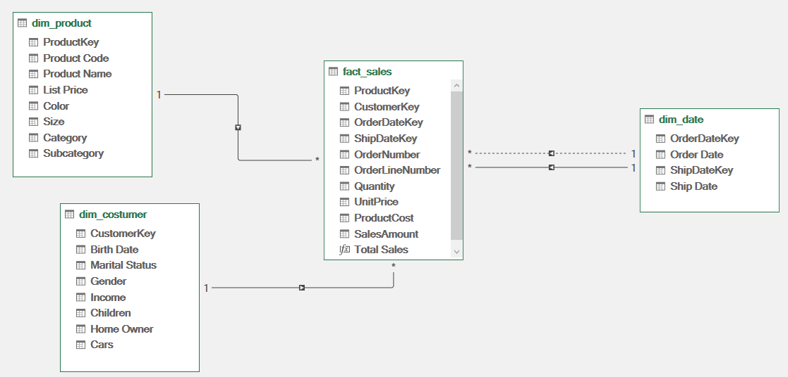

*Descripción: fact_sales relacionada con dim_product, dim_costumer y dim_date (pedido y envío).*

---

## 5. Problemas identificados en los datos

### 5.1. Problemas en products.csv

Los problemas encontrados en el archivo de productos se listan en la Tabla 6.

**Tabla 6. Problemas identificados en products.csv.**

| Problema | Ejemplo | Registros | Tratamiento |
| --- | --- | --- | --- |
| Tabulaciones en el nombre | P0000: serum (Livon) | 5 | regexp_replace |
| Espacios repetidos en el nombre | good day butter Cookies | 6 | regexp_replace |
| Espacios al inicio o al final | P0000 | 4 | btrim |
| Encabezados distintos al modelo | product (brand), sub_category | — | Carga por posición |
| Producto sin nombre | P0748: "()" | 1 | Se conserva y se documenta |
| Categorías incoherentes | Banana - Raw en Biscuits & Cookies | Varios | Se conservan |
| Códigos no consecutivos | No existe P0003 | 50 | No afecta a la clave sustituta |

*Descripción: problemas de products.csv y su tratamiento.*

### 5.2. Problemas en la tabla desnormalizada de ventas

Los datos de ventas no tenían nulos ni filas repetidas; sus problemas eran de estructura (Tabla 7).

**Tabla 7. Problemas identificados en la tabla desnormalizada de ventas.**

| Problema | Tratamiento |
| --- | --- |
| Producto, cliente, fechas y medidas en una sola tabla | Separación en hechos y dimensiones |
| Productos y clientes repetidos en las 100 filas | Cada uno se guarda una vez en su dimensión |
| Dos fechas por venta (pedido y envío) | Una sola dim_date con dos relaciones |
| La hoja dim_date no incluye todas las fechas de envío | dim_date se llenó con ambas fechas |
| El CSV exportado usa punto y coma como separador | Se indicó DELIMITER ';' al importar |
| Hoja con nombre dim_costumer | En PostgreSQL se llamó dim_customer |

*Descripción: problemas de la tabla de ventas y su tratamiento.*

---

## 6. Proceso ETL de products.csv

### 6.1. Vista general del flujo

Se siguió el orden de la guía: staging, importación, validación, limpieza, carga de la dimensión y consultas. Las transformaciones aplicadas se resumen en la Tabla 8.

**Tabla 8. Transformaciones aplicadas sobre stg_products.**

| Columna | Transformación |
| --- | --- |
| product_name | Recorte de extremos y un solo espacio en lugar de espacios o tabulaciones repetidos |
| category | Recorte de extremos |
| subcategory | Recorte de extremos |
| product_key | Clave sustituta generada con BIGSERIAL |

*Descripción: transformaciones aplicadas en staging y en la carga.*

### 6.2. Creación de la tabla de staging

Se ejecutó el script de creación de stg_products con las cuatro columnas del archivo (Figura 2) y luego se consultó la tabla para confirmar su estructura (Figura 3).

**Figura 2. Creación de la tabla de staging stg_products.**

  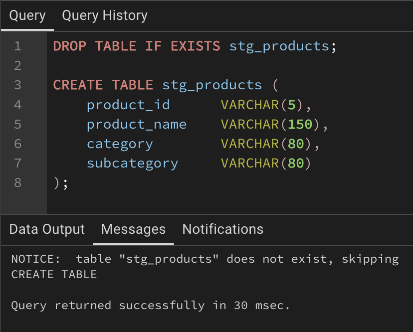

*Descripción: tabla creada sin errores.*

**Figura 3. Verificación de la estructura de stg_products.**

  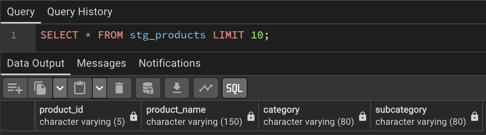

*Descripción: tabla vacía con sus cuatro columnas.*

### 6.3. Importación de products.csv

La práctica se realizó en macOS, donde la opción Import/Export Data de pgAdmin no permitió importar el archivo de forma visual. Por eso se usó el comando \copy de psql con la misma configuración (Tabla 9).

**Tabla 9. Configuración de la importación de products.csv.**

| Parámetro | Valor |
| --- | --- |
| Herramienta | psql (\copy) en macOS |
| Tabla destino | public.stg_products |
| Formato | CSV |
| Encabezado | Sí |
| Delimitador | , |
| Codificación | UTF-8 |

*Descripción: parámetros de la importación.*

El comando cargó los 699 registros, como se observa en la Figura 4.

**Figura 4. Importación de products.csv mediante \copy.**

  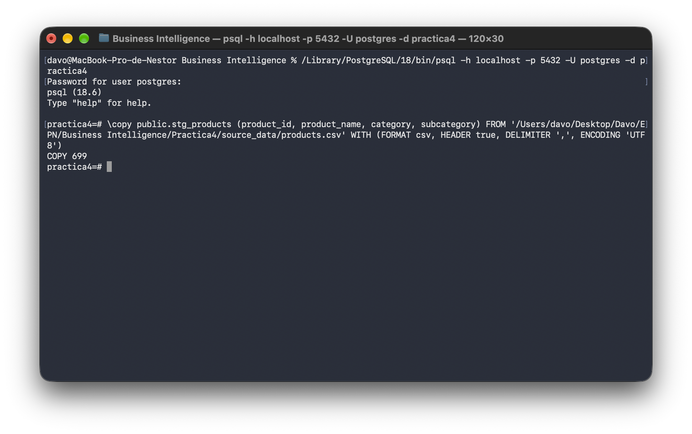

*Descripción: resultado COPY 699.*

### 6.4. Validación del dataset importado

Se ejecutaron las consultas de validación y los resultados coincidieron con los valores esperados (Tabla 10): 699 registros (Figura 5), 699 códigos únicos (Figura 6) y 10 categorías con 53 subcategorías (Figura 7).

**Tabla 10. Resultados de validación de stg_products.**

| Validación | Esperado | Obtenido |
| --- | --- | --- |
| Registros | 699 | 699 |
| product_id únicos | 699 | 699 |
| Categorías | 10 | 10 |
| Subcategorías | 53 | 53 |

*Descripción: comparación entre los valores esperados y los obtenidos.*

**Figura 5. Validación del número de registros.**

  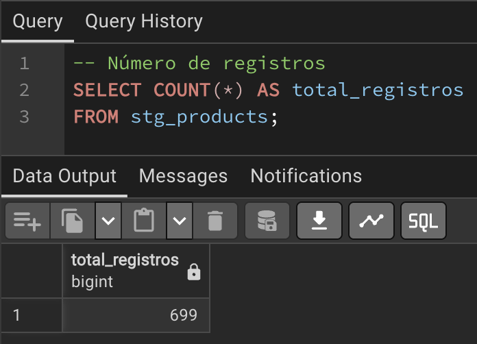

*Descripción: total de registros en staging.*

**Figura 6. Validación de identificadores de producto únicos.**

  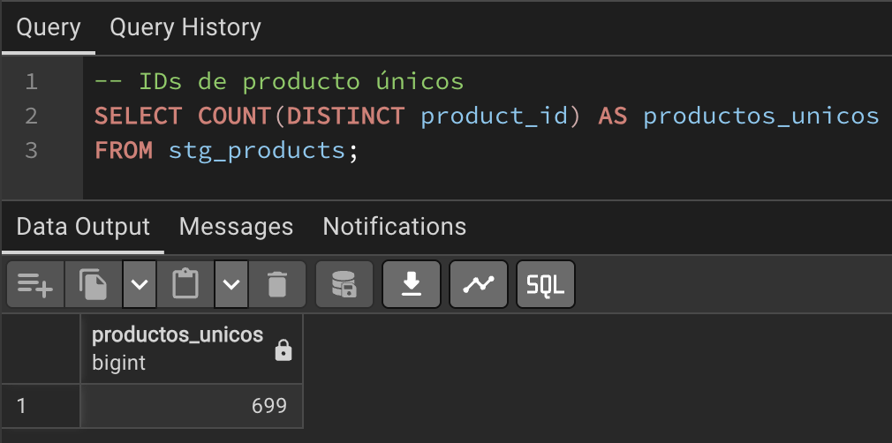

*Descripción: product_id distintos.*

**Figura 7. Validación del número de categorías y subcategorías.**

  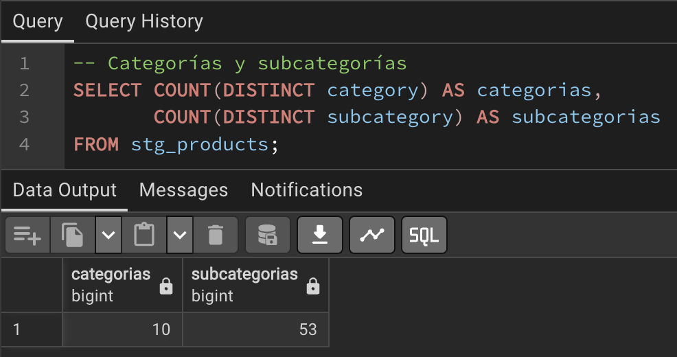

*Descripción: categorías y subcategorías distintas.*

### 6.5. Limpieza de los datos

Se ejecutó un UPDATE sobre staging que limpió los espacios y tabulaciones de los 699 registros (Figura 8). Un detalle: btrim no elimina tabulaciones, así que el nombre de P0000 quedó con un espacio al inicio (Figura 14). Aplicar btrim después de regexp_replace lo evitaría.

**Figura 8. Limpieza de texto en stg_products.**

  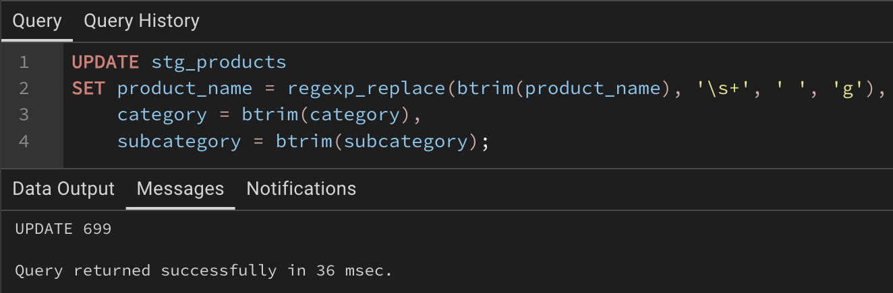

*Descripción: UPDATE de 699 registros.*

Después se comprobó que no hubiera códigos duplicados (Figura 9) ni nulos o vacíos (Figura 10); ambas consultas no devolvieron filas.

**Figura 9. Verificación de identificadores duplicados.**

  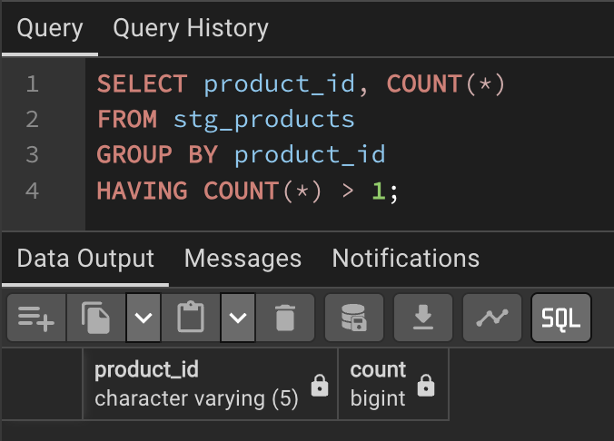

*Descripción: sin duplicados.*

**Figura 10. Verificación de identificadores nulos o vacíos.**

  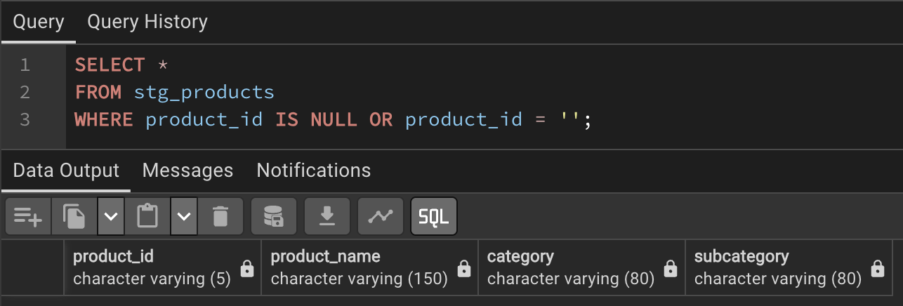

*Descripción: sin nulos ni vacíos.*

### 6.6. Creación y carga de dim_product

Se creó dim_product con la estructura de la Tabla 4 (Figura 11) y se cargó desde staging, con 699 filas insertadas (Figura 12).

**Figura 11. Creación de la dimensión dim_product.**

  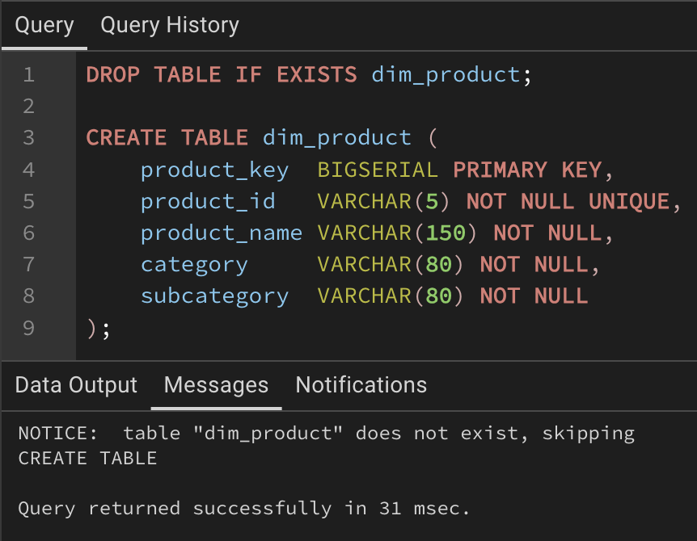

*Descripción: DDL de dim_product.*

**Figura 12. Carga de dim_product desde staging.**

  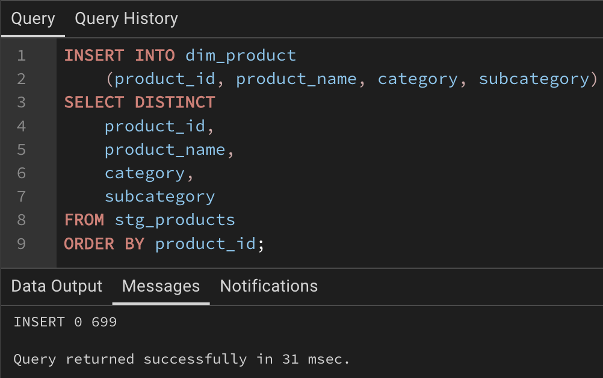

*Descripción: INSERT 0 699.*

El conteo de la dimensión dio 699 registros (Figura 13). En la Figura 14 se ve que product_key es consecutiva aunque product_id salte de P0002 a P0004, y que los nombres ya están limpios.

**Figura 13. Conteo de registros cargados en dim_product.**

  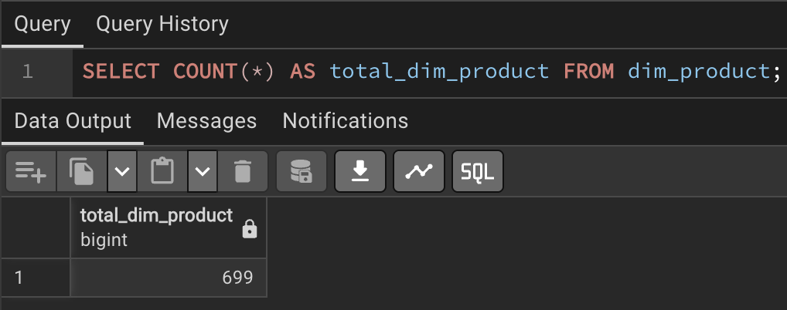

*Descripción: 699 registros en la dimensión.*

**Figura 14. Primeros 20 registros de dim_product.**

  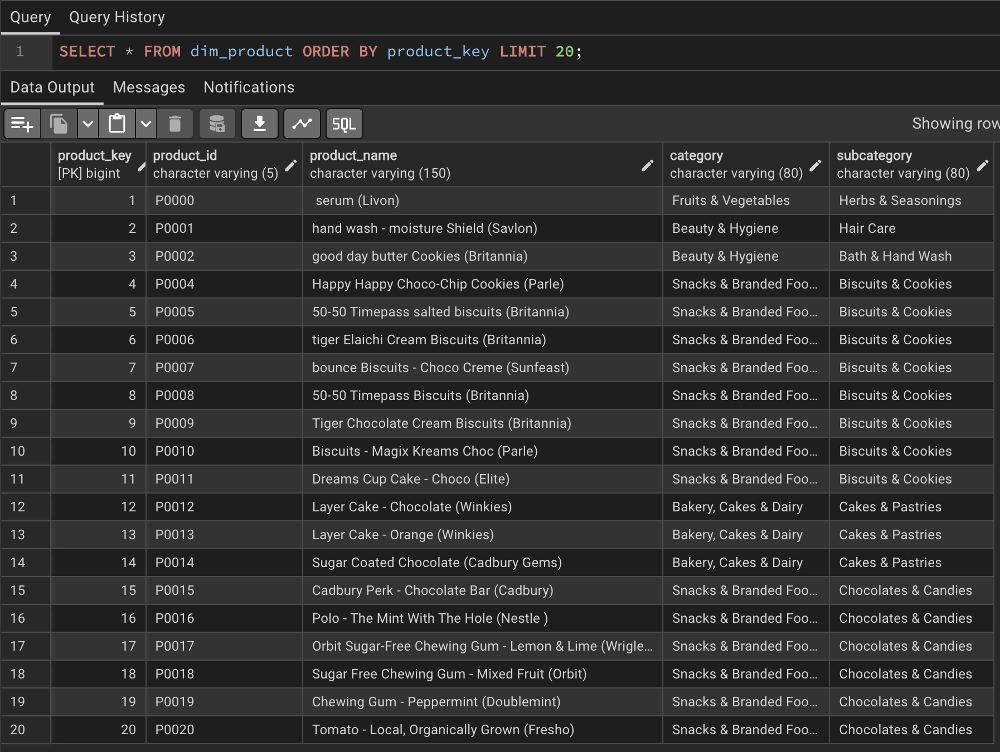

*Descripción: primeros registros ordenados por product_key.*

### 6.7. Consultas de análisis sobre dim_product

#### 6.7.1. Productos por categoría

La categoría con más productos es Snacks & Branded Foods (227) y la que menos tiene es Baby Care (2), como se observa en la Figura 15.

**Figura 15. Productos por categoría.**

  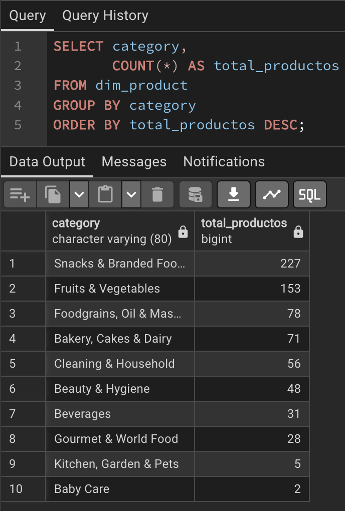

*Descripción: productos por categoría, de mayor a menor.*

#### 6.7.2. Productos por subcategoría

Las subcategorías con más productos son Snacks & Namkeen (75), Fresh Vegetables (66) y Masalas & Spices (60) (Figura 16).

**Figura 16. Productos por subcategoría.**

  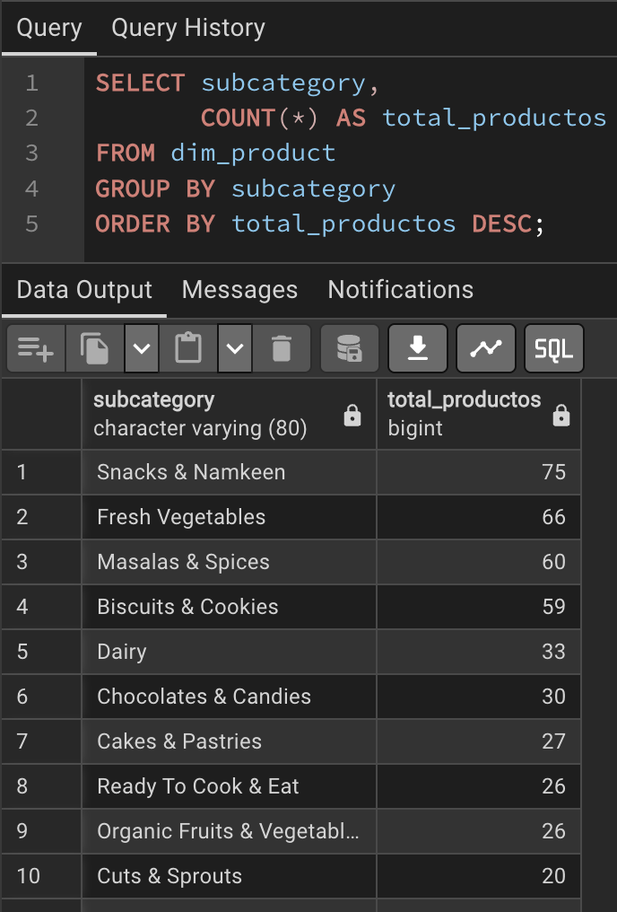

*Descripción: primeras diez subcategorías.*

#### 6.7.3. Productos de la categoría Beauty and Hygiene

El filtro por la categoría Beauty & Hygiene devuelve sus 48 productos (Figura 17).

**Figura 17. Productos de la categoría Beauty & Hygiene.**

  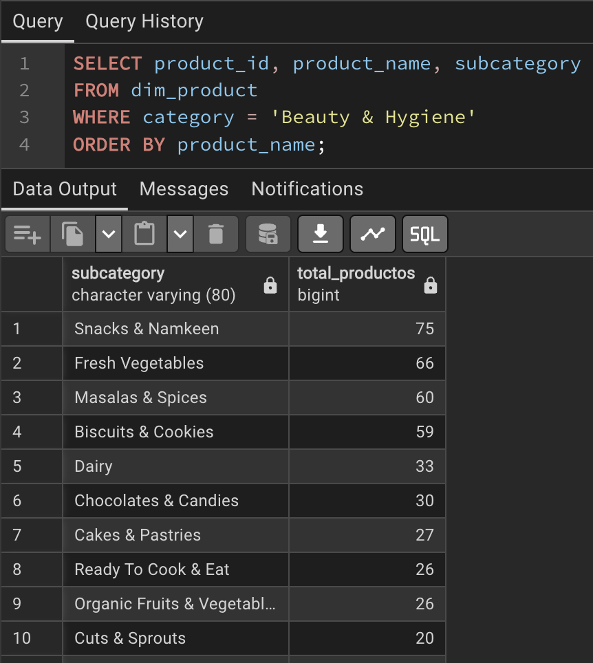

*Descripción: productos de Beauty & Hygiene ordenados por nombre.*

#### 6.7.4. Productos de la subcategoría Biscuits and Cookies

El filtro por Biscuits & Cookies devuelve productos de Snacks & Branded Foods, entre ellos P0748 sin nombre y Banana - Raw, ya señalados en la Tabla 6 (Figura 18).

**Figura 18. Productos de la subcategoría Biscuits & Cookies.**

  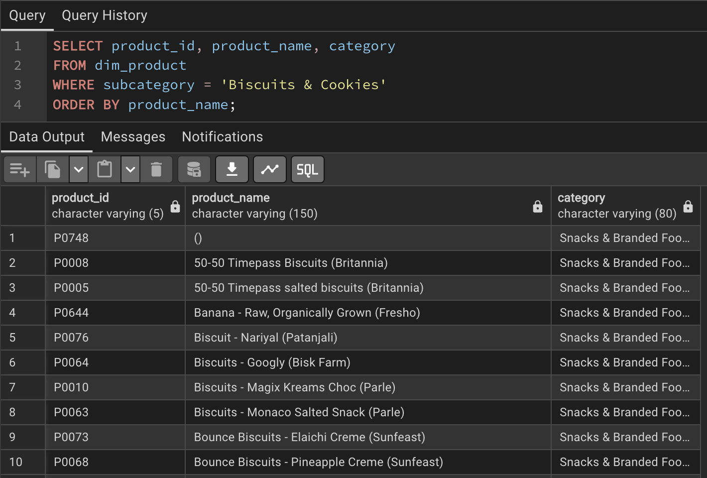

*Descripción: productos de Biscuits & Cookies ordenados por nombre.*

#### 6.7.5. Número de subcategorías por categoría

Snacks & Branded Foods tiene 8 subcategorías, mientras que Baby Care y Kitchen, Garden & Pets tienen 2 (Figura 19).

**Figura 19. Número de subcategorías por categoría.**

  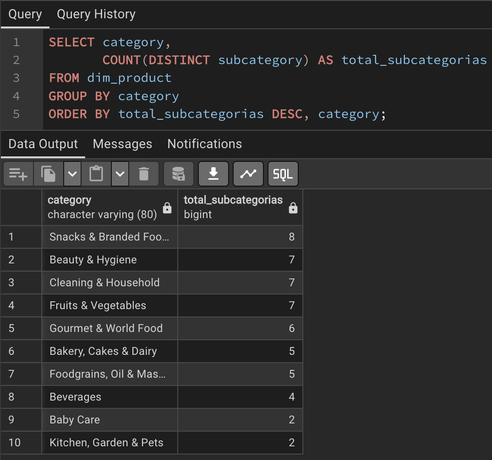

*Descripción: subcategorías distintas por categoría.*

---

## 7. Proceso ETL de la tabla de ventas

### 7.1. Vista general del flujo

Se repitió el proceso de la sección 6 con la tabla de ventas: la hoja VentasDesnormalizada se exportó a CSV, se cargó en public.stg_ventas y desde ahí se llenó el esquema dw_ventas. Las dimensiones de producto y cliente usan claves sustitutas y guardan la clave original en source_product_key y source_customer_key. Las transformaciones se resumen en la Tabla 11.

**Tabla 11. Transformaciones aplicadas en el proceso de ventas.**

| Paso | Transformación |
| --- | --- |
| Limpieza | Recorte de espacios en los campos de texto y género en mayúsculas |
| Carga de dimensiones | SELECT DISTINCT desde staging y claves sustitutas |
| Carga de dim_date | Unión de fechas de pedido y envío; cálculo de año, trimestre, mes y día |
| Carga de hechos | Reemplazo de las claves originales por las claves sustitutas |

*Descripción: transformaciones del flujo de ventas.*

### 7.2. Creación de la tabla de staging stg_ventas

Se creó stg_ventas con las 26 columnas del archivo, ya con tipos numéricos y de fecha (Figura 20).

**Figura 20. Creación de la tabla de staging stg_ventas.**

  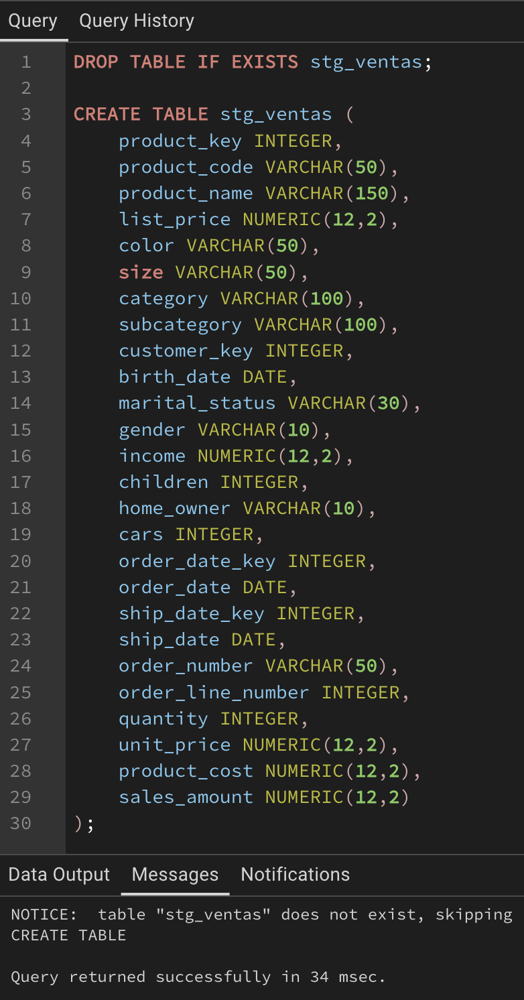

*Descripción: DDL de stg_ventas.*

### 7.3. Importación de los datos de ventas

Se usó \copy igual que en la sección 6.3, cambiando el delimitador a punto y coma (Tabla 12). Se cargaron las 100 ventas (Figura 21).

**Tabla 12. Configuración de la importación de Tabla_Desnormalizada_Ventas.csv.**

| Parámetro | Valor |
| --- | --- |
| Tabla destino | public.stg_ventas |
| Formato | CSV |
| Encabezado | Sí |
| Delimitador | ; |
| Codificación | UTF-8 |

*Descripción: parámetros de la importación de ventas.*

**Figura 21. Importación de los datos de ventas mediante \copy.**

  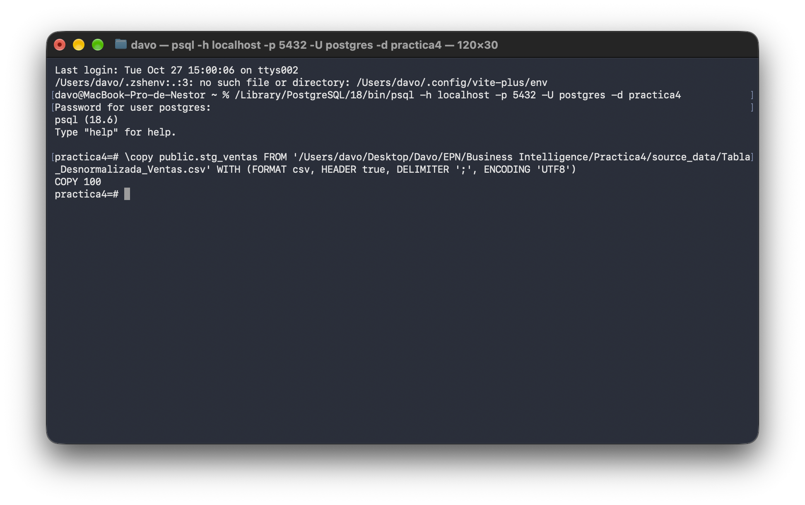

*Descripción: resultado COPY 100.*

### 7.4. Validación de stg_ventas

Los resultados de las validaciones se resumen en la Tabla 13. El conteo general dio 100 registros, 9 productos, 10 clientes, 100 pedidos y 2 categorías (Figura 22). No hubo pedidos repetidos (Figura 23), campos obligatorios nulos (Figura 24) ni claves de fecha que no coincidieran con su fecha (Figura 25).

**Tabla 13. Resultados de validación de stg_ventas.**

| Validación | Resultado |
| --- | --- |
| Registros / productos / clientes / pedidos / categorías | 100 / 9 / 10 / 100 / 2 |
| Pedidos repetidos | 0 |
| Campos obligatorios nulos | 0 |
| Claves de fecha inconsistentes | 0 |

*Descripción: validaciones sobre stg_ventas.*

**Figura 22. Conteos generales en stg_ventas.**

  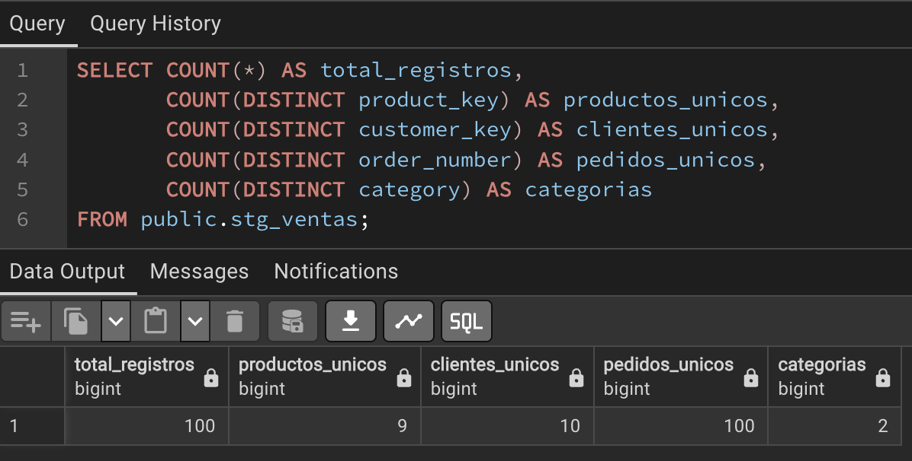

*Descripción: registros y valores distintos en staging.*

**Figura 23. Verificación de ventas duplicadas.**

  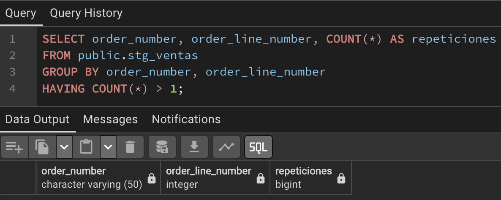

*Descripción: sin pedidos duplicados.*

**Figura 24. Verificación de campos obligatorios nulos.**

  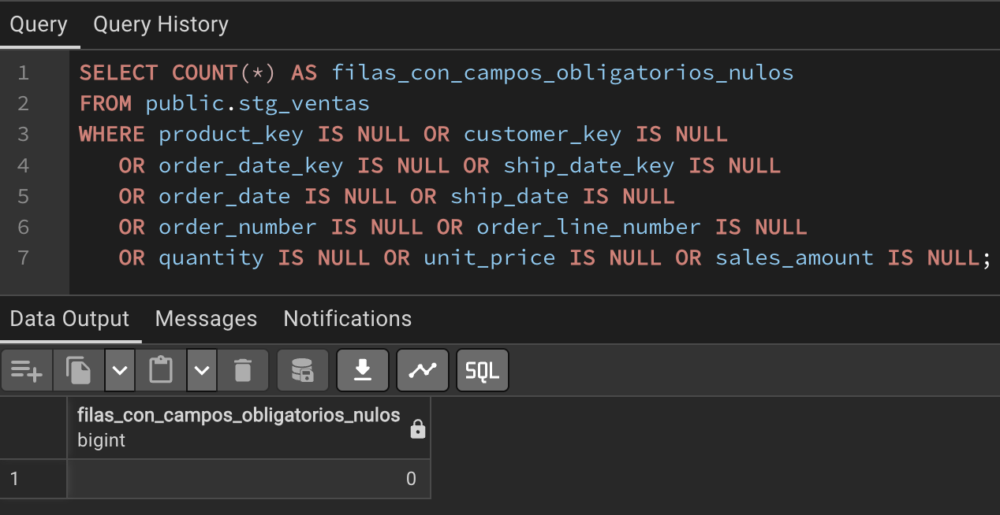

*Descripción: 0 filas con nulos.*

**Figura 25. Verificación de las claves de fecha.**

  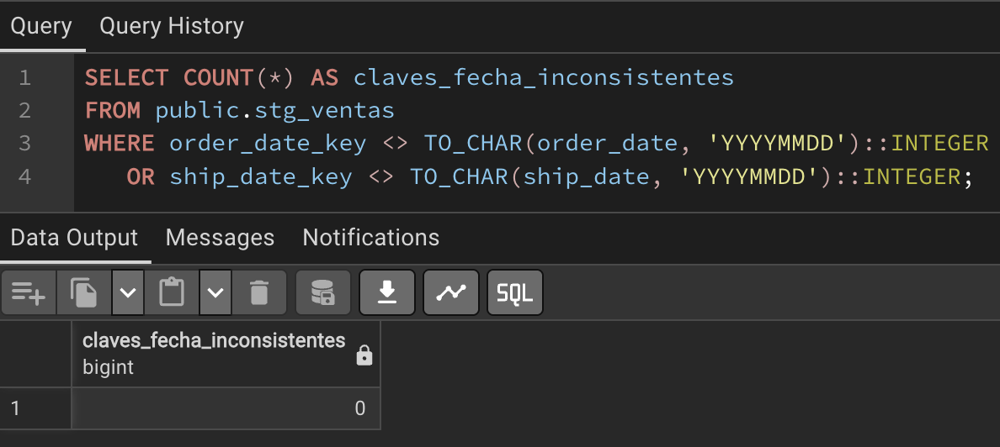

*Descripción: 0 claves inconsistentes.*

### 7.5. Limpieza de los datos de ventas

Se aplicó una limpieza preventiva a los campos de texto de las 100 filas (Figura 26).

**Figura 26. Limpieza de texto en stg_ventas.**

  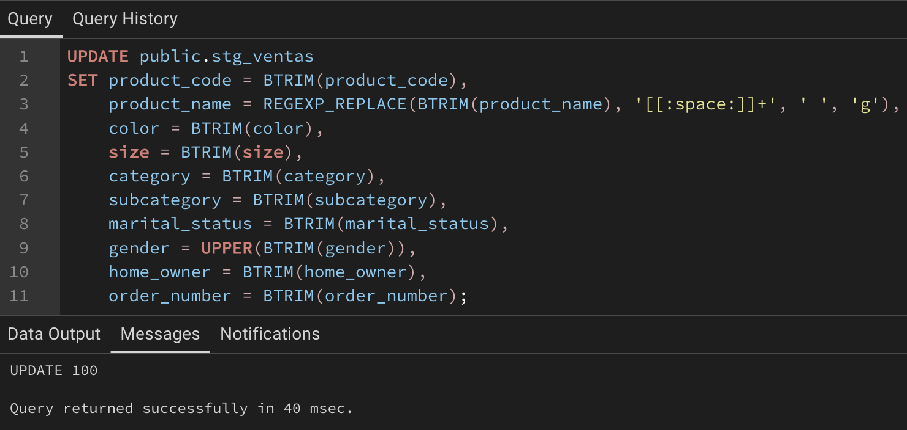

*Descripción: UPDATE de 100 registros.*

### 7.6. Creación del esquema estrella dw_ventas

Se creó el esquema dw_ventas (Figura 27) y dentro de él las cuatro tablas descritas en la Tabla 14.

**Figura 27. Creación del esquema dw_ventas.**

  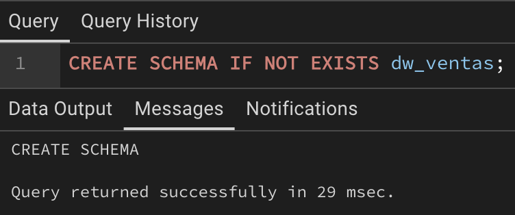

*Descripción: esquema creado.*

**Tabla 14. Estructura de las tablas del esquema dw_ventas.**

| Tabla | Clave primaria | Otras restricciones |
| --- | --- | --- |
| dim_product | product_key (BIGSERIAL) | source_product_key UNIQUE |
| dim_customer | customer_key (BIGSERIAL) | source_customer_key UNIQUE |
| dim_date | date_key (AAAAMMDD) | full_date UNIQUE |
| fact_sales | sales_key (BIGSERIAL) | Claves foráneas a las tres dimensiones, pedido y línea UNIQUE, CHECK en cantidad y montos |

*Descripción: claves y restricciones de cada tabla.*

Se crearon las dimensiones de producto (Figura 28), cliente (Figura 29) y fecha (Figura 30).

**Figura 28. Creación de dw_ventas.dim_product.**

  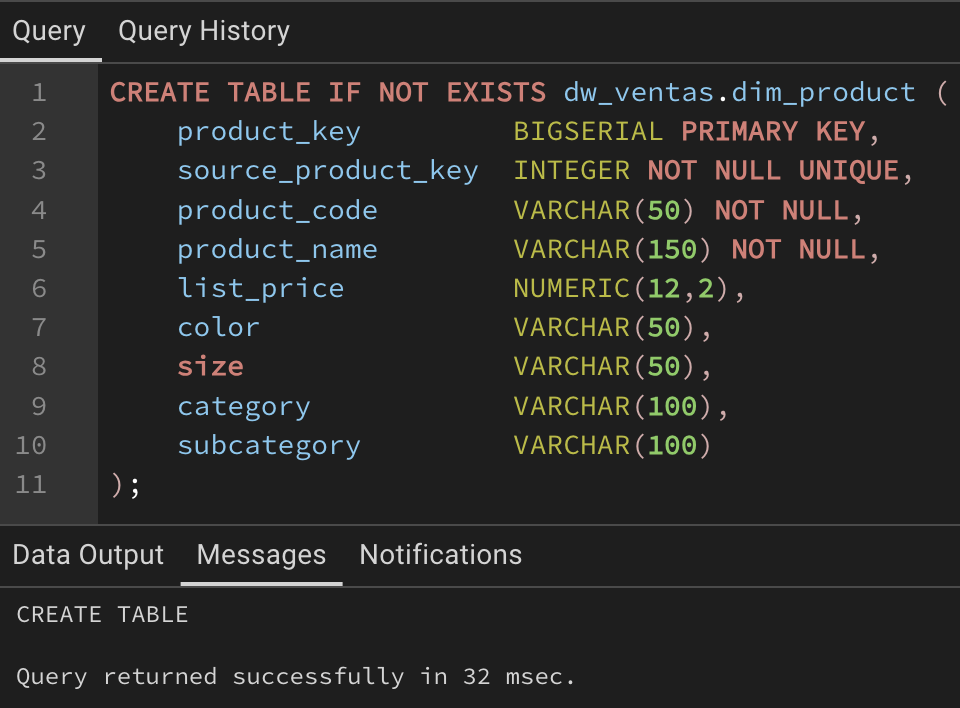

*Descripción: DDL de la dimensión de producto.*

**Figura 29. Creación de dw_ventas.dim_customer.**

  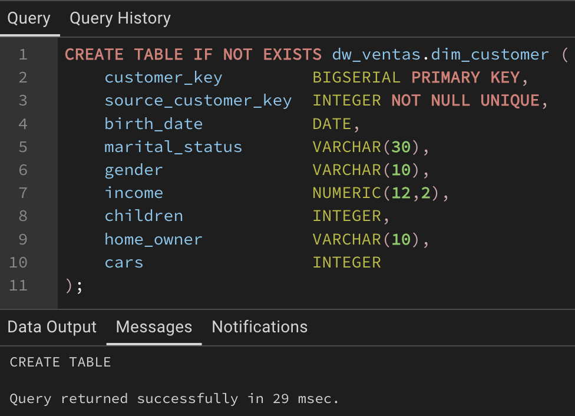

*Descripción: DDL de la dimensión de cliente.*

**Figura 30. Creación de dw_ventas.dim_date.**

  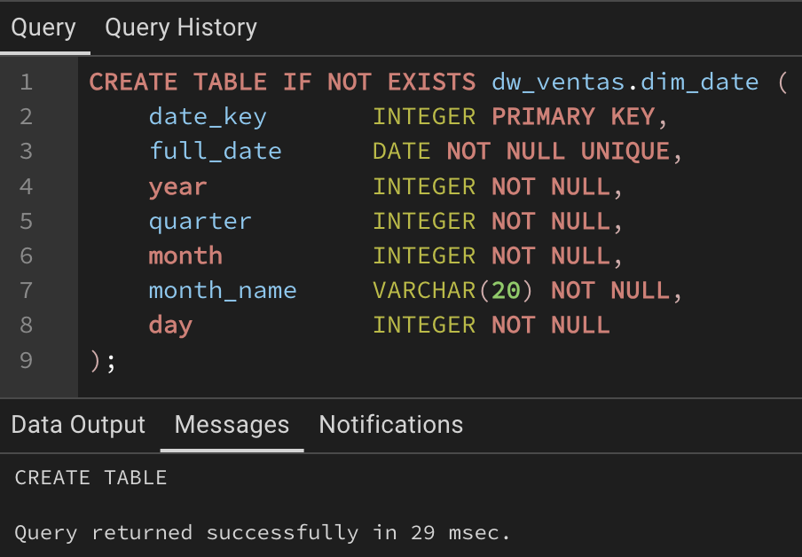

*Descripción: DDL de la dimensión de fecha.*

Al final se creó fact_sales, con dos claves foráneas hacia dim_date (Figura 31). La consulta a information_schema confirmó las cuatro tablas en el esquema (Figura 32).

**Figura 31. Creación de dw_ventas.fact_sales.**

  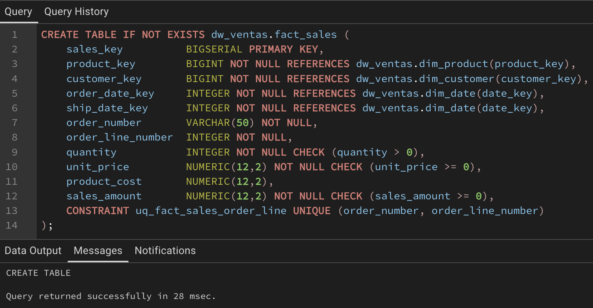

*Descripción: DDL de la tabla de hechos.*

**Figura 32. Tablas creadas en el esquema dw_ventas.**

  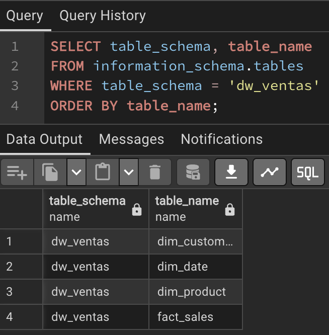

*Descripción: tablas del esquema dw_ventas.*

### 7.7. Carga del modelo estrella

Se cargaron 9 productos (Figura 33) y 10 clientes (Figura 34). La dimensión de fecha recibió 147 fechas, resultado de unir las de pedido y las de envío (Figura 35). Por último se cargaron las 100 ventas en fact_sales, reemplazando las claves originales por las sustitutas (Figura 36).

**Figura 33. Carga de dw_ventas.dim_product.**

  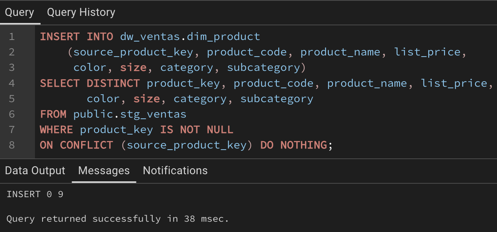

*Descripción: INSERT 0 9.*

**Figura 34. Carga de dw_ventas.dim_customer.**

  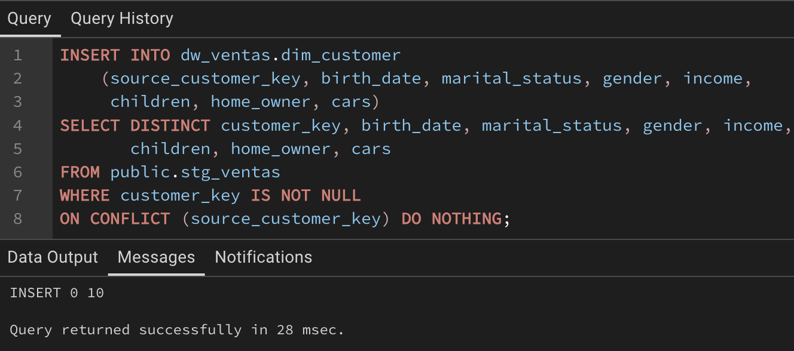

*Descripción: INSERT 0 10.*

**Figura 35. Carga de dw_ventas.dim_date.**

  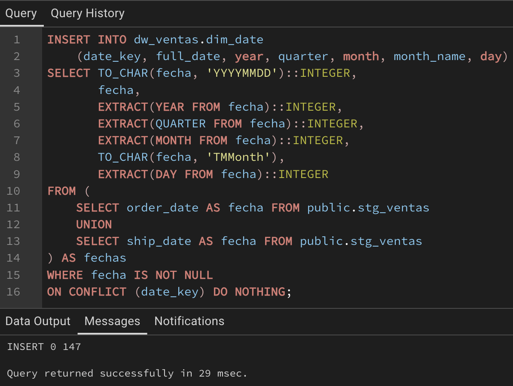

*Descripción: INSERT 0 147.*

**Figura 36. Carga de dw_ventas.fact_sales.**

  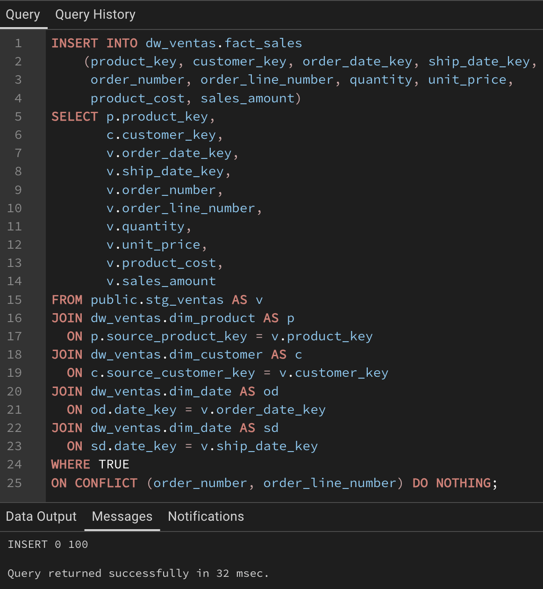

*Descripción: INSERT 0 100.*

El conteo por tabla confirmó la carga (Tabla 15 y Figura 37). La suma de las medidas de fact_sales dio 296 unidades y 69 547 en ventas (Figura 38).

**Tabla 15. Registros cargados en el esquema dw_ventas.**

| Tabla | Registros |
| --- | --- |
| dim_product | 9 |
| dim_customer | 10 |
| dim_date | 147 |
| fact_sales | 100 |

*Descripción: filas por tabla después de la carga.*

**Figura 37. Conteo de registros por tabla en dw_ventas.**

  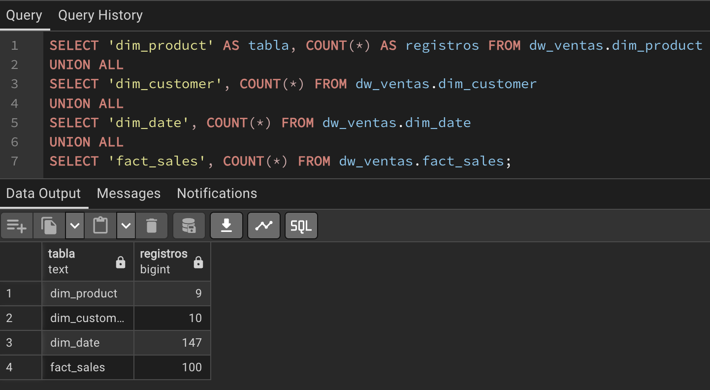

*Descripción: registros por tabla.*

**Figura 38. Totales de cantidad y ventas en fact_sales.**

  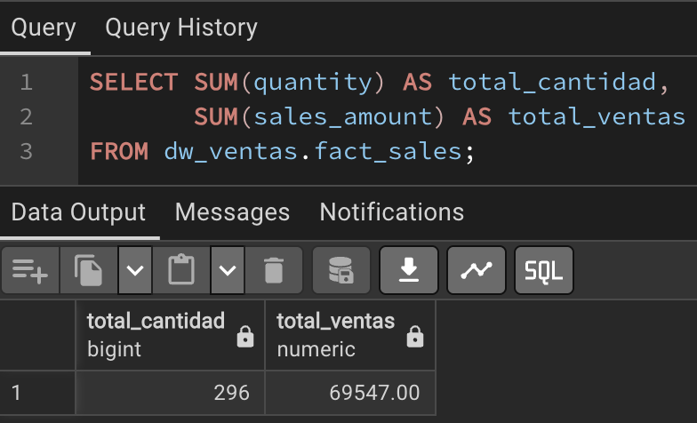

*Descripción: total de unidades y de ventas.*

### 7.8. Consultas de negocio sobre el modelo estrella

Las cinco consultas están en <a href="scripts/consultas_analisis.sql">consultas_analisis.sql</a>.

#### 7.8.1. Ventas por categoría de producto y mes

Se unió fact_sales con dim_product y con dim_date por la fecha de pedido. Hubo 60 ventas de Electronics y 40 de Accessories, y junio de 2022 fue el mes con más ventas (7), como se observa en la Figura 39.

**Figura 39. Ventas por categoría de producto y mes.**

  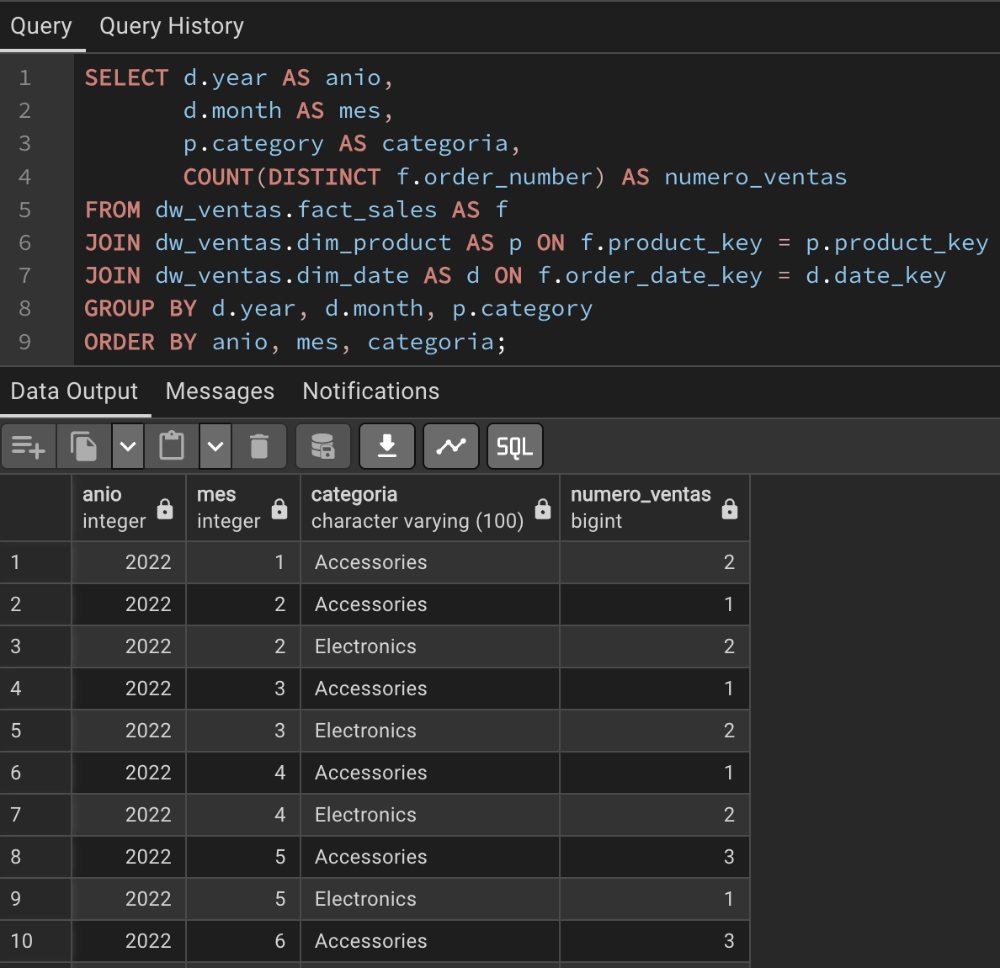

*Descripción: ventas por año, mes y categoría.*

#### 7.8.2. Ingreso total por cliente y género

El cliente 1022 (M) es el que más compró, con 11 656, y el 1016 (F) el que menos, con 2 496 (Figura 40). Por género, las mujeres suman 38 836 y los hombres 30 711.

**Figura 40. Ingreso total por cliente y género.**

  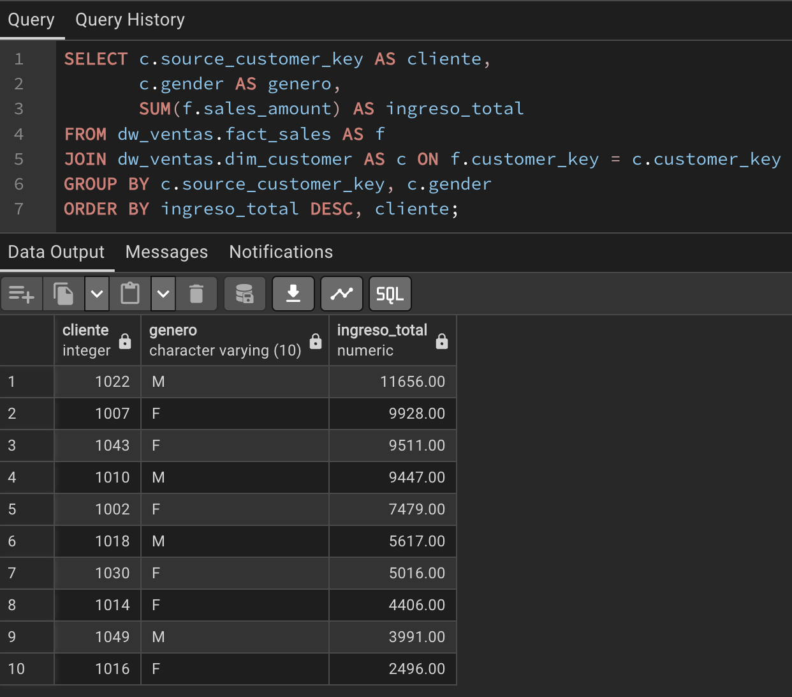

*Descripción: ventas por cliente, de mayor a menor.*

#### 7.8.3. Cantidad total vendida por producto

Product 19 es el más vendido, con 60 unidades, y Product 5 el que menos, con 16 (Figura 41).

**Figura 41. Cantidad total vendida por producto.**

  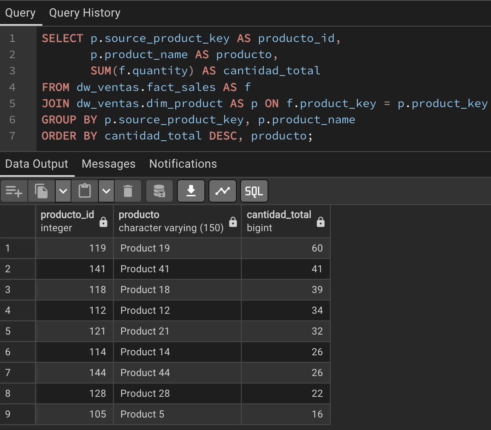

*Descripción: unidades vendidas por producto.*

#### 7.8.4. Cantidad enviada por mes de envío

En este caso dim_date se unió por la fecha de envío. Diciembre de 2022 fue el mes con más unidades enviadas, con 18 (Figura 42).

**Figura 42. Cantidad enviada por mes de envío.**

  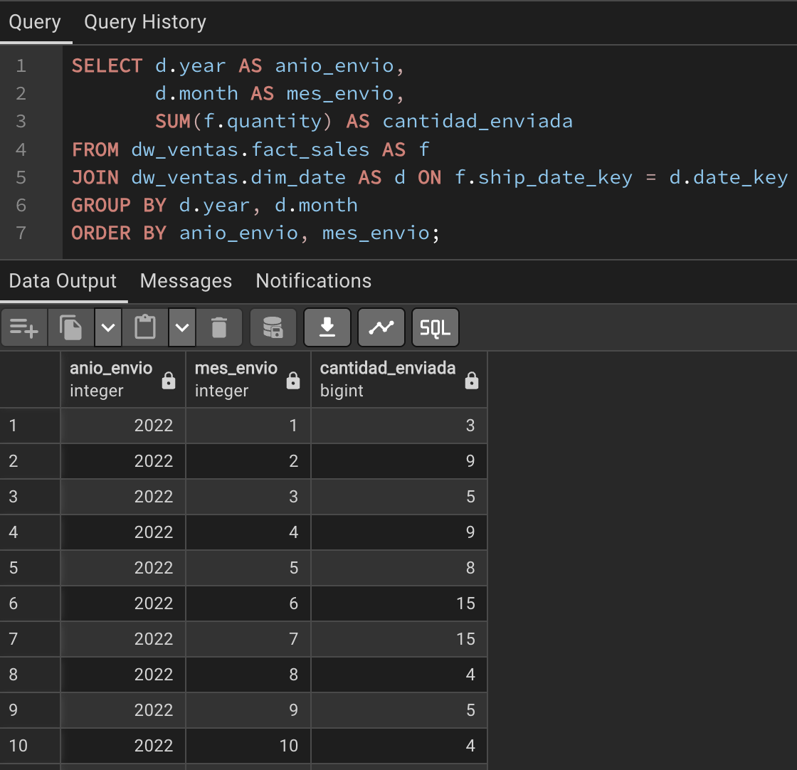

*Descripción: unidades enviadas por año y mes.*

#### 7.8.5. Ventas por tamaño de producto y estado civil del cliente

La combinación con más ventas es Medium y Married (23 714) y la de menos es Small y Single (2 264). En todos los tamaños los casados compraron más que los solteros (Figura 43).

**Figura 43. Ventas por tamaño de producto y estado civil del cliente.**

  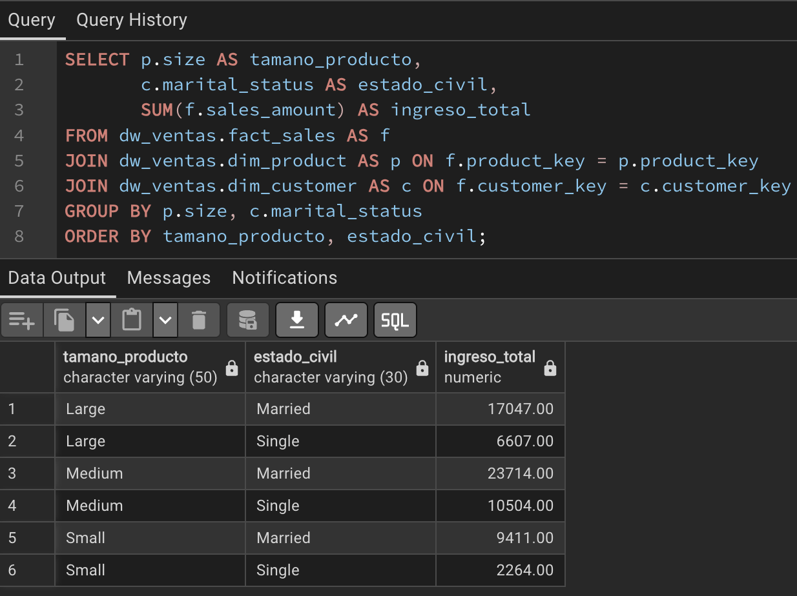

*Descripción: ventas por tamaño y estado civil.*

---

## 8. Scripts SQL entregables

- **Creación de tablas (DDL):** [crear_tablas.sql](scripts/crear_tablas.sql)
- **Limpieza y carga (DML):** [limpieza_carga.sql](scripts/limpieza_carga.sql)
- **Consultas de negocio:** [consultas_analisis.sql](scripts/consultas_analisis.sql)

---

## 9. Relación con una arquitectura Data Warehouse

stg_products y stg_ventas corresponden al área de staging, donde los datos se revisan y limpian sin modificar las fuentes. Las dimensiones y la tabla de hechos forman la capa de presentación, con datos validados, restricciones de integridad y claves sustitutas propias. Con products.csv solo se llegó a la dimensión porque no hay un evento que medir; con la tabla de ventas se completó el esquema estrella, donde fact_sales guarda las medidas y las dimensiones dan el contexto para analizarlas.

---

## 10. Conclusiones

1. El área de staging permitió validar los datos antes de cargarlos; en ambos procesos los conteos coincidieron con las fuentes.
2. La limpieza eliminó tabulaciones y espacios repetidos, aunque el orden de btrim y regexp_replace dejó un espacio inicial en un registro.
3. Las claves sustitutas independizan el modelo de los códigos de la fuente, que se conservan como referencia.
4. Mantener categoría y subcategoría en la dimensión permite agrupar y filtrar sin uniones adicionales.
5. Las preguntas de negocio requerían un evento medible, por lo que se construyó un esquema estrella de ventas con una dimensión de fecha usada para el pedido y para el envío.

---

## 11. Referencias bibliográficas

[1] Escuela Politécnica Nacional, *Guía de Práctica 4: Implementación física de una dimensión para un modelo estrella en PostgreSQL*, Facultad de Ingeniería de Sistemas, Business Intelligence, 2026.

[2] R. Kimball y M. Ross, *The Data Warehouse Toolkit: The Definitive Guide to Dimensional Modeling*, 3.ª ed. Indianapolis, IN, EE. UU.: John Wiley & Sons, 2013.

[3] R. Kimball y J. Caserta, *The Data Warehouse ETL Toolkit: Practical Techniques for Extracting, Cleaning, Conforming, and Delivering Data*. Indianapolis, IN, EE. UU.: John Wiley & Sons, 2004.

[4] The PostgreSQL Global Development Group, "COPY," *PostgreSQL Documentation*. [En línea]. Disponible en: https://www.postgresql.org/docs/current/sql-copy.html

[5] The PostgreSQL Global Development Group, "String Functions and Operators," *PostgreSQL Documentation*. [En línea]. Disponible en: https://www.postgresql.org/docs/current/functions-string.html

---

## 12. Declaración de uso de Inteligencia Artificial

Se declara un uso estimado del **35 % de inteligencia artificial generativa** (Claude, de Anthropic) como apoyo en la redacción y organización del informe. El diseño del modelo, los scripts SQL, la carga de datos, las consultas, el diagrama en Power Pivot y las capturas fueron realizados por los integrantes del grupo.
